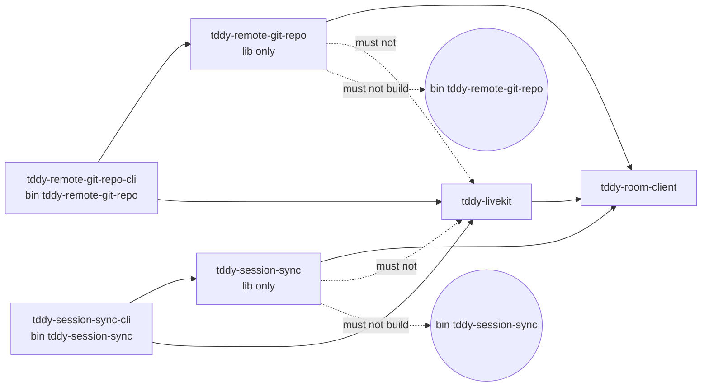

# Changeset: The git shim and the worktree mirror are built by wiring crates

**Date**: 2026-10-21
**Status**: 🚧 In Progress
**PR**: not opened yet (local planning; the orchestrator opens it)
**Type**: Refactor (architecture)
**Complexity**: 3 — two crates split into library + wiring crate each (mechanical moves, no behaviour change), two script package lists, one ratchet test file plus one test-support method; the moved CLI suites spawn a process
**Stack**: #satellite 14/15. Base: `feature/satellite/lifecycle-launch` (#635), planned on its tip `2fdcc7481`.

## Initial Discovery

[2026-10-21-livekit-satellite-client-bins-wiring-initial-discovery.md](./2026-10-21-livekit-satellite-client-bins-wiring-initial-discovery.md)

## Prerequisites

Deferred-work cross-check (`.agents/skills/deferred-work/references/planning-cross-check.md`),
2026-10-21, over `tddy-remote-git-repo`, `tddy-session-sync`, `tddy-daemon-extensions`,
`tddy-testing-commons` and the scripts. No record in the path carries `Claimed by:`.

| Item | Verdict | Note |
|---|---|---|
| [`oversized-file-attach.md`](../../../packages/tddy-session-sync/docs/code-issues/oversized-file-attach.md) (`attach.rs`, 555) | ⚠ DURING | Not touched: only `main.rs` moves. It must not grow. Its split belongs to the stack's sweep node, which is not planned here. |
| [`oversized-file-sync.md`](../../../packages/tddy-session-sync/docs/code-issues/oversized-file-sync.md) (`sync.rs`, 788) | ⚠ DURING | Same: not touched, must not grow, and the split is not done here. |
| [`complexity-ssh-argv-dequote-command.md`](../../../packages/tddy-remote-git-repo/docs/code-issues/complexity-ssh-argv-dequote-command.md) | — unrelated | `ssh_argv.rs` stays in the library unchanged. |
| [2026-10-19-satellite-7-client-transports-left-files-over-the-500-line-budget.md](../todo/2026-10-19-satellite-7-client-transports-left-files-over-the-500-line-budget.md) | ⚠ DURING | Covers `attach.rs`. This node does not change its line count. |
| [2026-09-16-the-shipped-binary-set-is-restated-in-eight-places-and-one-is-pinned.md](../todo/2026-09-16-the-shipped-binary-set-is-restated-in-eight-places-and-one-is-pinned.md) | — considered, unaffected | All eight lists name **binaries**, and binary names do not change. The only package list among them is `release`'s `cargo build -p`, which this node edits. |
| [2026-08-15-remote-git-repo-over-livekit-deliberate-gaps.md](../todo/2026-08-15-remote-git-repo-over-livekit-deliberate-gaps.md), [2026-08-15-session-worktree-sync-deliberate-gaps.md](../todo/2026-08-15-session-worktree-sync-deliberate-gaps.md) | — unrelated | Product gaps in the relay and the mirror. Behaviour does not change here. |
| [2026-09-09-restructure-defects-from-the-first-cross-crate-move.md](../todo/2026-09-09-restructure-defects-from-the-first-cross-crate-move.md) | ⚠ DURING | The moves below go through the restructure engine (the developer's rule). If the engine refuses a move, stop and ask; do not fall back to `git mv`. Record each new defect as a new todo file. |

`tddy-room-client` has no `docs/code-issues/` directory; it has not been analyzed. This node does not
touch it.

## Responsibility

Moving the `tddy-remote-git-repo` and `tddy-session-sync` binaries into wiring crates. Owns:

- the new packages `packages/tddy-remote-git-repo-cli` and `packages/tddy-session-sync-cli` (binary
  only; `[[bin]]` keeps the original binary name; `src/main.rs` is the moved entry point; they depend
  on their library plus `tddy-livekit`);
- removing `[[bin]]`, `src/main.rs`, and `tddy-livekit` (plus `clap` / `env_logger` if only `main.rs`
  used them) from both library manifests;
- moving `tests/cli_acceptance.rs` from each library to its wiring crate, with assertions unchanged;
- the package lists in `release` and `scripts/dev-runtime-binaries.sh`, `packages/tddy-remote-git-repo/README.md`'s build line, and
  the root `Cargo.toml` members;
- the ratchet edit for these two crates, and `WorkspaceGraph::crates_building` in
  `tddy-testing-commons`.

## Boundaries

- Changes no behaviour. Flags, environment, exit codes, `--help` text and binary paths stay the same.
- Does not touch `tddy-tools` or its `livekit` feature (#satellite 15/15).
- Does not rename LiveKit-shaped library surface (see *RPC boundary* below).
- Does not split `attach.rs` or `sync.rs`.
- Does not add a build of either binary without LiveKit. Each wiring crate always binds LiveKit.
- Does not edit `packages/*/docs/` directly. `packages/tddy-daemon-extensions/docs/extension-ports.md`
  (ratchet table) and `packages/tddy-testing-commons/docs/dependency-graph.md` (new method) are
  updated at wrap.

## Dependencies

What each parent PR delivers that this PR consumes. These surfaces are **theirs to create**;
implementing one here collides with the PR that owns it.

| Parent node | What it delivers | How this PR consumes it | This PR does NOT |
|---|---|---|---|
| #629 client-transports (merged) | `tddy-room-client` (`RoomConnector`, `RoomSession`, `RoomDuplex`, `NoRoomTransport`); `relay::run(.., connector)`, `attach(.., connector)`; `LiveKitRoomConnector` | The wiring crates' `main.rs` hands `LiveKitRoomConnector` to those entry points, as the moved code already does | change the port or either entry point |
| #630 coder-participant (merged) | The `tddy-coder-cli` pattern: a `-cli` package keeps the binary name and joins `WIRING` | The same shape, applied twice | |
| #635 lifecycle-launch | The ratchet's final form: no `KNOWN_OFFENDERS`; `only_plugins_and_wiring_name_a_livekit_crate` is the closing assertion | Edits the lists in `livekit_is_a_satellite.rs` | re-add an offender list, or edit #635's lifecycle/agent-launch manifests |

**Sequencing fact.** `only_plugins_and_wiring_name_a_livekit_crate` is a whole-workspace assertion.
It turns green here only once #635's own green has struck `tddy-session-lifecycle` and
`tddy-agent-launch`. Its failure output lists the crate names, so this node's share is visible: only
`tddy-remote-git-repo` and `tddy-session-sync`.

## Draft PR contract

The first push (commit 2) publishes no production surface. It publishes the ratchet's next form and
one test-support method:

```rust
// tddy-testing-commons::dependency_graph
impl WorkspaceGraph {
    /// The workspace crates with a `bin` target named `binary`.
    pub fn crates_building(&self, binary: &str) -> BTreeSet<String>;
}

// tddy-daemon-extensions/tests/livekit_is_a_satellite.rs
const WIRING: &[&str] = &[.., "tddy-remote-git-repo-cli", "tddy-session-sync-cli", ..];
const WIRING_WITH_A_LIBRARY: &[&str] = &["tddy-tools"];
/// Libraries a wiring crate builds a client binary from. They name LiveKit nowhere.
const CLIENT_LIBRARIES: &[&str] = &["tddy-remote-git-repo", "tddy-session-sync"];
/// Each client binary and the wiring crate that builds it.
const CLIENT_BINARIES: &[(&str, &str)] = &[
    ("tddy-remote-git-repo", "tddy-remote-git-repo-cli"),
    ("tddy-session-sync", "tddy-session-sync-cli"),
];
```

`crates_building` is implemented, not stubbed: it is test infrastructure, read from the same
`cargo metadata` call, with its own unit test. The red tests are the three ratchet assertions in
*Acceptance Tests*. The `-cli` packages are **not** created at the contract. No test needs them to
compile, and an empty package would be a stub.

## Green wave

**Wave:** 6. It sits after #635 (wave 5) only because of the whole-workspace assertion.
**Greenable independently:** yes for the work and for two of its three red tests
(`each_client_binary_is_built_by_its_wiring_crate`,
`a_client_library_names_livekit_nowhere_in_its_sources`). These read only this node's two crates.
`only_plugins_and_wiring_name_a_livekit_crate` also needs #635 green.
**Concurrent with:** #635's green (disjoint files apart from the ratchet's lists, which #635 does not
change further), and #satellite 15/15's green (disjoint crates; 15/15 edits the same ratchet lines on
top of this one).
**Blocks:** #satellite 15/15. Its ratchet edit is textually on top of this one, and it removes
`WIRING_WITH_A_LIBRARY`, which this node shrinks to `tddy-tools`.

    #635 → n14 (ratchet closing assertion)      n14 → n15 (ratchet text; crates_building)

## RPC boundary (answer to "defined by RPC boundary")

After this node, each library takes a transport-neutral boundary, and only its wiring crate binds a
transport:

| Library | Boundary | Still LiveKit-shaped in the API (not changed here) |
|---|---|---|
| `tddy-remote-git-repo` | `relay::run(SshRequest, Credentials, Arc<dyn RoomConnector>)`; `relay::relay_over_duplex(RoomDuplex, stdio)` | It asks the daemon's `MintLiveKitToken` RPC (a `tddy-service` proto name) for the room admission, a `{url, room, token}` it passes as `RoomAuth::Token`. Neutral in shape, LiveKit in name. |
| `tddy-session-sync` | `attach(&Credentials, Arc<dyn RoomConnector>) -> Attached`; `run(&Credentials, Attached)` | `credentials::LiveKitCredentials {url, api_key, api_secret}`, `Credentials::livekit`, `SyncArgs::{livekit_url, livekit_api_key, livekit_api_secret}`, `LIVEKIT_*` variables. It mints its own token through `RoomAuth::Credentials`, which is LiveKit's access model (API key and secret, signed JWT). |

`tddy_room_client::RoomJoin {url, room, identity, auth}` and `RoomAuth::{Credentials, Token}` are
the port's vocabulary. `Credentials` presumes a transport whose server signs tokens from an API key
pair. That is true of LiveKit and is a limit of the port, not of these crates.

## Acceptance dependency graph (after this node)



| Must-not edge | Checked by |
|---|---|
| `tddy-remote-git-repo` → any `LIVEKIT_FAMILY` crate (`[dependencies]`, optional included) | `only_plugins_and_wiring_name_a_livekit_crate` |
| `tddy-session-sync` → any `LIVEKIT_FAMILY` crate | same |
| a path into `livekit`/`tddy_livekit` anywhere under either library's `src/`, `main.rs` included | `a_client_library_names_livekit_nowhere_in_its_sources` |
| a library crate building the client binary | `each_client_binary_is_built_by_its_wiring_crate` |
| `tddy-room-client` → `tddy-livekit` | unchanged; `tddy-room-client` names no LiveKit crate and is on no list, so the closing assertion covers it |

## Final Checklist

- [ ] `the_extension_ports_*`, `only_plugins_and_wiring_name_a_livekit_crate`,
      `a_wiring_crate_that_ships_a_library_names_livekit_only_from_its_binary`,
      `a_client_library_names_livekit_nowhere_in_its_sources`,
      `each_client_binary_is_built_by_its_wiring_crate` pass (`tddy-daemon-extensions`)
- [ ] `cargo tree -p tddy-remote-git-repo -e normal | grep -c livekit` prints 0; same for `tddy-session-sync`
- [ ] the moved `cli_acceptance` suites pass in the `-cli` crates unchanged (`git diff -M` shows a pure rename)
- [ ] `./release` and `./web-dev --build` build both binaries under their old names

## Affected Packages

`tddy-remote-git-repo`, `tddy-remote-git-repo-cli` (new), `tddy-session-sync`,
`tddy-session-sync-cli` (new), `tddy-daemon-extensions` (test), `tddy-testing-commons` (test
support), root `Cargo.toml`, `release`, `scripts/dev-runtime-binaries.sh`.

## Summary

Neither client library names LiveKit. Its binary is built by a wiring crate that binds
`LiveKitRoomConnector` to the library's `RoomConnector` boundary.

## Scope

- [ ] `packages/tddy-remote-git-repo-cli`: `Cargo.toml` (`[[bin]] name = "tddy-remote-git-repo"`), `src/main.rs` moved, `tests/cli_acceptance.rs` moved
- [ ] `packages/tddy-session-sync-cli`: same shape for `tddy-session-sync`
- [ ] Library manifests: drop `[[bin]]`, `tddy-livekit`, and `main.rs`-only dependencies; update the manifest comments that say "named by the binary alone"
- [ ] Root `Cargo.toml` members; `Cargo.lock`
- [ ] `release` (`-p tddy-remote-git-repo-cli`, `-p tddy-session-sync-cli`), `scripts/dev-runtime-binaries.sh` (`DEV_RUNTIME_PACKAGES`)
- [ ] `packages/tddy-remote-git-repo/README.md` build line
- [ ] Ratchet green (contract tests)

## Technical Changes

### State A
- `packages/tddy-remote-git-repo/Cargo.toml`: `[lib]` + `[[bin]] tddy-remote-git-repo` (`src/main.rs`, 114 lines); `tddy-livekit` in `[dependencies]` "named by the binary alone". `main.rs:14` imports `LiveKitRoomConnector`; `:86` `relay::run(request, credentials, Arc::new(LiveKitRoomConnector))`.
- `packages/tddy-session-sync/Cargo.toml`: `[lib]` + `[[bin]] tddy-session-sync` (`src/main.rs`, 139 lines); `tddy-livekit` the same. `main.rs:15`, `:124` `attach(&credentials, Arc::new(LiveKitRoomConnector))`.
- Only `tests/cli_acceptance.rs` in each crate uses `CARGO_BIN_EXE_*` (`env!`, so the suite must live in the package that owns the bin).
- Cross-package users find the git shim by name next to the test executable (`current_exe()/../tddy-remote-git-repo`): `tddy-worktree-service/tests/remote_git_livekit_acceptance.rs:176`, `tddy-session-lifecycle/tests/session_sync_livekit_acceptance.rs:784`. `tddy-projects/src/project_provision.rs:24` tries `CARGO_BIN_EXE_tddy-remote-git-repo`, then the sibling, then `PATH`. None names a package.
- CI builds `--workspace --bins` and stages binaries by name (`.github/workflows/ci.yml:563,599`). No nextest filter names either package.
- Ratchet: both crates on `WIRING_WITH_A_LIBRARY`, with the shape test exempting `src/main.rs`.

### State B
- Both libraries are library-only and name no LiveKit crate. `tddy-*-cli` builds the binary, under
  the same name, from the moved `main.rs`.
- In a workspace `cargo test`, each `-cli` crate's own integration test is what makes cargo build its
  binary. `remote_git_livekit_acceptance` and `session_sync_livekit_acceptance` keep finding the
  shim next to their executable, as before. Keep the moved `cli_acceptance.rs` in the `-cli` crate
  for this reason too.

### Delta
As listed in Scope.

## Implementation Milestones
- [ ] M1 `tddy-remote-git-repo-cli`: package, moved `main.rs` and suite; library manifest trimmed
- [ ] M2 `tddy-session-sync-cli`: same
- [ ] M3 Scripts and README; ratchet green

**How the moves are made.** Use the restructure engine (`tddy-tools restructure`) for the code moves.
The operations target modules, and `main.rs` is a binary root, which no operation addresses today.
If the engine refuses or cannot express a move, **stop and ask the developer** before any manual
move, per the repo rule. Record the gap as a new `docs/dev/todo/` file with a code example. Prove a
whole-file move is exact with `git show HEAD:<old> | diff - <new>` (expect empty).

## Testing Plan

The ratchet's three red tests are the acceptance. The moved `cli_acceptance` suites prove that each
binary keeps its name and command line. Scoped verification:
`./dev cargo test -p tddy-daemon-extensions --test livekit_is_a_satellite`,
`./dev cargo test -p tddy-testing-commons --lib`, `./test -p tddy-remote-git-repo
-p tddy-remote-git-repo-cli -p tddy-session-sync -p tddy-session-sync-cli`, and
`cargo clippy -p <each> --all-targets -- -D warnings`. CI covers the workspace, including the two
cross-package suites that run the git shim.

## Acceptance Tests

| Test | File | Validates | State at contract |
|---|---|---|---|
| `each_client_binary_is_built_by_its_wiring_crate` | `packages/tddy-daemon-extensions/tests/livekit_is_a_satellite.rs` (new) | `crates_building("tddy-remote-git-repo") == {tddy-remote-git-repo-cli}`, same for `tddy-session-sync` | ❌ fails: built by the library crates |
| `a_client_library_names_livekit_nowhere_in_its_sources` | same (new) | Every `.rs` under each `CLIENT_LIBRARIES` crate's `src/`, `main.rs` included, has no path into LiveKit | ❌ fails: both `src/main.rs` |
| `only_plugins_and_wiring_name_a_livekit_crate` | same (lists edited) | The two libraries are no longer allowed to name LiveKit | ❌ fails: the two libraries (plus #635's two crates until #635 is green) |
| `documents_the_refresh_token_flag_…` and the rest of `cli_acceptance.rs` | moved to `packages/tddy-remote-git-repo-cli/tests/` | The binary keeps its name, `--help` and exit codes | ✅ passes today in the library; moves unchanged |
| `cli_acceptance.rs` (session-sync) | moved to `packages/tddy-session-sync-cli/tests/` | same | ✅ same |
| `crates_building_names_the_crate_with_that_bin_target` | `packages/tddy-testing-commons/src/dependency_graph.rs` (unit) | The helper reads `bin` targets from `cargo metadata` | ✅ test infrastructure, passes at contract |

## Technical Debt & Production Readiness

## Decisions & Trade-offs
- **A `-cli` package per binary, not one shared client-binaries crate.** The binaries would build
  each other's dependency trees, and `CARGO_BIN_EXE_*` would still bind every suite to that one
  package. This matches `tddy-coder-cli`.
- **The names follow `tddy-coder-cli`:** `tddy-remote-git-repo-cli`, `tddy-session-sync-cli`.
- **Binary-only packages (no `[lib]`).** Nothing needs to import them. `tddy-coder-cli` has a lib
  only because it also implements `LiveKitParticipantHost`.
- **The test that runs the binary moves; library tests stay.** `env!("CARGO_BIN_EXE_…")` is defined
  only in the package that owns the bin. Every other suite in both crates tests the library through
  `tddy-room-client`'s in-memory connector.
- **The ratchet gains `crates_building`.** That makes "the binary moved" a fact read from
  `cargo metadata`, not a convention. It also lets the contract fail with no stub package.

## Refactoring Needed
### From /validate-changes
### From /validate-tests
### From /validate-prod-ready
### From /analyze-clean-code

## Validation Results
### /validate-changes
### /validate-tests
### /validate-prod-ready
### /analyze-clean-code

## TODO

- [x] Record initial discovery (`2026-10-21-livekit-satellite-client-bins-wiring-initial-discovery.md`)
- [x] Cross-check `packages/*/docs/code-issues/` and `docs/dev/todo/` for items this change touches (Step 2b)
- [x] Create/update PRD documentation
- [x] Create changeset (this document)
- [ ] Create failing acceptance tests
- [ ] Run acceptance tests (verify they fail)
- [ ] USER REVIEW — acceptance tests
- [ ] TDD Red — write failing unit/integration tests
- [ ] TDD Green — implement with quality code
- [ ] Update documentation with progress
- [ ] Run scoped tests for touched packages; full-workspace result from CI
- [ ] Validate changes (/validate-changes)
- [ ] Validate tests (/validate-tests)
- [ ] Validate production readiness (/validate-prod-ready)
- [ ] Analyze code quality (/analyze-clean-code)
- [ ] Linting and formatting (scoped)
- [ ] Wrap documentation (/wrap-context-docs)
- [ ] USER REVIEW — work complete
