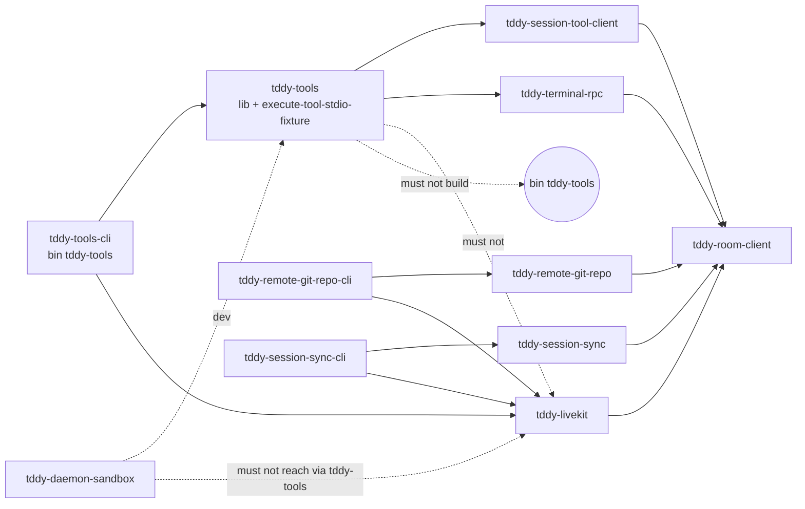

# Changeset: tddy-tools is built by a wiring crate; the library has no LiveKit feature

**Date**: 2026-10-21
**Status**: 🚧 In Progress
**PR**: not opened yet (local planning; the orchestrator opens it)
**Planned on**: `feature/satellite/client-bins-wiring` @ `7de05ac9e` (local; on #635 @ `c2a84c343`)
**Type**: Refactor (architecture)
**Complexity**: 4 — more than one crate (new `tddy-tools-cli`, `tddy-tools`, the ratchet, six scripts); 35 test suites and their dev-dependencies move; six binary-only modules (2,948 lines) re-parent into the library; a cargo feature is removed; the moves must go through the restructure engine, which has no operation for a binary root (unsettled, see Decisions)
**Stack**: #satellite 15/15. Base: `feature/satellite/client-bins-wiring` (#satellite 14/15).

## Initial Discovery

[2026-10-21-livekit-satellite-tools-wiring-initial-discovery.md](./2026-10-21-livekit-satellite-tools-wiring-initial-discovery.md)

## Prerequisites

Deferred-work cross-check (`.agents/skills/deferred-work/references/planning-cross-check.md`),
2026-10-21, over `tddy-tools`, `tddy-daemon-extensions`, `tddy-testing-commons`, `tddy-coder`
(`run.rs:197` text only) and the scripts. No record in the path carries `Claimed by:`.

| Item | Verdict | Note |
|---|---|---|
| [`oversized-file-server.md`](../../../packages/tddy-tools/docs/code-issues/oversized-file-server.md) (`server.rs`, 2,677 production) | ⚠ DURING | `server.rs` stays in the library and must not change. Its decomposition belongs to the stack's sweep node, which is not planned here. |
| [`complexity-server-take-a-turn.md`](../../../packages/tddy-tools/docs/code-issues/complexity-server-take-a-turn.md), [`complexity-server-subagent-new-session-tool.md`](../../../packages/tddy-tools/docs/code-issues/complexity-server-subagent-new-session-tool.md) | — unrelated | `server.rs` is not touched. |
| [`complexity-cli-run-call-tool.md`](../../../packages/tddy-tools/docs/code-issues/complexity-cli-run-call-tool.md) (`cli.rs:525`) | ⚠ DURING | `cli.rs` re-parents from the binary into the library, in the same crate and at the same path, so the record's `**Location:**` stays true. If the Option B fork is chosen instead, `cli.rs` moves crates and this record must move to `packages/tddy-tools-cli/docs/code-issues/`. Do not extract the method here. |
| [2026-10-08-tddy-tools-server-rs-is-3-9k-lines-and-the-crate-mixes-several-responsibilities.md](../todo/2026-10-08-tddy-tools-server-rs-is-3-9k-lines-and-the-crate-mixes-several-responsibilities.md) | ⚠ DURING | This node answers part of it: "two binaries" becomes one (the fixture), and the binary's wiring leaves. It does not split the crate further. |
| [2026-09-10-the-execute-tool-stdio-fixture-bin-forces-three-dev-deps-into-dependencies.md](../todo/2026-09-10-the-execute-tool-stdio-fixture-bin-forces-three-dev-deps-into-dependencies.md) | ⚠ DURING, not fixed | The fixture serves a **library** suite (`session_tool_stdio_rpc_dispatch.rs`), so it stays in `tddy-tools` with its three dependencies. This node must not move it into `tddy-tools-cli`, which would put a test fixture in a wiring crate. |
| [2026-09-16-the-shipped-binary-set-is-restated-in-eight-places-and-one-is-pinned.md](../todo/2026-09-16-the-shipped-binary-set-is-restated-in-eight-places-and-one-is-pinned.md) | — considered, unaffected | The binary's name does not change. `release`'s `-p` list is edited. |
| [2026-09-09-restructure-defects-from-the-first-cross-crate-move.md](../todo/2026-09-09-restructure-defects-from-the-first-cross-crate-move.md) | ⚠ DURING | The moves go through the restructure engine. If it refuses, stop and ask. Record each new gap as a new todo file. |
| [2026-10-21-tddy-daemon-binary-cannot-be-built-without-the-livekit-plugin.md](../todo/2026-10-21-tddy-daemon-binary-cannot-be-built-without-the-livekit-plugin.md) | ℹ ANSWERED for `tddy-tools`, by the opposite choice | That entry proposes a default-on `livekit` feature in the daemon's **wiring** crate. This node removes the feature from the `tddy-tools` **library**, and the wiring crate binds LiveKit with no feature. Re-adding a feature on `tddy-tools-cli` is the Option-2 fork in Decisions. |

## Responsibility

Moving the `tddy-tools` binary into a wiring crate and removing LiveKit from the library. Owns:

- `packages/tddy-tools-cli`: binary-only, `[[bin]] name = "tddy-tools"`, `src/main.rs` (the moved
  entry point, binding `tddy_livekit::room_connector::LiveKitRoomConnector`, with no feature and no
  `NoRoomTransport` arm), and `tests/` (the 35 suites that run the binary);
- re-parenting `cli`, `index_client`, `index_console`, `pty_relay`, `remote_cli` and `session_hook`
  from the binary root into `tddy-tools`' `lib.rs`;
- removing from `packages/tddy-tools/Cargo.toml`: `[[bin]] tddy-tools`, `tddy-livekit`, and
  `[features] default = ["livekit"]` / `livekit` (plus any dependency only `main.rs` used);
- `packages/tddy-tools/BUILD.yaml` (the BSP target builds `-p tddy-tools-cli --bin tddy-tools`);
- the package lists in `release`, `test`, `claude-sandbox`, `run-index-daemon` and
  `scripts/dev-runtime-binaries.sh`; the hint at `packages/tddy-coder/src/run.rs:197`;
  `packages/tddy-tools/README.md`; `.agents/skills/darwin-sandbox/SKILL.md:67`;
  `docs/ft/coder/warm-code-intelligence-daemon.md:166`;
- the ratchet's final form for client binaries: `WIRING_WITH_A_LIBRARY` and
  `a_wiring_crate_that_ships_a_library_names_livekit_only_from_its_binary` deleted.

## Boundaries

- Changes no behaviour of the binary, except that it no longer builds without LiveKit (no
  `--no-default-features` arm).
- Does not touch `server.rs`, `cli.rs`'s bodies, or any other library module's contents.
- Does not move `execute-tool-stdio-fixture` or the 19 library suites.
- Does not change the 12 cross-package suites that resolve `target/debug/tddy-tools` by name, or
  `tddy-daemon-sandbox/src/sandbox_session.rs`'s production resolution.
- Does not edit `packages/*/docs/` directly. `packages/tddy-daemon-extensions/docs/extension-ports.md`,
  `packages/tddy-workflow-recipes/docs/workflow-schemas.md:33` (`cargo test -p tddy-tools`) and any
  `tddy-tools` package doc are updated at wrap.

## Dependencies

What each parent PR delivers that this PR consumes. These surfaces are **theirs to create**;
implementing one here collides with the PR that owns it.

| Parent node | What it delivers | How this PR consumes it | This PR does NOT |
|---|---|---|---|
| #629 client-transports (merged) | `install_room_connector`, `run_pty_relay(config, connector)`, `NoRoomTransport`, `LiveKitRoomConnector` | The moved `main.rs` installs `LiveKitRoomConnector` | change the port or the tool client |
| #630 coder-participant (merged) | The `-cli` package pattern | Same shape | |
| #satellite 14/15 client-bins-wiring | `WorkspaceGraph::crates_building`; `CLIENT_LIBRARIES`, `CLIENT_BINARIES`, `a_client_library_names_livekit_nowhere_in_its_sources`, `each_client_binary_is_built_by_its_wiring_crate`; `WIRING_WITH_A_LIBRARY` shrunk to `["tddy-tools"]` | Adds `tddy-tools` / `tddy-tools-cli` to those lists; deletes `WIRING_WITH_A_LIBRARY` and its shape test | change `crates_building`, or re-implement 14/15's crate moves |
| #635 lifecycle-launch | The ratchet's closing assertion (already passing for #635's crates on `c2a84c343`) | | re-add an offender list |

**Sequencing fact.** #635 has already closed its part of the ratchet: the baseline on `c2a84c343`
is green apart from #satellite 14/15's three red tests. Every test here also iterates over 14/15's
crates (`CLIENT_LIBRARIES`, `CLIENT_BINARIES`, the closing assertion), so each one fully passes only
once 14/15 is green. Until then, its failure output lists 14/15's crates beside `tddy-tools`, and
this node's share is the `tddy-tools` entry alone.

## Draft PR contract

The first push (commit 2) publishes no production surface. It publishes the ratchet's final form:

```rust
const WIRING: &[&str] = &[.., "tddy-tools-cli", ..];
// WIRING_WITH_A_LIBRARY: deleted, with its shape test
const CLIENT_LIBRARIES: &[&str] = &["tddy-remote-git-repo", "tddy-session-sync", "tddy-tools"];
const CLIENT_BINARIES: &[(&str, &str)] = &[.., ("tddy-tools", "tddy-tools-cli")];
```

Each red test is one of the three ratchet assertions in *Acceptance Tests*. `tddy-tools-cli` is
**not** created at the contract.

## Green wave

**Wave:** 6, after #satellite 14/15 (wave 5, alongside #635). The three ratchet assertions also
read 14/15's two crates, so their full pass is 14/15's behaviour.
**Greenable independently:** the implementation, yes: the crates are disjoint from 14/15's.
The red tests turn fully green only after 14/15's green. Before that, a green run shows that the
`tddy-tools` entries disappeared from all three failure lists.
**Concurrent with:** #satellite 14/15's green, as implementation work (disjoint crates; the only
shared file is the ratchet, and this node's edit sits textually on top).
**Blocks:** nothing. This is the stack's top.

    n14 → n15 (the ratchet's lists read n14's crates; ratchet text; crates_building)

## RPC boundary (answer to "defined by RPC boundary")

| Library | Boundary | Still LiveKit-shaped in the API (not changed here) |
|---|---|---|
| `tddy-tools` | `session_tool_client::install_room_connector(Arc<dyn RoomConnector>)`, once at startup; `pty_relay::run_pty_relay(args, Arc<dyn RoomConnector>)` | `pty-relay --livekit-url/--livekit-room/--livekit-api-key/--livekit-api-secret`, which become `RoomAuth::Credentials` inside `tddy-terminal-rpc`; the tool client receives `livekit_url`/`livekit_room`/`livekit_token` from the daemon's `ConnectSession` and `OpenSessionRoom` responses (proto field names). |

The process-wide install (`install_room_connector` fails if called twice) is the tool client's
design from #629. This node keeps it.

## Acceptance dependency graph (after this node; the stack's final client shape)



| Must-not edge | Checked by |
|---|---|
| `tddy-tools` → any `LIVEKIT_FAMILY` crate, optional included (so no `livekit` feature can name `dep:tddy-livekit`) | `only_plugins_and_wiring_name_a_livekit_crate` |
| a path into LiveKit anywhere under `packages/tddy-tools/src/` | `a_client_library_names_livekit_nowhere_in_its_sources` |
| `tddy-tools` building the `tddy-tools` binary | `each_client_binary_is_built_by_its_wiring_crate` |
| an exception list for a library that wires LiveKit | `WIRING_WITH_A_LIBRARY` no longer exists; the test file has no such constant (review) |
| `tddy-daemon-sandbox` reaching LiveKit through its `tddy-tools` dev-dependency | `cargo tree -p tddy-tools -e normal,build \| grep -c livekit` → 0 (checklist) |

## Final Checklist

- [ ] All `livekit_is_a_satellite` tests pass; the file has no `WIRING_WITH_A_LIBRARY`
- [ ] `cargo tree -p tddy-tools -e normal,build | grep -ci livekit` prints 0
- [ ] `grep -n 'features\]' packages/tddy-tools/Cargo.toml` finds nothing
- [ ] the 35 moved suites pass in `tddy-tools-cli`, with `git diff -M` showing pure renames apart from any path fix-ups recorded here; the 19 library suites still pass in `tddy-tools`
- [ ] `./test -p tddy-sandbox-darwin` (or another cross-package suite) still finds `target/debug/tddy-tools` after `./test`'s prebuild
- [ ] `./run-index-daemon`, `./claude-sandbox`, `./release` and `./web-dev --build` build `tddy-tools`

## Affected Packages

`tddy-tools`, `tddy-tools-cli` (new), `tddy-daemon-extensions` (test), `tddy-coder` (one string),
root `Cargo.toml`, `release`, `test`, `claude-sandbox`, `run-index-daemon`,
`scripts/dev-runtime-binaries.sh`, `.agents/skills/darwin-sandbox/SKILL.md`,
`docs/ft/coder/warm-code-intelligence-daemon.md`.

## Summary

No library crate names LiveKit, and no exception list remains for a library that builds a binary.
Every client binary is a wiring crate that binds `LiveKitRoomConnector` to a library's
`RoomConnector` boundary.

## Scope

- [ ] Re-parent the six binary-only modules into `tddy-tools`' `lib.rs` (`tddy_tools::` → `crate::` inside them)
- [ ] `packages/tddy-tools-cli`: `Cargo.toml`, moved `src/main.rs` (its `mod` lines become `use tddy_tools::…`; `room_connector()` loses its `cfg` arms), and the 35 moved suites with their dev-dependencies
- [ ] `tddy-tools` manifest: drop `[[bin]] tddy-tools`, `tddy-livekit`, `[features]`, and `main.rs`-only dependencies; keep `execute-tool-stdio-fixture`
- [ ] `BUILD.yaml`: `package: tddy-tools-cli`; `srcs` cover both crates
- [ ] Root `Cargo.toml` members; `Cargo.lock`
- [ ] Scripts: `release:61`, `test:25`, `claude-sandbox:93`, `run-index-daemon:25,118,221,333`, `scripts/dev-runtime-binaries.sh:24`
- [ ] Text: `packages/tddy-coder/src/run.rs:197`, `packages/tddy-tools/README.md:11,23`, `.agents/skills/darwin-sandbox/SKILL.md:67`, `docs/ft/coder/warm-code-intelligence-daemon.md:166`
- [ ] Ratchet green (contract tests)

## Technical Changes

### State A
- `packages/tddy-tools/Cargo.toml`: `[lib]`, `[[bin]] tddy-tools` (`src/main.rs`, 232 lines), and
  `[[bin]] execute-tool-stdio-fixture` (`tests/fixtures/execute_tool_fixture.rs`). `tddy-livekit` is
  optional behind `[features] default = ["livekit"]`.
- `src/main.rs:6-11` declares `cli`, `index_client`, `index_console`, `pty_relay`, `remote_cli` and
  `session_hook`, which are absent from `lib.rs`. `:133-142` holds the `cfg(feature = "livekit")`
  `room_connector()` pair.
- 35 of 54 `tests/*.rs` run the binary; the other 19 test the library.
- 12 suites in `tddy-daemon-rpc`, `tddy-daemon-sandbox`, `tddy-session-lifecycle`, `tddy-sandbox-app`,
  `tddy-sandbox-darwin` and `tddy-integration-tests` use
  `var_os("CARGO_BIN_EXE_tddy-tools").unwrap_or(target/debug/tddy-tools)`. `./test:25` prebuilds
  `-p tddy-tools` for them.
- `BUILD.yaml`: `package: tddy-tools`, `bin_name: tddy-tools`. `tddy-build-rust` runs
  `cargo build -p <package> --bin <bin_name>`.

### State B
`tddy-tools` is a library with one test-fixture binary and names no LiveKit crate. `tddy-tools-cli`
builds `tddy-tools`.

### Delta
As listed in Scope.

## Implementation Milestones
- [ ] M1 Re-parent the six modules into the library (no behaviour change; `cargo test -p tddy-tools` green)
- [ ] M2 `tddy-tools-cli` with the moved `main.rs`; library manifest trimmed; feature gone
- [ ] M3 Move the 35 suites and their dev-dependencies
- [ ] M4 Scripts, `BUILD.yaml` and text; ratchet green

**How the moves are made.** Use the restructure engine for the code moves (`move_module_to_crate` /
`move_cluster_to_crate` for suites, the same-crate operations for the re-parent). `main.rs` is a
binary root, and its modules are not reachable from `lib.rs`, which no operation addresses today.
If the engine refuses or cannot express a move, **stop and ask the developer** before any manual
move. Record each gap as a new `docs/dev/todo/` file with a code example. Prove a whole-file move is
exact with `git show HEAD:<old> | diff - <new>`.

## Testing Plan

The three ratchet assertions are the acceptance. The 35 moved suites prove that the binary keeps its
command line, and the 19 library suites prove the library. Scoped verification:
`./dev cargo test -p tddy-daemon-extensions --test livekit_is_a_satellite`,
`./test -p tddy-tools -p tddy-tools-cli`, one cross-package suite (`./test -p tddy-sandbox-darwin`
on macOS), and `cargo clippy -p tddy-tools -p tddy-tools-cli --all-targets -- -D warnings`. CI covers
the rest.

## Acceptance Tests

| Test | File | Validates | State at contract |
|---|---|---|---|
| `each_client_binary_is_built_by_its_wiring_crate` | `packages/tddy-daemon-extensions/tests/livekit_is_a_satellite.rs` (`CLIENT_BINARIES` extended) | `crates_building("tddy-tools") == {tddy-tools-cli}` | ❌ fails: built by `tddy-tools` |
| `a_client_library_names_livekit_nowhere_in_its_sources` | same (`CLIENT_LIBRARIES` extended) | No LiveKit path under `packages/tddy-tools/src/` | ❌ fails: `src/main.rs` |
| `only_plugins_and_wiring_name_a_livekit_crate` | same (`WIRING_WITH_A_LIBRARY` deleted) | `tddy-tools` may not name `tddy-livekit`, even optionally | ❌ fails: `tddy-tools` |
| the 35 suites that run the binary | moved to `packages/tddy-tools-cli/tests/` | The binary keeps its name and command line | ✅ pass today; they move unchanged |

## Technical Debt & Production Readiness

## Decisions & Trade-offs
- **The six binary-only modules re-parent into the library (Option A), not into the wiring crate
  (Option B).** A `WIRING` crate is defined as one that "builds a binary and does nothing but wire it".
  Putting 2,948 lines of command handlers in it would contradict that. Option A also keeps the
  inline tests under `cargo test -p tddy-tools` and keeps `complexity-cli-run-call-tool`'s location
  true. Cost: the library gains six public modules. **Fork for the developer.**
- **`main.rs` moves whole.** 14/15 does the same for its two binaries. The clap `Args`, dispatch,
  `init_logging` and connector binding are the binary's front end.
- **No `livekit` feature on `tddy-tools-cli` (Option 1).** The wiring crate exists to bind the
  transport, so it always does. No script or CI job builds `--no-default-features`. **Fork:** keeping
  a default-on feature on `tddy-tools-cli` (Option 2) would preserve the documented stdio-only build.
  It would match the direction of the daemon todo entry, at the cost of a `cfg` pair in the wiring
  crate.
- **The suites that run the binary move; library suites stay.** `env!`/`cargo_bin_cmd!` resolve only
  in the package that owns the bin. Keeping them in `tddy-tools` with a `target/debug` fallback
  (as the cross-package users do) would let `cargo test -p tddy-tools` run a stale or missing binary,
  because cargo builds the bin only for its own package.
- **The name is `tddy-tools-cli`**, following `tddy-coder-cli`.

## Refactoring Needed
### From /validate-changes
### From /validate-tests
### From /validate-prod-ready
### From /analyze-clean-code

## Validation Results
### /validate-changes
### /validate-tests
### /validate-prod-ready
### /analyze-clean-code

## TODO

- [x] Record initial discovery (`2026-10-21-livekit-satellite-tools-wiring-initial-discovery.md`)
- [x] Cross-check `packages/*/docs/code-issues/` and `docs/dev/todo/` for items this change touches (Step 2b)
- [x] Create/update PRD documentation
- [x] Create changeset (this document)
- [x] Create failing acceptance tests
- [x] Run acceptance tests (verify they fail): 3 passed, 3 failed, each failure list naming `tddy-tools` beside 14/15's two crates
- [ ] USER REVIEW — acceptance tests
- [x] TDD Red — write failing unit/integration tests (none beyond the ratchet: this node adds no production surface)
- [ ] TDD Green — implement with quality code
- [ ] Update documentation with progress
- [ ] Run scoped tests for touched packages; full-workspace result from CI
- [ ] Validate changes (/validate-changes)
- [ ] Validate tests (/validate-tests)
- [ ] Validate production readiness (/validate-prod-ready)
- [ ] Analyze code quality (/analyze-clean-code)
- [ ] Linting and formatting (scoped)
- [ ] Wrap documentation (/wrap-context-docs)
- [ ] USER REVIEW — work complete
