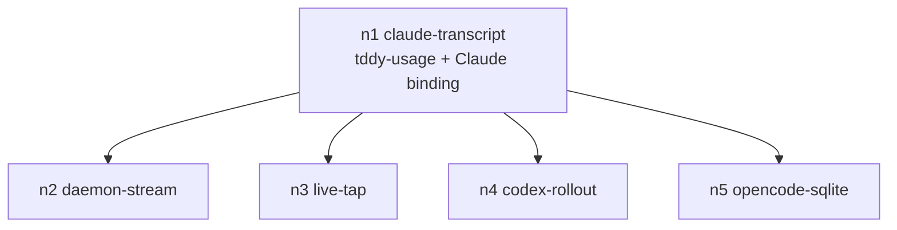

# Changeset: Declarative usage bindings, with Claude's transcripts as the first

**Date**: 2026-11-10
**Status**: 🚧 In Progress
**Type**: Feature
**Complexity**: 4 — four crates plus a new one, proto field additions, a spec-schema change with load-time refusals, a deleted reader
**Branch**: `feature/usage-binding/claude-transcript`, base `master` (`bfccc2b6f`) — `#usage-binding 1/5`, PR [#890](https://github.com/uppin/tddy-coder/pull/890), stack [#895](https://github.com/uppin/tddy-coder/stack/895)

## Initial Discovery

[2026-11-10-usage-binding-claude-transcript-initial-discovery.md](./2026-11-10-usage-binding-claude-transcript-initial-discovery.md)

## Prerequisites

No code issue in a touched package carries `Claimed by:` from another stack.

### ✅ RESOLVED HERE — oversized `backend/mod.rs` — [`packages/tddy-agent-backend/docs/code-issues/oversized-file-backend-mod.md`](../../packages/tddy-agent-backend/docs/code-issues/oversized-file-backend-mod.md)

537 production lines against a budget of 500. `gather_session_usage`, about 50 lines with its doc
comment, leaves the file for `tddy-usage`, and the `claude::read_claude_*` re-exports go too. That is
expected to take the file under budget. `[W]` re-measures. If the move leaves the file over budget, the
record is narrowed with a new measurement row rather than deleted.

### ℹ CONSIDERED — `slots/mod.rs` `render` complexity — [`packages/tddy-coding-agent-specs/docs/code-issues/complexity-slots-mod-render.md`](../../packages/tddy-coding-agent-specs/docs/code-issues/complexity-slots-mod-render.md)

The same file holds the `transcript_usage: false` literal (a test fixture at `slots/mod.rs:285`).
Removing that line does not touch `render`, so the issue is not affected.

## Affected Packages

- **tddy-usage** (new): the agent-agnostic engine:
  - the binding model;
  - path templates;
  - the `jsonl` format;
  - the conversation tree;
  - `gather_session_usage`;
  - the `token_accounting` module, moved here from `tddy-agent-backend`.
- **tddy-coding-agent-specs**: [coding-agent-specs.md](../../packages/tddy-coding-agent-specs/docs/coding-agent-specs.md)
  - `coding_agent.usage` (`spec/usage.rs`), validated at load;
  - `transcript_usage` removed;
  - `specs/claude.yaml` and `specs/claude-acp.yaml` bindings.
- **tddy-agent-backend**: [architecture.md](../../packages/tddy-agent-backend/docs/architecture.md)
  - `backend/claude/transcript_usage.rs` deleted;
  - `gather_session_usage` removed from `backend/mod.rs`;
  - `token_accounting` re-exported from `tddy-usage`, so every existing path keeps compiling.
- **tddy-presenter**: `usage_watcher.rs` takes the binding, `agent_home` and `conversation_id`; its
  `agent == "claude"` check is gone.
- **tddy-coder**: `run.rs` passes the resolved spec's usage section to the watcher.
- **tddy-sandbox-app**: `print_token_summary` takes the binding instead of `transcript_usage`.
- **tddy-service**: the proto `ConversationRecord` gains fields 8–12, mapped in `convert.rs`.
- **tddy-client-web**: regenerated `remote_pb` only. The web ignores the new fields until `#usage-binding 2/5`.

## Related Feature Documentation

- [PRD-2026-11-10-usage-binding-claude-transcript.md](../../ft/coder/1-WIP/PRD-2026-11-10-usage-binding-claude-transcript.md)
- [session-token-accounting.md](../../ft/coder/session-token-accounting.md)

## Summary

Every coding agent spec can declare `extensions.coding_agent.usage`, which names the files its usage
lives in and how to read them. A new agent-agnostic engine in a new crate, `tddy-usage`, evaluates
those bindings. Claude's transcripts are the first binding:
- deduplicated by `message.id`;
- with cache-read and cache-write counted;
- with subagents found recursively.

The Claude Rust reader, the `agent == "claude"` check and `transcript_usage` are removed.

## Background

See the PRD. Measured on a real session, `01a1c71c-…`:
- **Duplicate lines:** 10 assistant lines but only 6 `message.id`s, so naive Out was 3648 against 2057
  deduplicated.
- **Missing cache counters:** deduplicated input was 12 tokens, against cache_read 332 059 and
  cache_creation 43 803.

## Responsibility

This PR owns:

- **The `tddy-usage` crate and its public surface**:
  - `UsageSection`, `UsageSource` (`format`-tagged: `jsonl`), `JsonlSource`, `MainSpec`,
    `ChildrenSpec`, `NameSpec`, `RecordSpec`, `FieldEq`, `Aggregate` (`Sum`), `CounterMap`;
  - `FieldPath` and `PathTemplate`;
  - `UsageContext { agent_home, session_dir, conversation_id, worktree, agent_label, fallback_model }`;
  - `validate_usage_section(&UsageSection) -> Result<(), String>`;
  - `account(&UsageSection, &UsageContext) -> Vec<ConversationRecord>`;
  - `gather_session_usage(Option<&UsageSection>, &UsageContext) -> Vec<ConversationRecord>`.
- **`token_accounting`, moved into `tddy-usage`**:
  - `TokenUsage` gains `cache_read_tokens`, `cache_write_tokens` and `reasoning_tokens`;
  - `ConversationRecord` gains `cacheReadTokens`, `cacheWriteTokens`, `reasoningTokens`, an optional
    `costUsd` and an optional `parentId`, all serde-defaulted;
  - `format_token_summary` prints the new counters.
- **`CodingAgentSection.usage: Option<UsageSection>`** and its load-time refusals in `parse_section`.
- **The Claude bindings** in `specs/claude.yaml` and `specs/claude-acp.yaml`.
- **Proto fields** `ConversationRecord.cache_read_tokens = 8`, `cache_write_tokens = 9`,
  `reasoning_tokens = 10`, `cost_usd = 11` (optional double), `parent_id = 12` (optional string), and
  their `convert.rs` mapping.

## Boundaries

This PR does not:

- start any watcher in the daemon, add an RPC, or change the web UI (`#usage-binding 2/5`);
- tap protocol streams, add a conversation registry, or merge two sources describing one conversation
  (`#usage-binding 3/5`);
- add `aggregate: last`, header identity, parent-by-field children or arithmetic in mappings
  (`#usage-binding 4/5`);
- add the `sqlite` format (`#usage-binding 5/5`);
- bind any agent other than Claude and Claude-ACP.

## Dependencies

None. This is the root node.

## Draft PR contract

The first push of this PR (commit 2) publishes:

- **`packages/tddy-usage`**:
  - the crate, added to the workspace;
  - every type above, with serde derives and doc comments;
  - `validate_usage_section`, `account` and `gather_session_usage` with their final signatures and
    bodies marked `// TODO(claude-transcript): implement`, each returning an empty result;
  - `token_accounting` moved, with the new fields;
  - `tddy-agent-backend` re-exporting it.
- **`CodingAgentSection.usage`**, parsed, with `transcript_usage` still present until green removes it,
  plus the Claude bindings in YAML.
- **The proto fields** and their `convert.rs` mapping.
- **The failing tests** listed under *Acceptance Tests*.

Successors compile against `UsageSection`, `UsageContext`, `account`, `gather_session_usage` and the
widened `ConversationRecord`.

## Green wave

**Wave:** 1 of 2
**Greenable independently:** yes. Every test builds its fixtures on disk and calls this node's own
surface.
**Concurrent with:** none (the only wave-1 node).
**Blocks:** `#usage-binding 2/5`, `3/5`, `4/5`, `5/5`. Each consumes the binding model, `account` and
the widened record.

Real dependency edges, as opposed to the branch line:

    n1 → n2, n3, n4, n5



## Scope

- [ ] **tddy-usage crate**: the binding model, templates, the jsonl format, recursive children, dedupe, sum
- [ ] **token_accounting** moved, with the new counters; `tddy-agent-backend` re-exports it
- [ ] **Spec section** `coding_agent.usage` with load-time refusals; `transcript_usage` removed
- [ ] **Claude bindings** in `claude.yaml` and `claude-acp.yaml`
- [ ] **Consumers**: presenter watcher, `tddy-coder` call site, `tddy-sandbox-app` summary
- [ ] **Proto** fields and `convert.rs`
- [ ] **Delete** `backend/claude/transcript_usage.rs` and its acceptance test, replaced by the binding tests
- [ ] **Docs**: `coding-agent-specs.md` metadata row and a `usage` field table; `session-token-accounting.md`

## Technical Changes

### State A (Current)

- **`gather_session_usage`** (`tddy-agent-backend/src/backend/mod.rs:124`) takes `(session_dir,
  session_id, claude_home, fallback_model, include_main_agent)`.
  - When `include_main_agent` is true, it pushes `read_claude_transcript_usage` and then
    `read_claude_subagent_usages`.
  - It then appends `<session_dir>/egress/accounting.json` `conversations`.
- **The Claude reader** (`backend/claude/transcript_usage.rs`):
  - keeps lines where `type == "assistant"`;
  - sums `message.usage.{input,output}_tokens`, with no dedupe and no cache;
  - keeps the last `message.model`;
  - counts one turn per line;
  - reads one level of subagents (`<sid>/subagents/agent-*.jsonl`, name from `.meta.json`
    `agentType`, sorted by id);
  - yields a zero row with the agent label `"claude"`.
- **`ConversationRecord`** (`tddy-agent-backend/src/token_accounting.rs`) has 7 flat fields, with no
  cache, cost or parent. It is wire-shared with `accounting.json`, the `subagent_list` MCP tool and the
  proto `ConversationRecord` (`remote.proto:119-127`).
- **The two callers**:
  - the presenter `spawn_session_usage_watcher` sets `include_main_agent = config.agent == "claude"`
    (`usage_watcher.rs:155`);
  - `tddy-sandbox-app` reads `agent.spec.agent.transcript_usage` (`main.rs:578`).
- **`CodingAgentSection`** (`spec.rs:174`, `deny_unknown_fields`) carries `transcript_usage: bool`,
  which is true in `claude.yaml:56` and `claude-acp.yaml:56`.
- **No generic path-template helper exists.** `ArgvItem` substitution is argv-only, and `{home}` /
  `{session_dir}` are each replaced ad hoc. There is no JSON field-path or predicate language.

### State B (Target)

```yaml
# specs/claude.yaml, under extensions.coding_agent
usage:
  sources:
    - format: jsonl
      main:
        path: "{agent_home}/.claude/projects/*/{conversation_id}.jsonl"
      children:
        path: "{dir}/{stem}/subagents/agent-*.jsonl"
        id: "{stem}"
        name: { sidecar: "{dir}/{stem}.meta.json", field: agentType, default: subagent }
      record:
        where: [{ field: type, equals: assistant }]
        dedupe_by: message.id
        aggregate: sum
        model: message.model
        tokens:
          input: message.usage.input_tokens
          cache_read: message.usage.cache_read_input_tokens
          cache_write: message.usage.cache_creation_input_tokens
          output: message.usage.output_tokens
```

- **`tddy-usage::account(section, ctx)`** works in four steps:
  1. **Render `main.path`.** The variables are `{agent_home}`, `{session_dir}`, `{conversation_id}` and
     `{worktree}`. An unbound variable is an error, which is refused at load. A bound variable whose
     value is unset at runtime means no files.
  2. **Glob and merge.** Every matching file is merged into the main conversation, with
     `id = conversation_id` and `agent = agent_label`.
  3. **Read the records.** Each file's records are filtered by `where`. With `dedupe_by` set, the last
     line per key wins, and lines without the key are each kept. They are aggregated by `sum` per
     counter, `model` is the last value seen, and `turns` is the number of kept records.
  4. **Follow the children.** For each conversation file, `children.path` is rendered with that file's
     `{dir}` and `{stem}`. Each match becomes a child row: `id` from the `id` template, `agent` from the
     `name` spec, `parent_id` = the parent's id. The step is applied to each child in turn, recursively,
     with a depth guard of 16 and a visited-path set. Siblings are sorted by id.
- **The zero row.** With no main file, the main conversation is still one row carrying
  `fallback_model`, as today.
- **`gather_session_usage(section, ctx)`** returns `account` (when a section is given), followed by the
  `<session_dir>/egress/accounting.json` rows, as today. The accounting rows with no `parentId` keep
  none.
- **The record.** `total_tokens = input + cache_read + cache_write + output + reasoning`. The counters
  are disjoint by definition.
- **Load-time validation**, through `validate_usage_section` from `parse_section`, with messages
  prefixed `usage:`. It refuses:
  - an unknown `format` (serde tag);
  - an unknown template variable;
  - a `children` template naming a parent-file variable outside `{dir}` and `{stem}`;
  - an empty `sources`;
  - an empty field path.

  An operator override still carrying `transcript_usage` is refused by `deny_unknown_fields`, with the
  file named.
- **The consumers**:
  - the presenter's `SessionUsageWatchConfig { session_dir, usage: Option<UsageSection>, context:
    UsageContext, poll_interval }`;
  - `tddy-coder` builds the `UsageContext` with `agent_home = resolve_agent_home_dir()`, its current
    value; the jail-home fix is `#usage-binding 2/5`;
  - `tddy-sandbox-app` passes the spec's `usage` and the host home it already resolves.

### Delta (What's Changing)

#### tddy-usage (new)
- `src/lib.rs`, `src/section.rs` (the model), `src/template.rs`, `src/field_path.rs`, `src/jsonl.rs`,
  `src/tree.rs`, `src/gather.rs`, `src/token_accounting.rs` (moved).
- Dependencies: `serde`, `serde_json`, `glob` (or `globset`; whichever the workspace already uses),
  `log`. No agent crate is a dependency.

#### tddy-coding-agent-specs
- `src/spec/usage.rs`: `usage_errors(&UsageSection)`, which wraps `validate_usage_section`.
- `spec.rs`: the `usage` field and the `transcript_usage` removal.
- `slots/mod.rs:285`: the fixture literal.
- `specs/claude.yaml` and `specs/claude-acp.yaml`: the bindings.
- `docs/coding-agent-specs.md`: the metadata row and the field table (at wrap).

#### tddy-agent-backend
- Delete `backend/claude/transcript_usage.rs`, its re-exports, and `gather_session_usage` in `backend/mod.rs`.
- `token_accounting.rs` becomes `pub use tddy_usage::token_accounting::*`.
- Delete `tests/claude_transcript_usage_acceptance.rs` and move `tests/token_accounting_*` to
  `tddy-usage`.

#### tddy-presenter
- `usage_watcher.rs`: the config and target carry the section and context; the `agent == "claude"` check is gone.
- Tests rewritten: `tests/session_usage_watcher.rs`, and the 7-field record literals in `tests/usage_watcher.rs`.

#### tddy-coder
- `run.rs` around line 2108: resolve the session agent's spec usage section from the registry it
  already loads, and pass it as data.

#### tddy-sandbox-app
- `main.rs`: `is_transcript_agent` is replaced by `agent.spec.agent.usage.clone()`;
  `print_token_summary(session_dir, usage, ctx)`.

#### tddy-service / tddy-client-web
- `remote.proto` fields 8–12; `convert.rs`; regenerate the TS with
  `scripts/generated-code.sh write packages/tddy-client-web`.

## Implementation Milestones

- [ ] `tddy-usage` compiles in the workspace and passes the no-agent-vocabulary scan
- [ ] Templates and field paths, with unit tests
- [ ] The jsonl format: filter, dedupe, sum, model, turns
- [ ] Recursive children, with names from a sidecar
- [ ] `gather_session_usage` with `accounting.json` back-compat
- [ ] The spec section, its refusals and the Claude bindings; `transcript_usage` removed
- [ ] Consumers swapped; the Claude reader deleted
- [ ] Proto and `convert.rs`; TS regenerated
- [ ] `format_token_summary` shows cache and reasoning

## Testing Plan

### Testing Strategy

- **Integration-level acceptance tests in `tddy-usage`.** They write real transcript fixtures to a
  tempdir and evaluate the **real built-in Claude binding**, parsed from `claude.yaml` through
  `tddy-coding-agent-specs`. A dev-dependency is fine. The point is to prove that the YAML, not a
  hand-built struct, produces the right numbers.
- **The fixtures** are cut from the real transcript of session `01a1c71c-…`. Only `type`,
  `message.id`, `message.model` and `message.usage` are kept, with no content. Two lines share each
  `message.id`, as Claude writes them.
- **Spec-load acceptance** goes through the registry and checks that the refusal names the file.
- **Presenter watcher tests** drive a binding, not an agent name.

### Testing Options Analysis

- **Hand-built `UsageSection` structs in tests.** Fast, but they do not prove the YAML is right. They
  are used only for engine unit tests of edge cases: depth guard, cycles, an unset variable.
- **The real Claude binding over fixtures.** Chosen for acceptance.
- **A live `claude` run.** Rejected: slow and nondeterministic, and the fixture format is the contract.

### Coverage Requirements

- Every `RecordSpec` field, `children` recursion at depth ≥ 2, dedupe with and without the key, multiple
  main files, a missing main file, a malformed line skipped, and every load refusal.

## Acceptance Tests

### tddy-usage — `packages/tddy-usage/tests/claude_binding_acceptance.rs`
- `a_message_written_as_several_lines_is_counted_once`: two lines share a `message.id`, so the usage is
  counted once and turns = 1.
- `cache_read_and_cache_write_are_reported_beside_fresh_input`: the cache counters come from
  `cache_read_input_tokens` and `cache_creation_input_tokens`, and are included in the total.
- `a_subagent_of_a_subagent_is_a_child_of_its_parent`: a nested `subagents/` directory two levels deep
  gives three rows, each child's `parentId` naming its parent.
- `a_subagent_is_named_from_its_sidecar_and_defaults_when_it_has_none`: `agentType` from `.meta.json`;
  no sidecar gives `subagent`.
- `every_transcript_matching_the_main_path_is_merged`: the same session id under two project
  directories gives one main row with the sum.
- `a_session_with_no_transcript_reports_a_zero_row_with_the_fallback_model`.

### tddy-usage — `packages/tddy-usage/tests/gather_acceptance.rs`
- `tddy_subagent_rows_follow_the_agents_own_rows`.
- `an_accounting_file_written_without_the_new_fields_still_reads`.
- `a_session_whose_agent_declares_no_usage_reports_only_its_tddy_subagents`.

### tddy-usage — `packages/tddy-usage/tests/no_agent_vocabulary.rs`
- `the_usage_engine_names_no_agent`: the same scan as `tddy-sandbox/tests/no_agent_vocabulary.rs`
  over `packages/tddy-usage/src`.

### tddy-usage — `packages/tddy-usage/tests/token_summary_acceptance.rs`
- `the_summary_shows_cache_and_reasoning_per_row_and_in_the_total`. This replaces
  `tddy-agent-backend/tests/token_accounting_acceptance.rs`.

### tddy-coding-agent-specs — `packages/tddy-coding-agent-specs/tests/usage_section_acceptance.rs`
- `the_builtin_claude_specs_bind_their_transcripts`: `claude` and `claude-acp` load with one `jsonl`
  source.
- `an_unknown_usage_format_is_refused_at_load_naming_the_file`.
- `an_unknown_template_variable_is_refused_at_load`.
- `a_leftover_transcript_usage_flag_is_refused_at_load`.
- `a_source_without_a_main_path_is_refused_at_load`.

### tddy-presenter — `packages/tddy-presenter/tests/session_usage_watcher.rs` (rewritten)
- `broadcasts_the_snapshot_the_sessions_usage_binding_yields`.
- `a_session_without_a_usage_binding_broadcasts_only_its_tddy_subagents`.

### Unit tests (in `src`, `#[cfg(test)]`)
- `template.rs`: rendering, an unknown variable, a literal brace.
- `field_path.rs`: nested lookup, a missing segment, a non-number.
- `tree.rs`: the depth guard and the cycle guard.

## Technical Debt & Production Readiness

### Contract commit (pass 2, 2026-11-10)

- **`TokenUsage` is not widened.** It has about 15 struct-literal sites in `tddy-discovery`,
  `tddy-session-agents` and `tddy-coding-subagent`, all outside this node. Only `ConversationRecord`
  gains `cache_read_tokens`, `cache_write_tokens`, `reasoning_tokens`, `cost_usd` and `parent_id`.
  The *Responsibility* line naming `TokenUsage` is superseded.
- **`ConversationRecord` drops `Eq`** (`cost_usd: Option<f64>`). Nothing in the workspace required it
  (`cargo check --all-targets` over the 8 touched packages).
- **Still present for `/green` to remove:**
  - `transcript_usage` (red: `a_leftover_transcript_usage_flag_is_refused_at_load`);
  - `backend/claude/transcript_usage.rs`, `backend::gather_session_usage` and its consumer in
    `tddy-sandbox-app`;
  - `tests/{claude_transcript_usage,token_accounting}_acceptance.rs` in `tddy-agent-backend`, whose
    literals were only widened.
- **Already wired in the contract** (trivial delegation, so the tests compile against real seams):
  - the presenter watcher calls `tddy_usage::gather_session_usage`;
  - `tddy-coder` passes `CodingAgentRegistry::builtin_cached().get(agent).usage` as data;
  - the proto fields 8–12 and `convert.rs`;
  - regenerated `remote_pb.ts` in `tddy-client-web` and `tddy-rust-typescript-tests`.
- **Fixtures are builders, not a file cut from the transcript.** `tests/support/mod.rs` writes lines
  the way Claude Code does: one per content block, repeating `message.id` and `usage`. The
  measurement from session `01a1c71c-…` is reused as the cache test's numbers.
- **Three spec-load acceptance tests pass at the contract**, because serde enforces them through the
  surface: the built-ins bind; an unknown format is refused; a missing `main` is refused.
- **`no_agent_vocabulary`** strips `TODO(<node>)` tags before matching, because this node's own branch
  name (`claude-transcript`) is in every contract marker.
- **`packages/tddy-workflow-recipes/generated/schema-manifest.json`** is included as build-script
  output. Every fresh build rewrites it, and it was never committed in that form (developer,
  2026-11-10).

### Baseline (6c)

`./test -p tddy-coding-agent-specs -p tddy-agent-backend -p tddy-presenter` on `bfccc2b6f` gave 48
suites, 0 failures. `cargo build` was green for those three packages plus `tddy-service` and
`tddy-sandbox-app`. There are no pre-existing failures to tell apart from this node's red.

## Decisions & Trade-offs

- **A new crate.** The user chose it on 2026-11-10. The specs crate already depends on
  `tddy-agent-backend`, and presenter and sandbox-app must not depend on the specs crate, so the engine
  sits below both, taking the binding as data.
- **`token_accounting` moves into `tddy-usage`**, re-exported from `tddy-agent-backend`. The engine
  needs the record, and depending on `tddy-agent-backend` would drag its whole stack in.
- **`usage.sources` is a list from the start.** `#usage-binding 3/5` adds a second source per agent
  (the protocol tap), and a list now avoids a schema break then.
- **The counters are disjoint.** `input` is fresh input only and `output` excludes reasoning, so
  `total` is a plain sum. Each source's mapping is responsible for subtracting overlaps (the user chose
  reasoning as its own column on 2026-11-10).
- **No fallback for `transcript_usage`.** An override carrying it is refused at load (CLAUDE.md: no
  fallbacks without consent).
- **`tddy-coder` keeps `$HOME` as `agent_home` here.** The jail-home mismatch is fixed where the daemon
  takes over, in 2/5.

## Refactoring Needed

### From /validate-changes
### From /validate-tests
### From /validate-prod-ready
### From /analyze-clean-code

## Validation Results

### /validate-changes
### /validate-tests
### /validate-prod-ready
### /analyze-clean-code

## TODO

- [x] Record initial discovery (`2026-11-10-usage-binding-claude-transcript-initial-discovery.md`)
- [x] Cross-check `packages/*/docs/code-issues/` and `docs/dev/todo/` for items this change touches (Step 2b)
- [x] Create/update PRD documentation
- [x] Create changeset (this document)
- [x] Create failing acceptance tests
- [x] Run acceptance tests (verify they fail)
- [x] USER REVIEW — acceptance tests
- [x] TDD Red — write failing unit/integration tests
- [ ] TDD Green — implement with quality code
- [ ] Update documentation with progress
- [ ] Repeat Red→Green→Update cycle until feature complete
- [ ] Run the touched packages' tests (`./test -p {package}` per package) — verify 100% pass
- [ ] Validate changes (/validate-changes)
- [ ] Refactor issues from change validation
- [ ] USER REVIEW — development complete
- [ ] Validate tests (/validate-tests)
- [ ] Refactor test issues
- [ ] Validate production readiness (/validate-prod-ready)
- [ ] Refactor production readiness issues
- [ ] Analyze code quality (/analyze-clean-code)
- [ ] Refactor code quality issues
- [ ] Final validation (/validate-changes)
- [ ] Linting and formatting (`cargo clippy -p {package} -- -D warnings`, `cargo fmt`)
- [ ] USER REVIEW — scope developed, every gap approved: ready to wrap
