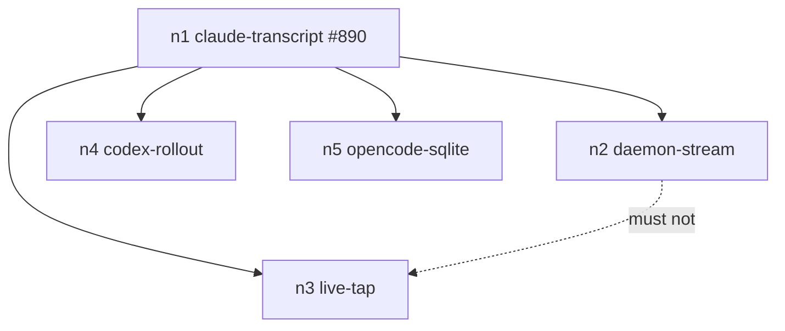

# Changeset: The daemon accounts every session's usage, and the Usage tab shows all of it

**Date**: 2026-11-10
**Status**: 🚧 In Progress
**Type**: Feature
**Complexity**: 5 — proto contract change across daemon and web, four launch paths plus resume and relaunch, a shared poller (concurrency), a deleted transport path
**Branch**: `feature/usage-binding/daemon-stream`, base `feature/usage-binding/claude-transcript` (#890) — `#usage-binding 2/5`

## Initial Discovery

[2026-11-10-usage-binding-daemon-stream-initial-discovery.md](./2026-11-10-usage-binding-daemon-stream-initial-discovery.md)

## Prerequisites

No code issue in a touched package carries `Claimed by:` from another stack.

### ℹ CONSIDERED — `mount_host.rs` `build_session_host` complexity — [`packages/tddy-daemon/docs/code-issues/complexity-mount-host-build-session-host.md`](../../packages/tddy-daemon/docs/code-issues/complexity-mount-host-build-session-host.md)

The user deferred it on 2026-11-10 (the `#agent-tools` sweep). If the usage stream needs host wiring,
it goes through the existing `activity_entry()`, which adds no branch to `build_session_host`.

### ℹ CONSIDERED — `oversized-file-session-main-pane.md` (`tddy-session-web`)

`SessionMainPane.tsx` is not touched. The Usage tab lives in `SessionUsageTab.tsx` and
`SessionInspectorDrawer.tsx`.

## Affected Packages

- **tddy-service**:
  - `proto/activity.proto`: `rpc StreamSessionUsage(StreamSessionUsageRequest) returns (stream
    SessionUsageSnapshot)`, plus `UsageConversation`;
  - `proto/remote.proto`: `TokenUsageUpdated` (oneof field 13) and `ConversationRecord` removed, with
    field 13 and the name `token_usage_updated` reserved;
  - `convert.rs`: the TddyRemote mapping removed.
- **tddy-session-activity**: the `StreamSessionUsage` handler, the per-session poller registry and peer
  routing.
- **tddy-agent-launch**: `usage_context.rs` writes and reads `<session_dir>/usage-context.json` at
  every launch, resume and relaunch.
- **tddy-spawn**: the workflow-session spawn writes the context, with the OS user's home.
- **tddy-usage**: `UsageContextFile` serde type (`spec_id`, `agent_home`, `conversation_id`,
  `worktree`) and `gather_session_usage_for(&UsageContextFile, &dyn Fn(&str) -> Option<UsageSection>,
  session_dir)`.
- **tddy-presenter**: `usage_watcher.rs` and `PresenterEvent::TokenUsageUpdated` deleted.
- **tddy-coder**: the watcher spawn deleted (`run.rs` ~2108).
- **tddy-tui**: the ignored `TokenUsageUpdated` arm deleted (`virtual_tui.rs:746`).
- **tddy-client-web**: regenerated `activity_pb` and `remote_pb`.
- **tddy-session-web**: `useSessionUsage` on the daemon `ActivityService` client; `SessionUsageTab`
  columns and tree; `sessionUsage.ts` (`UsageConversation`, tree building, totals including a partial
  cost); the Cypress backend `usageBackend.ts` and its fixtures.
- **tddy-daemon**: the acceptance test of a host terminal session end to end (tests only, unless
  wiring is needed).

## Related Feature Documentation

- [PRD-2026-11-10-usage-binding-daemon-stream.md](../../ft/web/1-WIP/PRD-2026-11-10-usage-binding-daemon-stream.md)
- [session-usage-inspector.md](../../ft/web/session-usage-inspector.md)
- [session-token-accounting.md](../../ft/coder/session-token-accounting.md)

## Summary

The daemon serves every session's usage. Every launch path writes a usage context, and
`ActivityService.StreamSessionUsage` evaluates the session agent's bindings against it: a snapshot
first, then each change. The Usage tab reads that stream, shows In · Cache read · Cache write · Out ·
Reasoning · Total · Cost · Turns, and nests conversations as a tree. The tddy-coder / presenter /
`TddyRemote` usage path is deleted.

## Background

See the PRD.
- **Terminal sessions:** for a terminal session the web's `ConnectSession` returns no room or
  identity, so `useSessionUsage` has no `TddyRemote` server to reach.
- **Wrong home:** jailed agents keep their files under `<tddy_data_dir>/homes/<key>` (persistent) or
  `<session_dir>/sandbox/.work/home` (session), and nothing records that home.

## Responsibility

This PR owns:

- **`UsageContextFile`** and `gather_session_usage_for` in `tddy-usage`.
- **`tddy-agent-launch::usage_context`**:
  - `write_usage_context(session_dir, &UsageContextFile)` and
    `read_usage_context(session_dir) -> Option<UsageContextFile>`;
  - the calls to them at every launch path.
- **The `StreamSessionUsage` RPC**, its messages, its handler and the per-session `UsagePollers`
  registry in `tddy-session-activity`.
- **The web**:
  - `useSessionUsage` on the `ActivityService` client;
  - `UsageConversation` and `buildUsageTree` / `usageTotals` (with `costPartial`);
  - the `SessionUsageTab` columns, the tree indentation and the cost cell;
  - the test ids `sessions-usage-{cache-read,cache-write,reasoning,cost}-<id>` and
    `sessions-usage-total-{cache-read,cache-write,reasoning,cost}`.
- **Deleting** the presenter watcher, `PresenterEvent::TokenUsageUpdated`, `TddyRemote`'s
  `TokenUsageUpdated` and the tddy-coder spawn.

## Boundaries

This PR does not:

- change how a binding is evaluated (`#usage-binding 1/5` owns the engine);
- register subagent conversations, or tap protocol streams (`#usage-binding 3/5`). A daemon-run coding
  subagent is not a row here unless its agent's own files nest it, as Claude's `subagents/` do;
- bind Codex or OpenCode (`4/5`, `5/5`);
- persist usage history beyond what the agents' own files hold.

## Dependencies

What each parent PR delivers that this PR consumes. These surfaces are **theirs to create**;
implementing one here collides with the PR that owns it.

| Parent node | What it delivers | How this PR consumes it | This PR does NOT |
|---|---|---|---|
| `#usage-binding 1/5` #890 `claude-transcript` | `tddy-usage`: `UsageSection`, `UsageContext`, `account`, `gather_session_usage`, the widened `ConversationRecord` (cache, reasoning, cost, parent); `CodingAgentSection.usage`; the Claude bindings | `gather_session_usage_for` builds a `UsageContext` from the context file and calls `gather_session_usage`; the handler maps `ConversationRecord` → `UsageConversation` | change the engine, the record fields, the spec section or the Claude binding |

## Draft PR contract

The first push (commit 2) publishes:

- **`activity.proto`**: the RPC and its messages. The TS is regenerated.
- **`UsageContextFile`**, `gather_session_usage_for`, `write_usage_context` and `read_usage_context`,
  with their signatures; bodies `// TODO(daemon-stream): implement`.
- **The `StreamSessionUsage` handler**, returning an empty stream.
- **`sessionUsage.ts`**: `UsageConversation`, `buildUsageTree`, `usageTotals` signatures.
- **The failing tests** below.

## Green wave

**Wave:** 2 of 2
**Greenable independently:** after #890 is green. The stream test evaluates the real Claude binding over
a fixture transcript, so it exercises #890's **behaviour**. The web tests use an in-memory
`ActivityService` backend and need only this node.
**Concurrent with:** `#usage-binding 3/5`, `4/5`, `5/5`. They share no surface with this node.
**Blocks:** none.

    n1 → n2, n3, n4, n5



## Scope

- [ ] **Usage context** written by the host PTY, jailed PTY and workflow launches, and by every resume and relaunch
- [ ] **`StreamSessionUsage`**: snapshot then changes, a shared poller per session, peer routing, dormant sessions
- [ ] **Web**: transport on `ActivityService`, the new columns, cost blank or partial, the tree
- [ ] **Delete** the TddyRemote / presenter / tddy-coder usage path
- [ ] **Docs**: `session-usage-inspector.md`, `session-token-accounting.md`, the daemon RPC docs

## Technical Changes

### State A (Current)

- **The usage stream** is `TddyRemote.Stream` → `ServerMessage.token_usage_updated` (oneof field 13),
  fed by `tddy-presenter::usage_watcher`. It is spawned only by `tddy-coder run_daemon` when LiveKit is
  enabled (`run.rs:2108`), with `claude_home = $HOME`.
- **The three spawn shapes** (`svc_start_session_core.rs start_here_body`):
  - **Host PTY:** `opencode_cli_spawn::start_cli_harness_session`. HOME is `home_dir_for_user(os_user)`,
    there is no `accounting.json`, and the conversation is `LaunchConversation::SessionId(session_id)`
    for `daemon_session_id`.
  - **Jailed PTY:** `LaunchSessions::launch_jailed` (`jail_launch.rs`). HOME is `grants.home`, from
    `lower_tool_jail`: `<tddy_data_dir>/homes/<key>` or `<session_dir>/sandbox/.work/home`. The
    accounting file is `<session_dir>/egress/accounting.json`.
  - **Workflow:** `spawn_tool_session` → `tddy-spawn spawner.rs`, a `tddy-coder --daemon` child with
    HOME the passwd home.
  - Resume and relaunch: `svc_resume_sandboxed_cli_harness_session.rs`, `jail_relaunch.rs`,
    `relaunch_jail_dirs.rs`.
- **The web Inspector tabs** reach the daemon through `useDaemonClient(Service)`, routed to the owning
  host by `sessionPaneClients`. Only the Usage tab uses the LiveKit room (`useRoomClient(…,
  TddyRemote)`, with `serverIdentity` defaulting to `"server"`).
- **`ActivityService`** is not in the closed `RESIDUAL_METHODS` list (`unbundle_service_split.rs:570`;
  closed only for Session/Project/DemoVm/LocalToken), so adding an RPC there touches no tripwire.

### State B (Target)

```proto
rpc StreamSessionUsage(StreamSessionUsageRequest) returns (stream SessionUsageSnapshot);

message StreamSessionUsageRequest { string session_token = 1; string session_id = 2; string daemon_instance_id = 3; }
message SessionUsageSnapshot { repeated UsageConversation conversations = 1; }
message UsageConversation {
  string agent = 1; string id = 2; string model = 3;
  uint64 input_tokens = 4; uint64 cache_read_tokens = 5; uint64 cache_write_tokens = 6;
  uint64 output_tokens = 7; uint64 reasoning_tokens = 8; uint64 total_tokens = 9;
  uint32 turns = 10; optional double cost_usd = 11; optional string parent_id = 12;
}
```

- **`usage-context.json`** is written next to `.session.yaml` by every launch:
  - **jail:** `agent_home = grants.home`, written at the end of `launch_jailed`;
  - **host PTY:** the passwd home;
  - **workflow:** the passwd home, written in `tddy-spawn`.

  Resume and relaunch rewrite it with the recomputed home. `conversation_id` is the session id for
  `daemon_session_id`. A minted id is written when it is minted, and the worktree kind writes the
  worktree.
- **The handler**:
  1. authorises `session_token`, the same as `StreamSessionActivity`;
  2. peer-routes on `daemon_instance_id`;
  3. resolves `<sessions_base>/sessions/<id>`;
  4. joins or starts that session's poller.

  The poller ticks every 2 s. On each tick it reads the context, looks the spec up in the daemon's
  `CodingAgentRegistry`, and calls `gather_session_usage_for` on a blocking task. When the snapshot
  differs from the last one it is broadcast. A new subscriber gets the last snapshot at once. The poller
  stops when its last subscriber drops.
- **The web**:
  - `useSessionUsage(sessionId)` uses the daemon `ActivityService` client the Activity tab uses. It
    takes no room and no identity.
  - `buildUsageTree` orders the rows parent-first, each child under its parent, with `depth`. An orphan
    has depth 0.
  - Cost renders `$0.0123` (4 significant decimals below $1), or blank. The TOTAL cost carries a `*`
    and a title of "partial: some conversations did not report a cost" when any row lacks one.

### Delta (What's Changing)

See *Affected Packages*. The deletions are:
- `packages/tddy-presenter/src/usage_watcher.rs`;
- `tests/{usage_watcher,session_usage_watcher}.rs`;
- `PresenterEvent::TokenUsageUpdated`;
- the `convert.rs` arm;
- the `tddy-tui` arm;
- `run.rs`'s spawn and `SESSION_USAGE_POLL_INTERVAL`.

## Implementation Milestones

- [ ] The context file, written and read at all launch, resume and relaunch sites
- [ ] The proto and its regeneration
- [ ] The poller registry and the handler, with peer routing
- [ ] Web transport, columns, cost and tree
- [ ] Deletions; the build of every touched package green

## Testing Plan

### Testing Strategy

- **Daemon-side acceptance in `tddy-session-activity`** calls the real handler with an in-memory
  subscriber, a session dir on disk with a context file, and the real built-in Claude spec. It checks
  the snapshot on subscribe, a change, and a dormant session.
- **Launch-side acceptance in `tddy-agent-launch`** checks that the context file has the right home per
  spawn shape, using the jail and host launch test harnesses that already exist there.
- **The end-to-end daemon test** starts a host terminal session for a YAML-only agent whose `usage:`
  points at a fixture under its home, then reads the stream through the daemon's RPC entries over
  in-memory RPC. It uses no LiveKit (memory: tests use cheap RPC).
- **The web tests** are Cypress component tests, driven with `mountWithRpc` and an in-memory
  `ActivityService` backend.

### Coverage Requirements

- Every spawn shape's home, resume rewriting the home, the snapshot-then-change ordering, the last
  subscriber stopping the poller, the peer route, a missing context file, cost partial, and a tree of
  depth 3.

## Acceptance Tests

### tddy-session-activity — `packages/tddy-session-activity/tests/session_usage_stream_acceptance.rs`
- `a_subscriber_receives_the_sessions_usage_snapshot_first`.
- `a_transcript_that_grows_streams_a_new_snapshot`.
- `an_unchanged_snapshot_is_not_streamed_again`.
- `an_ended_session_streams_its_final_usage`.
- `a_session_without_a_usage_context_streams_only_its_tddy_subagents`.
- `the_poller_stops_when_its_last_subscriber_leaves`.

### tddy-agent-launch — `packages/tddy-agent-launch/tests/usage_context_acceptance.rs`
- `a_jailed_session_records_its_jail_home_as_the_agent_home`.
- `a_host_terminal_session_records_the_os_users_home`.
- `a_relaunched_jail_rewrites_its_usage_context`.

### tddy-daemon — `packages/tddy-daemon/tests/terminal_session_usage_acceptance.rs`
- `a_host_terminal_sessions_usage_reaches_the_usage_stream`.

### tddy-session-web — `packages/tddy-session-web/cypress/component/SessionInspectorUsageAcceptance.cy.tsx` (extended; the five existing tests move to the `ActivityService` backend)
- `shows cache read, cache write, reasoning and cost beside in and out`.
- `leaves cost blank when a conversation reported none and marks the total partial`.
- `nests a subagent under the conversation that spawned it, at any depth`.
- `shows usage for a terminal session that has no LiveKit room`.

### tddy-session-web — `packages/tddy-session-web/src/sessionUsage.test.ts`
- `buildUsageTree puts each child after its parent with its depth`.
- `an orphan child is a top-level row`.
- `usageTotals sums every counter and flags a partial cost`.

## Technical Debt & Production Readiness

(Populated during development.)

## Decisions & Trade-offs

- **Evaluate while watched, not per live session.** One code path serves live and ended sessions, and
  nothing polls a session nobody is looking at. The launch paths only write a small file, so the
  context survives a daemon restart.
- **`ActivityService`, not `SessionService`.** It already hosts the per-session observation streams, and
  it is outside the closed residual-methods list.
- **A new `UsageConversation` message rather than moving `ConversationRecord`.** `activity.proto`
  cannot import `remote.proto`'s types cleanly, and the remote one is deleted.
- **Complexity 5** signals that the boundary could be split: transport/daemon and the UI columns. The
  user chose not to split on 2026-11-10, so the Claude-first goal lands in one PR.

## Refactoring Needed

### From /validate-changes
### From /validate-tests
### From /validate-prod-ready
### From /analyze-clean-code

## Validation Results

### /validate-changes
### /validate-tests
### /validate-prod-ready
### /analyze-clean-code

## TODO

- [x] Record initial discovery (`2026-11-10-usage-binding-daemon-stream-initial-discovery.md`)
- [x] Cross-check `packages/*/docs/code-issues/` and `docs/dev/todo/` for items this change touches (Step 2b)
- [x] Create/update PRD documentation
- [x] Create changeset (this document)
- [ ] Create failing acceptance tests
- [ ] Run acceptance tests (verify they fail)
- [ ] USER REVIEW — acceptance tests
- [ ] TDD Red — write failing unit/integration tests
- [ ] TDD Green — implement with quality code
- [ ] Update documentation with progress
- [ ] Repeat Red→Green→Update cycle until feature complete
- [ ] Run the touched packages' tests (`./test -p {package}` per package) — verify 100% pass
- [ ] Validate changes (/validate-changes)
- [ ] Refactor issues from change validation
- [ ] USER REVIEW — development complete
- [ ] Validate tests (/validate-tests)
- [ ] Refactor test issues
- [ ] Validate production readiness (/validate-prod-ready)
- [ ] Refactor production readiness issues
- [ ] Analyze code quality (/analyze-clean-code)
- [ ] Refactor code quality issues
- [ ] Final validation (/validate-changes)
- [ ] Linting and formatting (`cargo clippy -p {package} -- -D warnings`, `cargo fmt`)
- [ ] USER REVIEW — scope developed, every gap approved: ready to wrap
