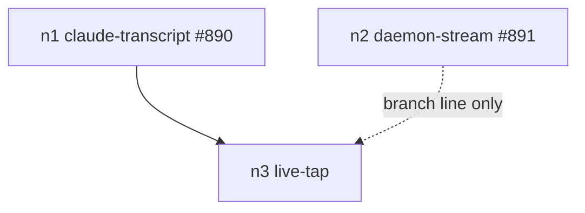

# Changeset: Daemon-run subagents and stream-only agents report their usage

**Date**: 2026-11-10
**Status**: 🚧 In Progress
**Type**: Feature
**Complexity**: 4 — four crates, three protocol drivers, an append-only registry written concurrently by subagent opens, a source-merge rule in the engine
**Branch**: `feature/usage-binding/live-tap`, base `feature/usage-binding/daemon-stream` (#891) — `#usage-binding 3/5`, PR [#892](https://github.com/uppin/tddy-coder/pull/892), stack [#895](https://github.com/uppin/tddy-coder/stack/895)

## Initial Discovery

[2026-11-10-usage-binding-live-tap-initial-discovery.md](./2026-11-10-usage-binding-live-tap-initial-discovery.md)

## Prerequisites

No code issue in a touched package carries `Claimed by:` from another stack.

### ⚠ DURING — oversized `headless_driver` — [`packages/tddy-agent-backend/docs/code-issues/oversized-file-headless-driver.md`](../../packages/tddy-agent-backend/docs/code-issues/oversized-file-headless-driver.md)

Deferred to the `#agent-tools` sweep node. The tap goes in a new module, `headless_driver/usage_tap.rs`,
and each driver grows only by the call that feeds it a line, so the record must not get worse. `[W]`
re-measures.

### ⚠ DURING — `complexity-headless-driver-run-turn.md`, `complexity-claude-process-ndjson-stream.md`

The tap is fed from `push_line`, not from `run_turn`'s branches, so neither function gains a branch.

## Affected Packages

- **tddy-agent-backend**:
  - `headless_driver/usage_tap.rs` (new): `UsageTap::{open(path, filter), offer(line)}`;
  - the stream-json, codex-jsonl and ACP drivers each offer every raw line or update to the tap they are
    given;
  - `adapters/headless.rs` opens the tap from the request's session dir and the spec's
    `usage_events`.
- **tddy-coding-agent-specs**:
  - `headless.usage_events` and `acp.usage_events`: lists of `FieldEq` (the `tddy-usage` type);
  - bindings in `cursor.yaml`, `claude-acp.yaml` and `codex-acp.yaml`;
  - the refusal of two sources mapping one counter.
- **tddy-usage**:
  - `merge_sources`: rows with the same conversation id merge field by field;
  - `validate_usage_section` refuses an overlapping counter;
  - `ConversationRegistry` (`<session_dir>/usage-conversations.jsonl`, append-only):
    `register(&RegisteredConversation)` and `read`;
  - `gather_session_usage_for` evaluates each registered conversation's spec binding and nests its
    rows under `parent_id`.
- **tddy-session-agents**: `open_agent_conversation` registers each coding-subagent conversation (spec
  id, conversation id, agent home, worktree, parent = the session's main conversation id).
- **tddy-coding-subagent**: `SubagentSession::cumulative_usage` and `context_tokens` read the tap's
  totals through `tddy-usage` with the conversation's binding, instead of returning zero.

## Related Feature Documentation

- [PRD-2026-11-10-usage-binding-live-tap.md](../../ft/coder/1-WIP/PRD-2026-11-10-usage-binding-live-tap.md)
- [session-token-accounting.md](../../ft/coder/session-token-accounting.md)

## Summary

Every coding subagent the daemon opens for a session is registered in the session directory. The
usage stream evaluates each one with its own agent's binding, nested under the main conversation.
Protocol drivers append the raw events their spec declares as usage to
`<session_dir>/usage/<conversation_id>.jsonl`. Agents with no files of their own (Cursor headless, ACP
cost) are then bound with the ordinary `jsonl` format. Coding subagents stop reporting zero.

## Background

See the PRD. Each driver drops usage today:
- **stream-json** (`stream_json.rs:140`): a `result` event keeps only `{text, is_error}`.
- **codex-jsonl** (`stream/codex.rs:65`): its usage events are only debug-logged.
- **ACP** (`acp_driver/mapping.rs:16-17`): `acp_update` returns `None` for usage.

A coding subagent's `SubagentSession::cumulative_usage` (`subagent_session.rs:108`) returns
`TokenUsage::default()`, and the daemon never writes its conversations anywhere the usage path reads.

## Responsibility

This PR owns:

- **`UsageTap`** in `tddy-agent-backend`, and the drivers feeding it.
- **`headless.usage_events` and `acp.usage_events`** in the spec schema.
- **In `tddy-usage`**: `merge_sources`, the overlapping-counter refusal, `ConversationRegistry` and
  `RegisteredConversation`, and the nesting of registered conversations in `gather_session_usage_for`.
- **The registration** in `open_agent_conversation`.
- **`cumulative_usage` and `context_tokens` from the tap**.
- **The bindings** for `cursor`, `claude-acp` (cost) and `codex-acp` (cost).

## Boundaries

This PR does not:

- change the stream RPC, the web, or the usage context (`#usage-binding 2/5`);
- add `aggregate: last`, header identity or arithmetic. A tap binding needing one of them waits for
  `#usage-binding 4/5` and is recorded as a TODO there. The ACP `usage_update` cost is cumulative and
  needs `last`, so **the ACP cost bindings land with `aggregate: sum` over the deltas only if the
  protocol reports deltas**. This is verified against a recorded ACP stream in this node; if it reports
  totals, the binding is left to 4/5 and this PR records that;
- add the `sqlite` format (`5/5`).

## Dependencies

What each parent PR delivers that this PR consumes. These surfaces are **theirs to create**;
implementing one here collides with the PR that owns it.

| Parent node | What it delivers | How this PR consumes it | This PR does NOT |
|---|---|---|---|
| `#usage-binding 1/5` #890 `claude-transcript` | `tddy-usage` engine, `FieldEq`, `UsageSection`, `account`, the widened record, `CodingAgentSection.usage`, Claude binding | the tap filter reuses `FieldEq`; registered conversations are evaluated with `account` | change the jsonl format's semantics or the record |
| `#usage-binding 2/5` #891 `daemon-stream` (branch line only, **not a real dependency**) | `UsageContextFile`, `gather_session_usage_for`, the stream | this PR extends `gather_session_usage_for` with the registry, so it is based on 2/5 to avoid a conflict, but its tests call `gather_session_usage_for` directly, not the stream | change the RPC, the poller or the web |

## Draft PR contract

The first push (commit 2) publishes:

- **`UsageTap`** with its signatures.
- **The `usage_events` spec fields**, parsed.
- **`ConversationRegistry`, `RegisteredConversation` and `merge_sources`**, with their signatures;
  bodies `// TODO(live-tap): implement`.
- **The failing tests** below.

## Green wave

**Wave:** 2 of 2
**Greenable independently:** after #890 is green. The tests evaluate real bindings, which is #890's
behaviour. It does not need #891's behaviour: the registry tests call `gather_session_usage_for`'s
registry step with a context built in the test.
**Concurrent with:** `#usage-binding 2/5`, `4/5`, `5/5`.
**Blocks:** none.

    n1 → n2, n3, n4, n5



## Scope

- [ ] **Tap** in the stream-json, codex-jsonl and ACP drivers, with the filter from YAML
- [ ] **Registry** of subagent conversations, persisted and nested
- [ ] **Source merge**, with the overlapping-counter refusal
- [ ] **`cumulative_usage`** from the tap
- [ ] **Bindings**: cursor, claude-acp cost, codex-acp cost (or a TODO, per *Boundaries*)
- [ ] **Docs**: `session-token-accounting.md`, `coding-agent-specs.md` (`usage_events`)

## Technical Changes

### State A (Current)

See *Background*. A headless request carries the session dir, which `headless.env`'s `{session_dir}`
already relies on (`adapters/headless.rs:265-283`). Coding subagents are opened through
`SessionAgentService.open_agent_conversation` (`tddy-session-agents/src/service.rs:876`,
`coding_agent.rs:191-226`).

### State B (Target)

```yaml
# specs/cursor.yaml, under extensions.coding_agent
headless:
  usage_events: [{ field: type, equals: result }]
usage:
  sources:
    - format: jsonl
      main: { path: "{session_dir}/usage/{conversation_id}.jsonl" }
      record:
        where: [{ field: type, equals: result }]
        aggregate: sum
        tokens: { input: usage.input_tokens, output: usage.output_tokens,
                  cache_read: usage.cache_read_input_tokens, cache_write: usage.cache_creation_input_tokens }
        cost: total_cost_usd
```

- **`UsageTap::offer(line)`** appends the line verbatim, with a newline, when it matches every
  `usage_events` predicate. It opens with `O_APPEND` and never truncates. An I/O failure is logged and
  disables the tap for the turn; it never fails the turn.
- **`RegisteredConversation`** is `{ spec_id, conversation_id, agent_home, worktree, parent_id,
  agent_label }`. Each one is a line in `usage-conversations.jsonl`, written with `O_APPEND` (safe for
  concurrent opens), and the last line per `conversation_id` wins.
- **`merge_sources`**: within one spec, rows with an equal `id` merge. Each counter comes from the
  source that maps it, and `turns` and `model` come from the first source in the list.

### Delta (What's Changing)

See *Affected Packages*.

## Implementation Milestones

- [ ] `UsageTap` and its unit tests
- [ ] Each driver feeds the tap
- [ ] `usage_events` spec fields
- [ ] Registry, nesting and merge
- [ ] `cumulative_usage` from the tap
- [ ] Bindings, verified against recorded streams

## Testing Plan

### Testing Strategy

- **Driver tests** feed recorded protocol lines (stream-json `result` with usage and cost, a codex-jsonl
  turn, ACP `usage_update`) into each driver with a tap, and assert the file holds exactly the matching
  lines.
- **Engine tests** cover the registry and the merge over files on disk.
- **A `tddy-session-agents` acceptance test** opens a coding subagent against a fixture YAML-only agent
  whose stream emits a `result` with usage. Its row appears nested under the session's main
  conversation.

### Coverage Requirements

- The filter matches or rejects, the tap's I/O failure does not fail the turn, concurrent registry
  appends, the last-wins re-registration on resume, the merge, and the overlap refusal.

## Acceptance Tests

### tddy-agent-backend — `packages/tddy-agent-backend/tests/usage_tap_acceptance.rs`
- `a_stream_json_result_is_tapped_verbatim_into_the_conversations_usage_file`.
- `only_the_events_the_spec_declares_are_tapped`.
- `an_acp_usage_update_is_tapped`.
- `a_tap_that_cannot_write_does_not_fail_the_turn`.

### tddy-usage — `packages/tddy-usage/tests/registry_acceptance.rs`
- `a_registered_subagent_is_a_child_of_the_main_conversation`.
- `a_conversation_re_registered_on_resume_appears_once`.
- `two_sources_describing_one_conversation_merge_into_one_row`.

### tddy-coding-agent-specs — `packages/tddy-coding-agent-specs/tests/usage_section_acceptance.rs` (extended)
- `two_sources_mapping_the_same_counter_are_refused_at_load`.
- `the_builtin_cursor_spec_binds_its_tapped_results`.

### tddy-session-agents — `packages/tddy-session-agents/tests/subagent_usage_acceptance.rs`
- `a_coding_subagent_the_daemon_opens_reports_its_own_usage_nested_under_the_session`.

### tddy-coding-subagent — unit test in `src/session/subagent_session.rs`
- `cumulative_usage_reads_the_tapped_totals`.

## Technical Debt & Production Readiness

### Contract commit (pass 2, 2026-11-11): premises checked against real sources

- **ACP `usage_update.cost` is cumulative** (`agent-client-protocol-schema 0.11.4`
  `UsageUpdate { used, size, cost: Option<Cost { amount, currency }> }`, "Cumulative session cost").
  It needs `aggregate: last` (`#usage-binding 4/5`) and a currency filter. **The ACP cost bindings
  move to 4/5**, as *Boundaries* anticipated. This node taps ACP `usage_update` (tested) but binds
  none.
- **Cursor's stream-json `result` carries no usage** in any recorded fixture
  (`tddy-integration-tests/tests/cursor_backend.rs`: `{"type":"result","result":…,"session_id":…}`).
  A Cursor binding would be invented, so none ships. A **TODO for the sweep**: record a real
  `agent -p --output-format stream-json` result and bind it if it reports usage.
- **The verified binding is Claude's headless `result`.** The recorded sample in
  `tddy-agent-backend/tests/agent_env_allow_list.rs` carries `usage` and `total_cost_usd`. It is a
  second source in `claude.yaml` mapping **cost only**, and the transcript keeps the tokens.
  `headless.usage_events: [{ field: type, equals: result }]`.
- **Changed in a parent's test.** `#usage-binding 1/5`'s
  `the_builtin_claude_specs_bind_their_transcripts` asserted exactly one source. This node adds a
  second, so it now asserts that the first source is the transcript.
- **Where things live:**
  - `HeadlessCommand.usage_tap: Option<UsageTapSpec>` is where a driver gets its tap;
  - `UsageTap` lives at `tddy_agent_backend::usage_tap`;
  - `merge_sources`, `register_conversation`, `registered_conversations` and
    `RegisteredConversation` live in `tddy-usage/src/registry.rs`.
- ⚠ **`SubagentSession::cumulative_usage` from the tap has no red test yet.** Evaluating a subagent's
  binding needs its agent home. The headless harness inherits the real `$HOME`, and a test must not
  read or write `~/.claude`. `/green` adds the test once the launch passes an explicit agent home.

### Red (2026-11-11)

- `tddy-usage/tests/registry_acceptance.rs`: 3 of 3 fail.
- `tddy-agent-backend/tests/usage_tap_acceptance.rs`: 2 of 3 fail. The cannot-write guard passes on
  the stub.
- `headless_driver_acceptance.rs`: the tap test fails; the no-tap test and the 12 existing tests
  pass.
- `usage_section_acceptance.rs`: `two_sources_mapping_the_same_counter_are_refused_at_load` fails.
  The tap-binding test passes, because the YAML is contract data.

A scoped `./test -p tddy-coding-agent-specs -p tddy-agent-backend -p tddy-usage` gives 43 suites
green, and every failure is a 1/5 or 3/5 red test. Clippy `-D warnings --all-targets` is clean on
`tddy-usage`, `tddy-agent-backend`, `tddy-coding-agent-specs`, `tddy-coding-subagent` and
`tddy-session-agents`.

## Decisions & Trade-offs

- **Tap raw events rather than parse usage in Rust.** The driver names no usage field, so the mapping
  stays in YAML (the user's rule, 2026-11-10). The tap file doubles as an audit record.
- **Ownership is the mapping.** No extra `owns:` key; overlapping maps are refused.
- **Registry as an append-only JSONL.** It is safe under concurrent opens without a lock, and survives
  a daemon restart.
- **Based on 2/5 although it needs only 1/5.** The line is linear, and both nodes edit
  `gather_session_usage_for`. Its tests avoid 2/5's behaviour, so it is still wave 2.

## Refactoring Needed

### From /validate-changes
### From /validate-tests
### From /validate-prod-ready
### From /analyze-clean-code

## Validation Results

### /validate-changes
### /validate-tests
### /validate-prod-ready
### /analyze-clean-code

## TODO

- [x] Record initial discovery (`2026-11-10-usage-binding-live-tap-initial-discovery.md`)
- [x] Cross-check `packages/*/docs/code-issues/` and `docs/dev/todo/` for items this change touches (Step 2b)
- [x] Create/update PRD documentation
- [x] Create changeset (this document)
- [x] Create failing acceptance tests
- [x] Run acceptance tests (verify they fail)
- [x] USER REVIEW — acceptance tests
- [x] TDD Red — write failing unit/integration tests
- [ ] TDD Green — implement with quality code
- [ ] Update documentation with progress
- [ ] Repeat Red→Green→Update cycle until feature complete
- [ ] Run the touched packages' tests (`./test -p {package}` per package) — verify 100% pass
- [ ] Validate changes (/validate-changes)
- [ ] Refactor issues from change validation
- [ ] USER REVIEW — development complete
- [ ] Validate tests (/validate-tests)
- [ ] Refactor test issues
- [ ] Validate production readiness (/validate-prod-ready)
- [ ] Refactor production readiness issues
- [ ] Analyze code quality (/analyze-clean-code)
- [ ] Refactor code quality issues
- [ ] Final validation (/validate-changes)
- [ ] Linting and formatting (`cargo clippy -p {package} -- -D warnings`, `cargo fmt`)
- [ ] USER REVIEW — scope developed, every gap approved: ready to wrap
