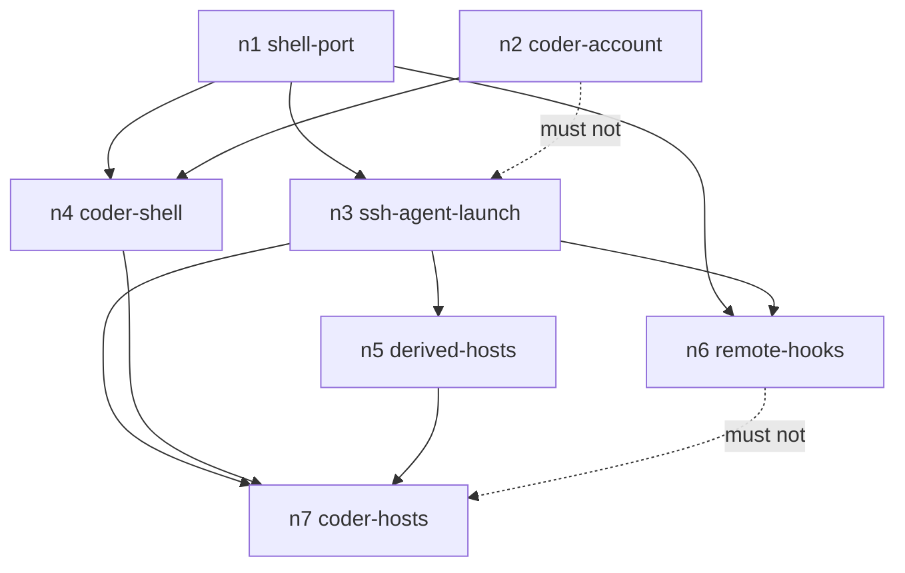
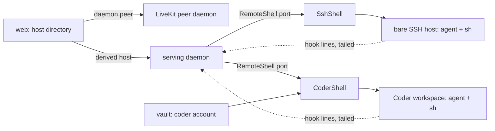

# Changeset: Connect a Coder deployment as an account

**Date**: 2026-11-15
**Status**: 🚧 In Progress
**Type**: Feature
**Complexity**: 4 — a proto contract change, two packages (daemon and web), an HTTP probe seam, a secret at rest
**Branch**: `feature/remote-shell/coder-account`, base `feature/remote-shell/shell-port` — `#remote-shell 2/7` — PR #916 (https://github.com/uppin/tddy-coder/pull/916)

## Initial Discovery

Full codebase exploration that grounded this plan: [initial-discovery.md](./2026-11-15-remote-shell-coder-account-initial-discovery.md).

State A below is distilled from that file. Do not duplicate grep traces or file dumps here.

## Prerequisites

No code issue in a touched package carries `Claimed by:` from another stack.

### ⚠ DURING — `service.rs` is past the file budget — [`packages/tddy-accounts/docs/code-issues/oversized-file-service.md`](../../../packages/tddy-accounts/docs/code-issues/oversized-file-service.md) and [`2026-10-21-tddy-accounts-service-rs-over-file-budget.md`](../todo/2026-10-21-tddy-accounts-service-rs-over-file-budget.md)

The file is at 772 production lines. This node adds one delegating RPC arm there and puts everything else in `coder_account.rs`. It must not add helpers to `service.rs`. Not split here.

### ⚠ DURING — Add account is shown on daemons that cannot link — [`2026-10-07-keyring-link-github-add-account-ungated.md`](../todo/2026-10-07-keyring-link-github-add-account-ungated.md)

The Coder form must not repeat it: it is shown only where `AccountsService` is registered, and a refusal is displayed, never hidden. The GitHub gap stays open.

### ℹ CONSIDERED — Warp runs only on the person's own sign-in — [`2026-10-24-warp-provider-account.md`](../todo/2026-10-24-warp-provider-account.md)

The closest analogue: a CLI tool's credential that has no model endpoint to probe. This node gives Coder its own intake with a probe that fits it instead of a preset, which is the shape that entry would also need. Not fixed here.

### ℹ CONSIDERED — The web's preset options mirror the daemon's table — [`2026-10-21-web-provider-preset-options-mirror-the-daemon-table.md`](../todo/2026-10-21-web-provider-preset-options-mirror-the-daemon-table.md)

Coder is not a preset, so this node adds nothing to either table.

## Affected Packages

- **tddy-service**: `proto/accounts.proto`: `rpc ConnectCoderAccount`, `ConnectCoderAccountRequest`, `ConnectCoderAccountResponse`
- **tddy-accounts**: new `src/coder_account.rs`: `CODER_PROVIDER`, `CoderAccount`, `CoderDeploymentProbe`, `HttpCoderDeploymentProbe`, `CoderAccountError`; `service.rs` delegates one RPC arm to it
- **tddy-client-web**: regenerated `accounts_pb`
- **tddy-workspace-web**: `src/accounts/ConnectCoderAccountForm.tsx`; `AccountsContent.tsx` renders the Coder group
- **tddy-daemon**: wiring: the probe is given to `AccountsServiceImpl`

## Related Feature Documentation

- [PRD-2026-11-15-remote-shell-coder-account.md](../../ft/daemon/1-WIP/PRD-2026-11-15-remote-shell-coder-account.md)
- [Provider accounts](../../ft/daemon/provider-accounts.md)
- [Accounts screen](../../ft/web/accounts-screen.md)
- [Credential sync](../../ft/daemon/credential-sync.md)

## Summary

A signed-in person connects a [Coder](https://github.com/coder/coder) deployment on the Accounts screen by entering its URL and a session token. The daemon checks the pair against the deployment, seals it in the person's credential vault as a `coder` account, and lists it beside their GitHub and provider accounts.

## Background

See the PRD.

## Responsibility

This PR owns:

- `ConnectCoderAccount` and its two messages.
- `tddy_accounts::coder_account`: `pub const CODER_PROVIDER: &str = "coder"`; `CoderAccount { account_id, label, deployment_url, username, user_id }` with `from_record(&CredentialRecord) -> Option<Self>` and `into_record(self, token: SecretString) -> CredentialRecord`; `trait CoderDeploymentProbe { async fn whoami(&self, url: &Url, token: &SecretString) -> Result<CoderUser, CoderProbeError>; }`; `HttpCoderDeploymentProbe`.
- `CoderAccounts::credentials_for(subject, account_id) -> Result<CoderCredentials, CoderAccountError>`, the read path later nodes use to get the URL and token of an open vault.
- `ConnectCoderAccountForm` and the Coder group on the Accounts screen.

## Boundaries

This PR does not:

- list workspaces, run anything on one, or start a session (`feature/remote-shell/coder-shell`, `feature/remote-shell/coder-hosts`);
- add `coder` to the model-provider preset table, the route matrix or `PROVIDER_PRESET_OPTIONS`;
- use the host's own `coder login`; the user chose the vault account on 2026-11-15;
- assign a Coder account to a project;
- split `service.rs`.

## Dependencies

None from this stack's behaviour. `feature/remote-shell/shell-port` is beneath this branch in the line only because a registered stack is linear; this PR consumes nothing it delivers and must not call `tddy-remote-shell`.

## Successor PRs

- `#remote-shell 3/7` — `feature/remote-shell/ssh-agent-launch` — a session whose agent runs on an SSH host
- `#remote-shell 4/7` — `feature/remote-shell/coder-shell` — coder workspaces as a remote-shell transport
- `#remote-shell 5/7` — `feature/remote-shell/derived-hosts` — sSH hosts as hosts derived from a daemon
- `#remote-shell 6/7` — `feature/remote-shell/remote-hooks` — a remote agent's hooks reach the daemon with nothing installed
- `#remote-shell 7/7` — `feature/remote-shell/coder-hosts` — coder workspaces as hosts that run sessions

## Draft PR contract

The first push after the plan (commit 2) publishes, as the start of this same PR:

- The proto RPC and messages, with the TypeScript regenerated.
- `coder_account.rs` with every signature; bodies `// TODO(coder-account): implement`.
- The service arm answering `unimplemented` through the new module.
- `ConnectCoderAccountForm` exported, rendering nothing yet.
- The failing tests below.

This PR goes on to implement all of it. It does not merge in that state.

## Contract as published

Published in the contract commit.

- **Proto**: `AccountsService.ConnectCoderAccount`, `ConnectCoderAccountRequest { session_token, deployment_url, token, label }`, `ConnectCoderAccountResponse { account }`. `accounts_pb.ts` is regenerated in `tddy-client-web` and `tddy-rust-typescript-tests` (`scripts/generated-code.sh write`). No residual-methods or roster list names accounts RPCs, so nothing was registered.
- **`tddy_accounts::coder_account`**: `CODER_PROVIDER`; `CoderDeploymentUrl` (`parse`, `as_str`, `host`); `CoderUser { id, username }`; `CoderProbeError::{Rejected, Unreachable, Unusable}`; `trait CoderDeploymentProbe { async fn whoami(&self, url: &CoderDeploymentUrl, token: &SecretString) }`; `CoderAccount { account_id, label, deployment_url, username, user_id }` with `for_user`, `from_record`, `into_record(self, token, now)`; `CoderCredentials { url, token }`; `CoderAccountError::{InvalidUrl, MissingToken, Rejected, Unreachable, NotFound, Vault}`; `CoderAccounts::{new(vaults, subject_of, probe), connect, credentials_for(subject, account_id)}`; `AccountsServiceImpl::with_coder_accounts`. Bodies are `TODO(coder-account)`.
- **`tddy_daemon::coder_deployment_probe::HttpCoderDeploymentProbe::new(reqwest::Client)`**.
- **Web**: `ConnectCoderAccountForm` (`ConnectCoderAccountInput { deploymentUrl, token, label }`), an empty shell section on `AccountsScreen`. Test ids: `accounts-connect-coder`, `accounts-coder-url`, `accounts-coder-token`, `accounts-coder-label`, `accounts-coder-submit`, `accounts-coder-error`.

Where the contract differs from the plan above:

- **The HTTP probe and its test are in `tddy-daemon`**, beside `provider_model_probe.rs`. `tddy-accounts` has no HTTP client by design ("this crate stays free of a network stack"), and putting the probe there would add `reqwest` to it. `packages/tddy-accounts/tests/coder_deployment_probe.rs` is therefore `packages/tddy-daemon/tests/coder_deployment_probe.rs`.
- **`CoderDeploymentUrl` replaces `url::Url`**: `tddy-accounts` has no `url` crate.
- **A third probe outcome, `Unusable`**: something answered, and it is not a Coder deployment. It is refused as its own cause, distinct from a rejected token.
- **`CoderAccounts` is a concrete type over `SessionVaults`**, because `credentials_for` is by subject. The acceptance tests seal a real vault in a temp directory.
- **Reconnecting keeps the first label** even when another is typed; the test pins it.
- **`service.rs` is 790 lines** (was 772): one delegating arm, one field, two imports. No helper was added.
- The daemon does not wire `with_coder_accounts` yet; that is implementation.

Red state at the contract commit: `coder_account_acceptance` 0 passed / 12 failed (the eight planned and four more: empty token, unwired daemon, locked-vault read, unknown account); `tddy-daemon` `coder_deployment_probe` 0 / 4; `coder_account.rs` unit tests 0 / 11 (the lib target's 29 existing tests pass); Cypress `ConnectCoderAccountAcceptance` 0 / 3, each waiting for `accounts-connect-coder`. The three existing accounts specs still pass (4, 14, 25). Clippy and fmt are clean on `tddy-accounts` and `tddy-daemon`. The full `tddy-daemon` suite was not run locally.

## Green wave

**Wave:** 1 of 4
**Greenable independently:** yes — the daemon tests drive this node's own RPC with a stand-in deployment; the web tests use an in-memory `AccountsService`
**Concurrent with:** `feature/remote-shell/shell-port`
**Blocks:** `coder-shell` (its workspace listing reads the account this node stores)

Real dependency edges, as opposed to the branch line:

    n1 → n3, n4, n6      n2 → n4      n3 → n5, n6, n7      n4 → n7      n5 → n7



Final design, all seven merged:



## Scope

- [x] **Codec and probe**: `CoderAccount`, `CoderDeploymentProbe`, the HTTP probe
- [x] **RPC**: `ConnectCoderAccount`, its refusals, reconnect replacing the token, `credentials_for`
- [x] **Web**: the Coder group and connect form
- [x] **Docs**: provider-accounts, accounts-screen, `packages/tddy-accounts/docs/`

## Technical Changes

### State A (Current)

- Vault records are `CredentialRecord { provider: ProviderId (open string), account, label, secret, metadata, updated_at, version }`, one vault file per signed-in GitHub subject, readable only while that vault is open.
- `accounts.proto` `AccountsService`: `ListAccounts`, `SetAccountLabel`, `RemoveAccount`, `BeginLinkAccount`, `PollLinkAccount`, `ConnectProviderAccount`, `ListProviderAccountModels`, `ListProviderRoutes`, `SetProviderAccountDefaults`. `AccountSummary` carries no secret.
- `ConnectProviderAccount { preset, label, api_key, anthropic_base_url, openai_base_url }` validates against `provider_account::presets()` and probes `/models`.
- `ProviderAccount::from_record` returns `None` for a non-preset record, so a `coder` record lists with empty preset fields.
- `tddy-screen-sharing` is the precedent for a provider that owns its own constant and record codec outside the preset table.
- Web: `tddy-workspace-web/src/accounts/{AccountsScreen,AccountsContent,ConnectProviderAccountForm}.tsx`; groups are keyed by `provider`.

### State B (Target)

```proto
rpc ConnectCoderAccount(ConnectCoderAccountRequest) returns (ConnectCoderAccountResponse);
message ConnectCoderAccountRequest { string session_token = 1; string deployment_url = 2; string token = 3; string label = 4; }
message ConnectCoderAccountResponse { AccountSummary account = 1; }
```

- The record: `provider = "coder"`, `account = "coder-<user_id>@<host>"`, `secret = token`, `metadata = { url, subject (username), subject_id (user id), probed_at }`.
- URL validation reuses the rules `ConnectProviderAccount` applies to an operator-supplied root.
- Refusals map to `INVALID_ARGUMENT` (URL, empty token), `UNAUTHENTICATED` (deployment rejected the token), `UNAVAILABLE` (unreachable), `FAILED_PRECONDITION` (vault not open).

### Delta (What's Changing)

See *Affected Packages* and *Responsibility*.

## Implementation Milestones

- [x] Codec round-trips a record
- [x] HTTP probe against a stand-in deployment
- [x] RPC with every refusal and the reconnect path
- [x] Web form and group
- [x] `./test -p tddy-accounts`, the one Cypress spec

## Testing Plan

### Testing Strategy

- **Daemon acceptance** in `tddy-accounts`: the real service over an open in-memory vault, with a stand-in `CoderDeploymentProbe`. One test drives `HttpCoderDeploymentProbe` against a local HTTP listener.
- **Web**: one Cypress component spec with `mountWithRpc` and an in-memory `AccountsService` backend.

No test uses LiveKit or a network service. Run `./test -p <package>` for each touched package; the whole-workspace result comes from CI.

### Coverage Requirements

Every acceptance criterion of the PRD has at least one named test below; each refusal and each distinct failure outcome has its own.

## Acceptance Tests

### tddy-accounts — `packages/tddy-accounts/tests/coder_account_acceptance.rs`
- `connecting_a_deployment_stores_a_coder_account_named_after_its_user`
- `a_connected_coder_account_lists_without_its_token`
- `a_token_the_deployment_rejects_is_refused_and_nothing_is_stored`
- `an_unreachable_deployment_is_refused_as_unavailable`
- `a_url_with_userinfo_or_a_query_is_refused`
- `reconnecting_the_same_user_replaces_the_token_and_keeps_the_label`
- `a_locked_vault_refuses_the_connect_as_a_precondition`
- `the_stored_url_and_token_are_readable_while_the_vault_is_open`

### tddy-accounts — `packages/tddy-accounts/tests/coder_deployment_probe.rs`
- `the_http_probe_sends_the_token_as_the_coder_session_header_and_reads_the_user`

### tddy-workspace-web — `packages/tddy-workspace-web/cypress/component/ConnectCoderAccountAcceptance.cy.tsx`
- `connects a Coder deployment and shows it under the Coder group`
- `shows the daemon's refusal beside the form and keeps what was typed`
- `never renders the token after the connect`

## Technical Debt & Production Readiness

(Populated during development.)

## Decisions & Trade-offs

- **Its own RPC, not a seventh preset.** A preset is a model endpoint with wire protocols and a route; Coder is neither.
- **The probe is an HTTP call, not the `coder` CLI.** Connecting an account then needs no CLI on the daemon host, and the probe is testable without a binary.
- **The vault account only.** The host's own `coder login` was offered as an alternative source and declined.
- **The token is readable only while the vault is open.** A later node that needs it for a running session holds it in memory for that session; nothing writes it to disk outside the vault.

## Refactoring Needed

### From /validate-changes
- None. No stubs remain (`TODO(coder-account)` gone), no `tddy-remote-shell` use, `## Dependencies` respected.

### From /validate-tests
- None. Rust acceptance tests use Given/When/Then, one behaviour per test, a stand-in deployment and a real temp-dir vault; the Cypress spec uses the `accountsScreenPage` page object and `mountWithRpc`-style in-memory backend, no raw `cy.get("[data-testid=...]")` for the flow under test.

### From /validate-prod-ready
- None. No mock/fake/stub in production paths, no `println!`/`eprintln!`/`dbg!`/`console.log` added, no TODO/FIXME left in the changed production files.

### From /analyze-clean-code
- `CoderAccounts::connect` (47 lines) and `HttpCoderDeploymentProbe::whoami` (48 lines) were over the 40-line acceptable band: fixed by extracting `account_error_of_probe` + `now_unix_seconds` (`coder_account.rs`) and `rejection_message` (`coder_deployment_probe.rs`). Both functions are now within 40 lines, behaviour unchanged.

## Restructuring (pr-wrap step 3.5)

File-length gate over the whole PR range (merge-base `bd6058210`), production lines counted to the first `#[cfg(test)]`:

| File | Before → after | Action |
|---|---|---|
| `packages/tddy-workspace-web/src/accounts/AccountsScreen.tsx` | 463 → 516, then split to 434 | 🔴 Decomposed in this PR: `ConnectCoder` and `ConnectApiKey` moved verbatim to `src/accounts/ConnectAccountControls.tsx` (93 lines). Green baseline before (`./test -p tddy-accounts -p tddy-daemon -p tddy-service`, 69 binaries, 0 failed), same green after for the web surface (Cypress `ConnectCoderAccountAcceptance` 3/3). |
| `packages/tddy-accounts/src/service.rs` | 772 → 790 | ⚠️ Not split here. This PR's own `## Boundaries` says it does not split `service.rs`, and the split is deferred by `docs/dev/todo/2026-10-21-tddy-accounts-service-rs-over-file-budget.md` to a follow-up branch after the stack lands. Recorded in `packages/tddy-accounts/docs/code-issues/oversized-file-service.md` (772 → 790). |
| `packages/tddy-rust-typescript-tests/gen/accounts_pb.ts` | 933 → 1006 | ⚠️ Alert only — generated by `scripts/generated-code.sh write`; generated output is never decomposed by hand. |

No successor PR's own commits modify `AccountsScreen.tsx`, `service.rs` or the generated file (checked against #917–#921 own commit ranges), so the `AccountsScreen` split does not cascade.

## Validation Results

### /validate-changes
- 2026-11-16, after `/pr-stack-rebase` single mode onto `feature/remote-shell/shell-port` `bd6058210`: leak check clean (`origin/<base>..HEAD` is this PR's 3 commits only). Build: `./test -p tddy-accounts -p tddy-daemon -p tddy-service` — 69 test binaries, 0 failed. Boundary: Responsibility delivered (codec, probe, RPC refusals, reconnect, `credentials_for`, web form/group all implemented and tested); Dependencies clean (nothing from `shell-port` consumed, no `tddy-remote-shell` call); Boundaries respected (no preset-table, route-matrix or project-assignment change; `service.rs` not split). Critical 0, Warning 0.

### /validate-tests
- 2026-11-16: 12 Rust acceptance tests in `coder_account_acceptance.rs`, 4 in `tddy-daemon/tests/coder_deployment_probe.rs`, 11 `coder_account` unit tests, 3 Cypress component tests — all passing in the scoped runs above. No always-passing, skipped, focused or order-dependent tests found.

### /validate-prod-ready
- 2026-11-16: changed production files checked — no mock code, no development fallback, no debug output, no leftover TODO/FIXME. ✅ Ready.

### /analyze-clean-code
- 2026-11-16: Score B before fixes (two functions in the 41–60 band), A after the extractions above. No function over 40 lines remains in the changed Rust files; no nesting over 3, no function over 5 parameters, no magic value requiring a constant beyond the named `PROBE_TIMEOUT` / `REFUSAL_BODY_LIMIT`.

## TODO

- [x] Record initial discovery (`2026-11-15-remote-shell-coder-account-initial-discovery.md`)
- [x] Cross-check `packages/*/docs/code-issues/` and `docs/dev/todo/` for items this change touches (Step 2b)
- [x] Create/update PRD documentation
- [x] Create changeset (this document)
- [x] Create failing acceptance tests
- [x] Run acceptance tests (verify they fail)
- [x] USER REVIEW — acceptance tests (approved in advance on 2026-11-15: "proceed with your recommended option"; the titles are listed in the PR body)
- [x] TDD Red — write failing unit/integration tests
- [x] TDD Green — implement with quality code
- [x] Update documentation with progress
- [x] Repeat Red→Green→Update cycle until feature complete
- [x] Run the touched packages' tests (`./test -p {package}` per package) — verify 100% pass
- [x] Validate changes (/validate-changes)
- [x] Refactor issues from change validation
- [x] USER REVIEW — development complete
- [x] Validate tests (/validate-tests)
- [x] Refactor test issues
- [x] Validate production readiness (/validate-prod-ready)
- [x] Refactor production readiness issues
- [x] Analyze code quality (/analyze-clean-code)
- [x] Refactor code quality issues
- [x] Final validation (/validate-changes)
- [x] Linting and formatting (`cargo clippy -p {package} -- -D warnings`, `cargo fmt`)
- [x] USER REVIEW — scope developed, every gap approved: ready to wrap
