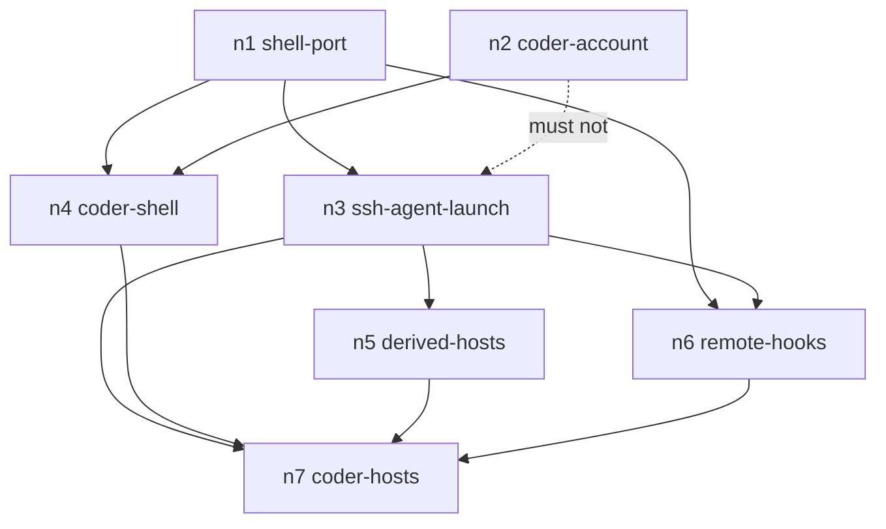
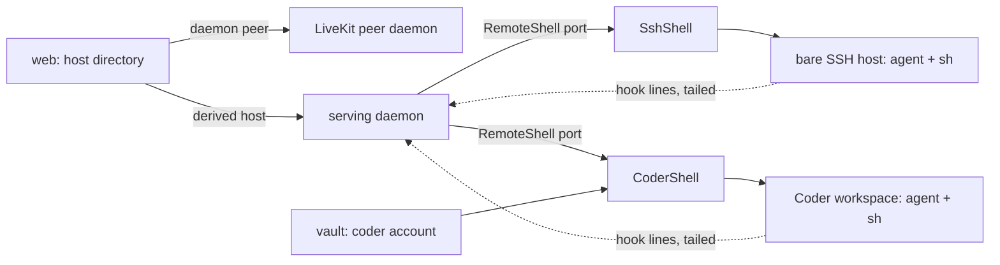

# Changeset: Coder workspaces as hosts that run sessions

**Date**: 2026-11-15
**Status**: 🚧 In Progress
**Type**: Feature
**Complexity**: 4 — a proto contract change, four packages across daemon and web, a credential resolved at launch and at resume
**Branch**: `feature/remote-shell/coder-hosts`, base `feature/remote-shell/remote-hooks` — `#remote-shell 7/7` — PR #921 (https://github.com/uppin/tddy-coder/pull/921)

## Initial Discovery

Full codebase exploration that grounded this plan: [initial-discovery.md](./2026-11-15-remote-shell-coder-hosts-initial-discovery.md).

State A below is distilled from that file. Do not duplicate grep traces or file dumps here.

## Prerequisites

No code issue in a touched package carries `Claimed by:` from another stack.

### ⚠ DURING — Project account assignment reaches one host — [`2026-10-14-project-account-assignment-reaches-one-host.md`](../todo/2026-10-14-project-account-assignment-reaches-one-host.md)

A Coder target names its account directly, not through a project assignment, so this node does not depend on that path and must not start to.

## Affected Packages

- **tddy-service**: `proto/session.proto`: `CoderTarget`, `SessionTarget.coder`; `proto/host.proto`: `DERIVED_HOST_KIND_CODER`, `DerivedHost.usable`, `DerivedHost.unusable_reason`
- **tddy-host-service**: `src/coder_derived_hosts.rs`: `CoderDerivedHosts` implementing `DerivedHostSource`
- **tddy-agent-launch**: `remote_agent_launch.rs`: the Coder arm of `shell_for_target`, given a `CoderCredentialSource`
- **tddy-session-lifecycle**: passes the caller's subject to the target resolution on start and resume
- **tddy-client-web**: regenerated `session_pb`, `host_pb`; the derived source carries `usable`
- **tddy-hosts-web**: `DerivedHostRows.tsx`: status and the unusable reason
- **tddy-session-create-web**: the Host field disables an unusable derived host and shows its reason

## Related Feature Documentation

- [PRD-2026-11-15-remote-shell-coder-hosts.md](../../ft/web/1-WIP/PRD-2026-11-15-remote-shell-coder-hosts.md)
- [Hosts screen](../../ft/web/hosts-screen.md)
- [Create-session package](../../ft/web/create-session-package.md)
- [Provider accounts](../../ft/daemon/provider-accounts.md)
- [Terminal sessions](../../ft/daemon/terminal-sessions.md)

## Summary

The workspaces of each connected Coder account appear as hosts derived from the daemon, with their status. Choosing a running one starts a session whose agent runs in that workspace, through the `coder` CLI, with nothing tddy-specific installed there.

## Background

See the PRD.

## Responsibility

This PR owns:

- `CoderTarget { account_id, owner, workspace, agent }` and the `coder` case of `SessionTarget`.
- The Coder arm of `shell_for_target`.
- `CoderDerivedHosts`, the `CODER` kind, `DerivedHost.usable` and `.unusable_reason`, the id scheme `<parent>/coder/<account_id>/<owner>/<workspace>`.
- The web's stopped and unusable states on derived hosts.
- Refusing a start or resume on a workspace that is stopped, or whose vault is locked.

## Boundaries

This PR does not:

- start, stop, create or delete a workspace;
- change the launch command, the hooks carrier or the follower;
- change `CoderShell`, the listing RPC or the account;
- add a Coder-specific path anywhere the SSH path already works through the port;
- show workspaces of accounts belonging to another signed-in person.

## Dependencies

What each parent PR delivers that this PR consumes. These surfaces are **theirs to create**;
implementing one here collides with the PR that owns it.

| Parent node | What it delivers | How this PR consumes it | This PR does NOT |
|---|---|---|---|
| `#remote-shell 3/7` `feature/remote-shell/ssh-agent-launch` | `SessionTarget`, `shell_for_target`, `launch_on_target`, the lifecycle of a target session | adds one `oneof` case and one match arm; everything after the shell is resolved is reused unchanged | add a second launch path, or change a refusal |
| `#remote-shell 4/7` `feature/remote-shell/coder-shell` | `CoderShell`, `CoderCredentialSource`, `CoderWorkspaceSource`, `ListCoderWorkspaces`, the CLI tooling probe | the launch arm builds a `CoderShell`; `CoderDerivedHosts` lists through `CoderWorkspaceSource` and reads the CLI probe | call the deployment or the CLI itself |
| `#remote-shell 5/7` `feature/remote-shell/derived-hosts` | `DerivedHostSource`, `ListDerivedHosts`, the web `derived` source, the grouped Host field, `DerivedHostRows` | registers a second `DerivedHostSource`; extends the rows with status | add a second listing RPC or a second directory source |
| `#remote-shell 2/7` `feature/remote-shell/coder-account` | the account, through `coder-shell` | account labels for row names, from `ListAccounts` | read the vault |
| `#remote-shell 6/7` `feature/remote-shell/remote-hooks` | an ancestor in the line only. Hooks work on a Coder target because they go through the port | one acceptance test observes a hook arriving | touch the carrier or the follower |

## Successor PRs

None. This is the top of the stack.

## Draft PR contract

The first push after the plan (commit 2) publishes, as the start of this same PR:

- The proto case, kind and two fields, with the TypeScript regenerated.
- `coder_derived_hosts.rs` with the type; `list` returning `// TODO(coder-hosts): implement`.
- The Coder arm of `shell_for_target` returning a `TargetError` marked `// TODO(coder-hosts): implement`.
- The failing tests below.

This PR goes on to implement all of it. It does not merge in that state.

## Contract as published

Published in the contract commit.

- **Proto**: `CoderTarget { account_id, owner, workspace, agent }` as `SessionTarget.coder = 2`; `DERIVED_HOST_KIND_CODER = 2`; `DerivedHost.usable = 6`, `DerivedHost.unusable_reason = 7`. Both `session_pb.ts` and `host_pb.ts` regenerated.
- **`tddy_changeset::SessionTarget::Coder { account_id, owner, workspace, agent: Option }`** with `SessionTarget::coder(..)` and `.on_agent(..)`. Real code; its tests pass.
- **`tddy_agent_launch::coder_target`** (`TODO(coder-hosts)`): `CoderTargetError::{NotACoderTarget, NoWorkspace, VaultLocked, NoSuchAccount, Unavailable}`, `NoCoderAccounts`, `shell_for_coder_target(target, subject, credentials)`, `shell_for_coder_target_through(coder_binary, …)`. `ssh-agent-launch`'s `shell_for_target` and `TargetError` are untouched.
- **`tddy_host_service::coder_derived_hosts`** (`TODO(coder-hosts)`): `CODER_CLI_NOT_INSTALLED`, `CoderAccountRef { account_id, label }`, `trait CoderAccountSource { fn accounts_of(&self, subject) }`, `coder_derived_host_id`, `coder_account_host_id`, `coder_host_label`, `workspace_not_running_reason`, `CoderDerivedHosts::new(parent_instance_id, subject, accounts, credentials, workspaces, coder_cli)`. `HostServiceImpl::{with_coder_accounts, coder_derived_hosts}`.
- **`DaemonSessionHost::with_coder_credentials`** and its accessor; the start and resume paths do not read it yet.
- **Web**: `usable` / `unusableReason` on `HostDescriptor` and `DaemonHost`; `derivedHostStatusTestId`, `derivedHostUnusableReasonTestId`.

Where the contract differs from the plan above:

- **A new port, `CoderAccountSource`.** Nothing in `coder-account` or `coder-shell` lists a subject's Coder accounts with their labels. The daemon adapter that fills it is implementation and needs its own test.
- **The source is built per call for one subject** and ignores the `os_user` passed to `list`; `derived-hosts`' trait is unchanged.
- **Refusals of a Coder target use `CoderTargetError`**, this PR's own type, so the parent's `TargetError` gains no variant.
- **`derived-hosts`' test helper `an_ssh_host` gained `usable: true`**: the new fields force the edit, and it pins that an SSH host is usable. `tddy_host_service::test_util` gained Coder stand-ins shared by three test files.

Decisions for the implementation:

- **Usability is read from the reason.** The web treats a derived host as unusable exactly when `unusable_reason` is non-empty, so a host from a daemon that does not know the fields, or from a fixture without them, stays usable. The daemon sets `usable` and the reason consistently.
- **No separate status field.** The status word travels in the reason (`the workspace is stopped`); the row shows `Available` / `Unavailable` and the reason.
- **An account that cannot be listed is one unusable row** (`<parent>/coder/<account_id>`, the account's label, the reason, no target), because a source returns either hosts or an error.
- **A locked vault answers `FAILED` with the reason and still carries the hosts of sources that listed.** That rule belongs to `derived-hosts`' handler and is recorded in that PR's changeset.
- **A stopped workspace is refused by the CLI's own complaint at launch**, not by asking the deployment before each start. With `coder-shell`'s start marker it arrives as `Unreachable` carrying that complaint.
- **A locked vault on resume** is `FailedPrecondition`, `the vault holding this session's Coder account is locked: unlock it and try again`, and the session is kept.
- The lifecycle tests assume a workspace's worktree sits under `default_remote_repo_root` as on an SSH target, created through the port.

Red state at the contract commit: `coder_agent_launch_acceptance` 0 passed / 4 failed, at this PR's `shell_for_coder_target_through`; `coder_target_session_acceptance` 0 / 3, because the start ignores `target` (`ssh-agent-launch`'s behaviour); `coder_derived_hosts_acceptance` 0 / 6, at `derived-hosts`' handler stub, with the same scenarios pinned at this PR's own stub by 12 unit tests; `coder_target.rs` unit tests 2 / 8; Cypress `CoderHostsAcceptance` 0 / 2 and `CreateSessionCoderHostAcceptance` 0 / 2, at `derived-hosts`' unimplemented rows and grouping. This PR goes green only after every PR below it. Clippy and fmt clean on the five touched Rust packages; `unbundle_service_split` passes (28). Fixtures are duplicated from the lower PRs' test files in four places; lifting them into shared support is the sweep's.

## Green wave

**Wave:** 4 of 4
**Greenable independently:** after `coder-shell` and `derived-hosts` are green: its tests list real workspaces through one and render through the other, and start through `ssh-agent-launch`. One launch test also watches a hook arrive, so `remote-hooks` must be green too
**Concurrent with:** none
**Blocks:** none

Real dependency edges, as opposed to the branch line:

    n1 → n3, n4, n6      n2 → n4      n3 → n5, n6, n7      n4 → n7      n5 → n7      n6 → n7



Final design, all seven merged:



## Scope

- [ ] **Target**: the Coder case, its resolution, the stopped and locked refusals, resume
- [ ] **Listing**: Coder derived hosts with status and usability
- [ ] **Web**: status, unusable state, account label
- [ ] **Docs**: hosts-screen, create-session-package, provider-accounts, terminal-sessions

## Technical Changes

### State A (Current)

After the six PRs below this one:

- `SessionTarget { oneof kind { SshTarget ssh = 1; } }`; `shell_for_target` resolves SSH; a target session launches, stops, resumes and delivers hooks through the port.
- `CoderShell`, `ListCoderWorkspaces`, `CoderCredentialSource`, the `coder` CLI probe.
- `ListDerivedHosts` with one source (`SshConfigDerivedHosts`); the web `derived` source, grouped Host field and `DerivedHostRows`.
- A derived host is always usable; there is no status on it.

### State B (Target)

```proto
message CoderTarget { string account_id = 1; string owner = 2; string workspace = 3; string agent = 4; }
message SessionTarget { oneof kind { SshTarget ssh = 1; CoderTarget coder = 2; } }
// DerivedHost: bool usable = 6; string unusable_reason = 7;   DerivedHostKind: DERIVED_HOST_KIND_CODER = 2
```

- `shell_for_target` takes the caller's subject. For a Coder target it asks `CoderCredentialSource` for the account and builds a `CoderShell`. Vault locked and unknown account are `TargetError`s that name the cause.
- `CoderDerivedHosts::list` lists every Coder account of the caller, then each account's workspaces. `usable = running && cli_installed`.
- One account failing (rejected token) marks that account's absence with a reason and does not hide another account's workspaces.

### Delta (What's Changing)

See *Affected Packages* and *Responsibility*.

## Implementation Milestones

- [ ] Proto and the resolution arm
- [ ] Start on a workspace through the stand-in `coder`
- [ ] Refusals: stopped, vault locked
- [ ] Coder derived hosts with usability
- [ ] Web states
- [ ] `./test -p` per touched package and the named Cypress specs

## Testing Plan

### Testing Strategy

- **Launch acceptance** in `tddy-agent-launch`: the target-session path with a stand-in `coder` executable and a stand-in credential source; the stub agent fires a hook.
- **Listing acceptance** in `tddy-host-service`: `CoderDerivedHosts` over stand-in sources.
- **Web**: Cypress component specs with in-memory backends.
- No real Coder deployment. The first run against one is manual and is listed as a risk.

No test uses LiveKit or a network service. Run `./test -p <package>` for each touched package; the whole-workspace result comes from CI.

### Coverage Requirements

Every acceptance criterion of the PRD has at least one named test below; each refusal and each distinct failure outcome has its own.

## Acceptance Tests

### tddy-agent-launch — `packages/tddy-agent-launch/tests/coder_agent_launch_acceptance.rs`
- `the_agent_runs_in_the_coder_workspace_named_by_the_target`
- `a_hook_fired_in_a_coder_workspace_reaches_the_daemon`
- `a_target_whose_vault_is_locked_fails_the_start_and_says_so`
- `a_target_naming_an_unknown_account_is_refused`

### tddy-session-lifecycle — `packages/tddy-session-lifecycle/tests/coder_target_session_acceptance.rs`
- `a_stopped_workspace_is_refused_as_a_target_with_that_reason`
- `a_resume_with_an_open_vault_restarts_the_agent_in_the_workspace`
- `a_resume_with_a_locked_vault_is_refused_and_the_session_is_kept`

### tddy-host-service — `packages/tddy-host-service/tests/coder_derived_hosts_acceptance.rs`
- `each_coder_accounts_workspaces_list_as_derived_hosts`
- `a_stopped_workspace_lists_as_unusable_with_its_status`
- `a_daemon_without_the_coder_cli_lists_workspaces_as_unusable_and_says_why`
- `a_locked_vault_fails_the_coder_listing_and_leaves_the_ssh_hosts_listed`
- `one_accounts_rejected_token_does_not_hide_another_accounts_workspaces`
- `same_named_workspaces_of_two_accounts_have_different_ids`

### tddy-hosts-web — `packages/tddy-hosts-web/cypress/component/CoderHostsAcceptance.cy.tsx`
- `lists a Coder workspace beneath its daemon with its account and status`
- `marks a stopped workspace and says why it cannot be used`

### tddy-session-create-web — `packages/tddy-session-create-web/cypress/component/CreateSessionCoderHostAcceptance.cy.tsx`
- `starts on the parent daemon with the workspace as the target`
- `does not let a stopped workspace be chosen`

## Technical Debt & Production Readiness

(Populated during development.)

## Decisions & Trade-offs

- **A Coder target names the account.** The workspace alone is ambiguous across deployments, and the launch needs to know whose vault to ask.
- **Stopped workspaces are shown, not hidden.** Hiding them would make a person think the account has none.
- **The resume needs the vault.** The token is not kept outside it. A locked vault is a refusal with a remedy, not a silent failure.
- **No workspace lifecycle.** Starting a workspace is slow, billable and Coder's own UI's job; it is recorded as a follow-up, not smuggled in.

## Refactoring Needed

### From /validate-changes
### From /validate-tests
### From /validate-prod-ready
### From /analyze-clean-code

## Validation Results

### /validate-changes
### /validate-tests
### /validate-prod-ready
### /analyze-clean-code

## TODO

- [x] Record initial discovery (`2026-11-15-remote-shell-coder-hosts-initial-discovery.md`)
- [x] Cross-check `packages/*/docs/code-issues/` and `docs/dev/todo/` for items this change touches (Step 2b)
- [x] Create/update PRD documentation
- [x] Create changeset (this document)
- [x] Create failing acceptance tests
- [x] Run acceptance tests (verify they fail)
- [x] USER REVIEW — acceptance tests (approved in advance on 2026-11-15: "proceed with your recommended option"; the titles are listed in the PR body)
- [x] TDD Red — write failing unit/integration tests
- [ ] TDD Green — implement with quality code
- [ ] Update documentation with progress
- [ ] Repeat Red→Green→Update cycle until feature complete
- [ ] Run the touched packages' tests (`./test -p {package}` per package) — verify 100% pass
- [ ] Validate changes (/validate-changes)
- [ ] Refactor issues from change validation
- [ ] USER REVIEW — development complete
- [ ] Validate tests (/validate-tests)
- [ ] Refactor test issues
- [ ] Validate production readiness (/validate-prod-ready)
- [ ] Refactor production readiness issues
- [ ] Analyze code quality (/analyze-clean-code)
- [ ] Refactor code quality issues
- [ ] Final validation (/validate-changes)
- [ ] Linting and formatting (`cargo clippy -p {package} -- -D warnings`, `cargo fmt`)
- [ ] USER REVIEW — scope developed, every gap approved: ready to wrap
