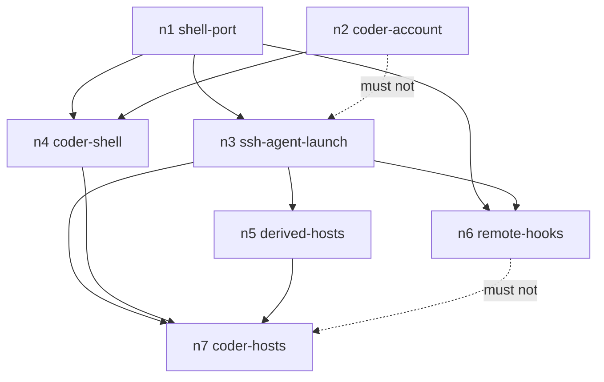
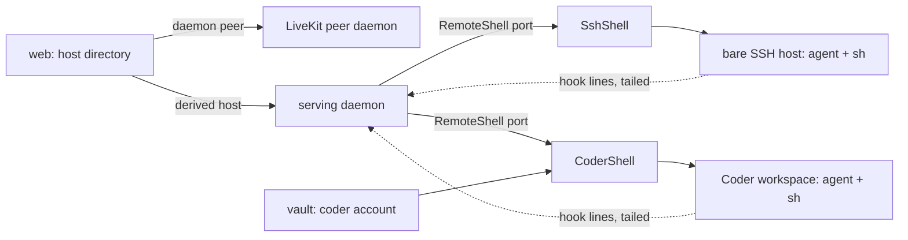

# Changeset: Coder workspaces as a remote-shell transport

**Date**: 2026-11-15
**Status**: 🚧 In Progress
**Type**: Feature
**Complexity**: 4 — two crates plus a proto contract change, a spawned-process seam (`coder` CLI), an HTTP seam, a secret passed to a child process
**Branch**: `feature/remote-shell/coder-shell`, base `feature/remote-shell/ssh-agent-launch` — `#remote-shell 4/7` — PR #918 (https://github.com/uppin/tddy-coder/pull/918)

## Initial Discovery

Full codebase exploration that grounded this plan: [initial-discovery.md](./2026-11-15-remote-shell-coder-shell-initial-discovery.md).

State A below is distilled from that file. Do not duplicate grep traces or file dumps here.

## Prerequisites

No code issue in a touched package carries `Claimed by:` from another stack.

### ⚠ DURING — `unlock_and_add` complexity in `host_messages` — [`packages/tddy-host-service/docs/code-issues/complexity-host-messages-unlock-and-add.md`](../../../packages/tddy-host-service/docs/code-issues/complexity-host-messages-unlock-and-add.md)

Not touched. The new handler lives in `coder_workspaces.rs`.

## Affected Packages

- **tddy-remote-shell**: new `src/coder.rs`: `CoderShell`, `CoderCredentials`, `CoderWorkspaceRef`
- **tddy-service**: `proto/host.proto`: `rpc ListCoderWorkspaces`, `CoderWorkspace`, `HostCoderCli` on the tooling response
- **tddy-host-service**: new `src/coder_workspaces.rs`: `CoderWorkspaceSource`, `HttpCoderWorkspaceSource`, the `CoderCredentialSource` port; the tooling probe
- **tddy-daemon**: wiring: `CoderCredentialSource` filled from `tddy_accounts::CoderAccounts`
- **tddy-client-web**: regenerated `host_pb`

## Related Feature Documentation

- [PRD-2026-11-15-remote-shell-coder-shell.md](../../ft/daemon/1-WIP/PRD-2026-11-15-remote-shell-coder-shell.md)
- [Provider accounts](../../ft/daemon/provider-accounts.md)
- [Hosts screen tooling](../../ft/web/hosts-screen-tooling.md)

## Summary

A Coder workspace becomes the second transport of the remote-shell port, driven by the `coder` CLI on the daemon's host with the account's URL and token. The daemon also lists the workspaces a Coder account can reach, with their status.

## Background

See the PRD.

## Responsibility

This PR owns:

- `tddy_remote_shell::coder`: `CoderShell::new(credentials, workspace)` / `::through(coder_binary, …)`; `CoderCredentials { url, token: SecretString }`; `CoderWorkspaceRef { owner, name, agent: Option<String> }`.
- `ListCoderWorkspaces(session_token, daemon_instance_id, account_id)` and its response with a `ProbeOutcome`, a reason and `repeated CoderWorkspace { owner, name, status, running }`.
- `tddy_host_service::coder_workspaces`: `trait CoderCredentialSource`, `trait CoderWorkspaceSource`, the HTTP implementation.
- `HostCoderCli { installed, version }` in `GetHostTooling`.

## Boundaries

This PR does not:

- start, stop or create a workspace. A stopped workspace is reported, not started;
- start a session on a workspace, or add a Coder case to `SessionTarget` (`feature/remote-shell/coder-hosts`);
- show workspaces in the host directory or the Hosts screen (`feature/remote-shell/coder-hosts`);
- store, validate or connect an account: that is `coder-account`'s;
- change `RemoteShell`, `SshShell` or the contract suite: those are `shell-port`'s.

## Dependencies

What each parent PR delivers that this PR consumes. These surfaces are **theirs to create**;
implementing one here collides with the PR that owns it.

| Parent node | What it delivers | How this PR consumes it | This PR does NOT |
|---|---|---|---|
| `#remote-shell 1/7` `feature/remote-shell/shell-port` | the `RemoteShell` trait, `RemoteShellError`, `InteractiveCommand`, the `contract` suite and the stand-in-executable test pattern | `CoderShell` implements the trait and is run through `contract::assert_behaves_like_a_remote_shell` | add or change a trait method, an error variant or a contract assertion |
| `#remote-shell 2/7` `feature/remote-shell/coder-account` | `CoderAccount`, `CoderAccounts::credentials_for(subject, account_id)`, the `coder` vault record | the daemon fills `CoderCredentialSource` from `credentials_for`; the listing and the shell take what it returns | read the vault directly, define the record codec, or add a connect path |

## Successor PRs

- `#remote-shell 5/7` — `feature/remote-shell/derived-hosts` — sSH hosts as hosts derived from a daemon
- `#remote-shell 6/7` — `feature/remote-shell/remote-hooks` — a remote agent's hooks reach the daemon with nothing installed
- `#remote-shell 7/7` — `feature/remote-shell/coder-hosts` — coder workspaces as hosts that run sessions

## Draft PR contract

The first push after the plan (commit 2) publishes, as the start of this same PR:

- `coder.rs` with every signature; bodies `// TODO(coder-shell): implement`.
- The proto RPC, messages and tooling field, with the TypeScript regenerated.
- `coder_workspaces.rs` with the two ports; the handler answering `unimplemented`.
- The failing tests below.

This PR goes on to implement all of it. It does not merge in that state.

## Contract as published

Published in the contract commit.

- **`tddy_remote_shell::coder`** (`TODO(coder-shell)` bodies): `CoderCredentials { url: String, token: SecretString }`; `CoderWorkspaceRef { owner, name, agent }` (`new`, `on_agent`, `Display` as `<owner>/<name>[.<agent>]`); `CoderShell::{new, through}`, `TRANSPORT = "coder"`, `URL_VARIABLE = "CODER_URL"`, `SESSION_TOKEN_VARIABLE = "CODER_SESSION_TOKEN"`. `tddy-remote-shell` gains a dependency on the leaf crate `tddy-credentials` for `SecretString`.
- **Proto**: `HostService.ListCoderWorkspaces`, `ListCoderWorkspacesRequest { session_token, daemon_instance_id, account_id }`, `ListCoderWorkspacesResponse { outcome, failure_reason, workspaces }`, `CoderWorkspace { owner, name, status, running }`, `HostCoderCli { installed, version }` as `GetHostToolingResponse.coder_cli = 6`. `host_pb.ts` regenerated. `HOST_METHODS` in `unbundle_service_split.rs` names the new method.
- **`tddy_host_service::coder_workspaces`**: `trait CoderCredentialSource { fn credentials_for(&self, subject, account_id) }`, `CoderCredentialError::{VaultLocked, NoSuchAccount, Unavailable}`, `CoderWorkspace { owner, name, status }` with `is_running`, `trait CoderWorkspaceSource { async fn workspaces(&self, credentials) }`, `CoderWorkspaceListError::{Rejected, Unreachable, Unusable}`; `HostServiceImpl::{with_coder_credentials, with_coder_workspaces}`; the handler in `src/service/coder_workspaces.rs`. `host_tooling`: `CoderCliStatus`, `classify_coder_version`.
- **`tddy_daemon::coder_workspace_source::HttpCoderWorkspaceSource::new(reqwest::Client)`**.

Where the contract differs from the plan above:

- **The HTTP workspace source and its test are in `tddy-daemon`**; `tddy-host-service` has no HTTP client. The host-service tests use a stand-in `CoderWorkspaceSource`.
- **One `CoderCredentials`**, owned by `tddy-remote-shell` and re-exported by `tddy-host-service`. `tddy_accounts::CoderCredentials` is `coder-account`'s and is converted by the daemon's adapter.
- **`running` is derived** from `status == "running"`.
- **The daemon wiring is implementation**: the `CoderCredentialSource` adapter over `CoderAccounts::credentials_for`, the mapping of its errors to `VaultLocked` / `NoSuchAccount` / `Unavailable`, and the `with_coder_*` calls in `runtime/mount_host.rs`. The adapter needs its own test.

Decision for the implementation — telling a stopped workspace from a failed command:

- `coder ssh` exits 1 both when the workspace cannot be entered and when the remote command exits 1. OpenSSH's 255 has no equivalent. The contract suite requires a failed command to be `Ok` with its status (or `Exited`), and `a_stopped_workspace_is_unreachable_not_a_failed_command` requires `Unreachable`.
- **`CoderShell` wraps the remote command with a start marker**: the wrapper prints a fixed marker line to stderr before running the command. A non-zero exit with no marker is `Unreachable`, carrying the CLI's stderr; with the marker it is the command's own result, and the marker is removed from the returned stderr. The test pins only the argv prefix `ssh --disable-autostart ada/devbox.main -- sh -c `, which leaves room for it.
- The CLI's own error text is **not** matched: it is unverified and may change.

Unverified against a real `coder` CLI or deployment, and pinned only by the stand-in: that arguments after `--` are joined for the workspace's shell; the `owner/name.agent` form; the two environment variables; `coder version`'s output; the `latest_build.status` values.

Red state at the contract commit: `coder_shell_acceptance` 0 passed / 6 failed; `coder.rs` unit tests 1 / 3; `coder_workspaces_acceptance` 0 / 9 (six planned and three more: unknown account, no session, unknown host); `tddy-host-service` lib 182 / 3; `tddy-daemon` `coder_workspace_source` 0 / 6. Every failure is this PR's own stub. `unbundle_service_split` passes (28). Clippy and fmt are clean on the four packages. The other `tddy-host-service` integration binaries and the full `tddy-daemon` suite were not run locally.

## Green wave

**Wave:** 2 of 4
**Greenable independently:** after `coder-account` is green: the listing reads a stored account through that node's `credentials_for`. The shell half needs only `shell-port`'s contract suite
**Concurrent with:** `feature/remote-shell/ssh-agent-launch`
**Blocks:** `coder-hosts` (it lists and runs on workspaces through this node)

Real dependency edges, as opposed to the branch line:

    n1 → n3, n4, n6      n2 → n4      n3 → n5, n6, n7      n4 → n7      n5 → n7

Final design, all seven merged:

## Scope

- [x] **Transport**: `CoderShell` passing the contract suite
- [x] **Listing**: `ListCoderWorkspaces` with its distinct outcomes
- [x] **Tooling**: the `coder` CLI probe
- [ ] **Docs**: `packages/tddy-remote-shell/docs/`, provider-accounts, hosts-screen-tooling

## Technical Changes

### State A (Current)

- After `shell-port`: `RemoteShell` with `SshShell` and `InMemoryShell`, and a contract suite a transport can run.
- After `coder-account`: a `coder` vault record and `CoderAccounts::credentials_for`.
- `HostService.ListSshConfigHosts(session_token, daemon_instance_id)` answers `ProbeOutcome`, `failure_reason`, `hosts[]`, keeping OK-empty apart from FAILED. It is routed to a peer by `daemon_instance_id`.
- `GetHostTooling` reports git, the GitHub CLI (`HostGithubCli { outcome, installed, authenticated, login }`), the ssh-agent and remote desktop. Probes run as the OS user and scrub GitHub token variables.
- Nothing in the repository names Coder.

### State B (Target)

- `CoderShell::exec` runs `coder ssh <owner>/<name>[.<agent>] -- sh -c '<command>'` with the two variables set on the child. `interactive` is the same client without the one-shot wrapper, for a local PTY. The exact flags are confirmed against the `coder` CLI in pass 2 and recorded in the discovery file.
- A workspace that is stopped or whose agent is disconnected is `RemoteShellError::Unreachable`.
- The listing calls `GET /api/v2/workspaces?q=owner:me` with the `Coder-Session-Token` header.
- `ListCoderWorkspaces` outcomes: `OK` (possibly empty), `FAILED` with a reason that distinguishes vault locked, token rejected and deployment unreachable.

### Delta (What's Changing)

See *Affected Packages* and *Responsibility*.

## Implementation Milestones

- [x] `CoderShell` exec and streamed exec through the stand-in `coder`
- [x] Interactive command
- [x] Contract suite green
- [x] Listing against a stand-in deployment, each outcome
- [x] Tooling probe
- [x] `./test -p tddy-remote-shell -p tddy-host-service`

## Testing Plan

### Testing Strategy

- **Transport**: the shared contract suite plus Coder-specific cases, against a stand-in `coder` executable that records its environment and runs the command locally.
- **Listing**: the real handler with a stand-in `CoderCredentialSource` and a local HTTP listener standing for the deployment.
- No real Coder deployment in any test. That gap is stated as a risk: the first run against a real deployment is manual.

No test uses LiveKit or a network service. Run `./test -p <package>` for each touched package; the whole-workspace result comes from CI.

### Coverage Requirements

Every acceptance criterion of the PRD has at least one named test below; each refusal and each distinct failure outcome has its own.

## Acceptance Tests

### tddy-remote-shell — `packages/tddy-remote-shell/tests/coder_shell_acceptance.rs`
- `the_coder_shell_behaves_like_a_remote_shell`
- `a_command_runs_on_the_named_workspace`
- `the_deployment_url_and_token_reach_only_the_coder_process`
- `the_interactive_command_opens_a_terminal_on_the_workspace`
- `a_stopped_workspace_is_unreachable_not_a_failed_command`
- `a_missing_coder_cli_is_a_spawn_failure_that_names_it`

### tddy-host-service — `packages/tddy-host-service/tests/coder_workspaces_acceptance.rs`
- `an_accounts_workspaces_list_with_their_status`
- `an_account_with_no_workspaces_lists_empty_and_ok`
- `a_locked_vault_fails_the_listing_and_says_so`
- `a_token_the_deployment_rejects_fails_the_listing_and_says_so`
- `an_unreachable_deployment_fails_the_listing_and_says_so`
- `the_tooling_report_says_whether_the_coder_cli_is_installed`

## Technical Debt & Production Readiness

(Populated during development.)

## Decisions & Trade-offs

- **The CLI for the shell, HTTP for the listing.** The shell needs `coder ssh`'s connection handling; a listing needs one request and should work on a host where the CLI is missing, so the operator sees workspaces and the reason they cannot be used.
- **Credentials in the child's environment.** That is how the CLI takes them without a `coder login` on disk. They are set on that one process and scrubbed from every other probe, as the GitHub token variables are.
- **The token is held in memory for a shell's lifetime.** A vault that locks does not cut a running session; a new shell after a lock is refused with that reason.
- **No real deployment in CI.** The CLI's flags are pinned by the stand-in; a version that changes them breaks at run time, not in a test.

## Refactoring Needed

### From /validate-changes
### From /validate-tests
### From /validate-prod-ready
### From /analyze-clean-code

## Validation Results

### /validate-changes
### /validate-tests
### /validate-prod-ready
### /analyze-clean-code

## TODO

- [x] Record initial discovery (`2026-11-15-remote-shell-coder-shell-initial-discovery.md`)
- [x] Cross-check `packages/*/docs/code-issues/` and `docs/dev/todo/` for items this change touches (Step 2b)
- [x] Create/update PRD documentation
- [x] Create changeset (this document)
- [x] Create failing acceptance tests
- [x] Run acceptance tests (verify they fail)
- [x] USER REVIEW — acceptance tests (approved in advance on 2026-11-15: "proceed with your recommended option"; the titles are listed in the PR body)
- [x] TDD Red — write failing unit/integration tests
- [x] TDD Green — implement with quality code
- [ ] Update documentation with progress
- [ ] Repeat Red→Green→Update cycle until feature complete
- [x] Run the touched packages' tests (`./test -p {package}` per package) — verify 100% pass
- [ ] Validate changes (/validate-changes)
- [ ] Refactor issues from change validation
- [ ] USER REVIEW — development complete
- [ ] Validate tests (/validate-tests)
- [ ] Refactor test issues
- [ ] Validate production readiness (/validate-prod-ready)
- [ ] Refactor production readiness issues
- [ ] Analyze code quality (/analyze-clean-code)
- [ ] Refactor code quality issues
- [ ] Final validation (/validate-changes)
- [ ] Linting and formatting (`cargo clippy -p {package} -- -D warnings`, `cargo fmt`)
- [ ] USER REVIEW — scope developed, every gap approved: ready to wrap
