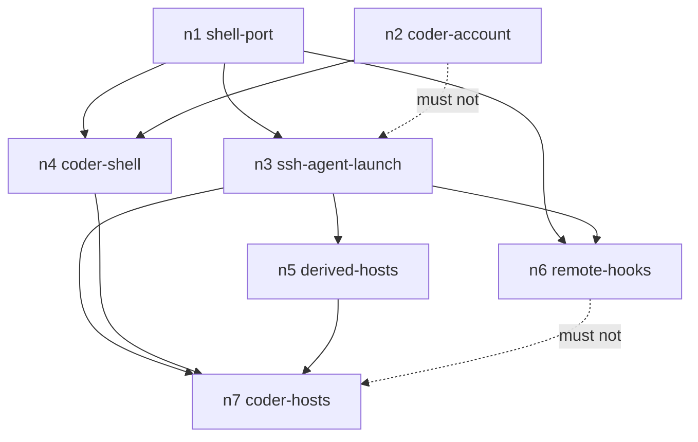
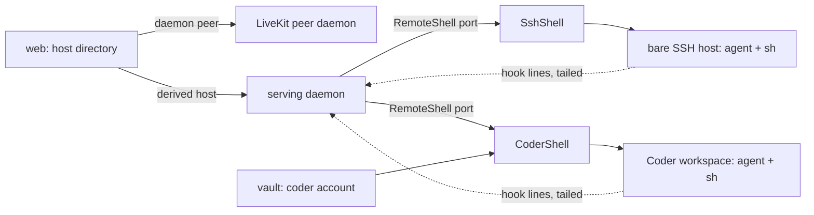

# Changeset: SSH hosts as hosts derived from a daemon

**Date**: 2026-11-15
**Status**: 🚧 In Progress
**Type**: Feature
**Complexity**: 4 — a proto contract change, four packages across daemon and web, a new host-directory source
**Branch**: `feature/remote-shell/derived-hosts`, base `feature/remote-shell/coder-shell` — `#remote-shell 5/7` — PR #919 (https://github.com/uppin/tddy-coder/pull/919)

## Initial Discovery

Full codebase exploration that grounded this plan: [initial-discovery.md](./2026-11-15-remote-shell-derived-hosts-initial-discovery.md).

State A below is distilled from that file. Do not duplicate grep traces or file dumps here.

## Prerequisites

No code issue in a touched package carries `Claimed by:` from another stack. `tddy-hosts-web`, `tddy-session-create-web` and `tddy-client-web` have no `docs/code-issues/` directory: they have not been analysed.

### ⚠ DURING — `host_id` should become a field of `DaemonAdvertisement` — [`2026-09-06-host-id-should-become-a-field-of-daemonadvertisement.md`](../todo/2026-09-06-host-id-should-become-a-field-of-daemonadvertisement.md)

A derived host's id embeds its parent's durable id. This node must take the parent id from `KnownHostEntry.instance_id`, the same value per-host RPCs are keyed on, and not from the advertisement. Not fixed here.

### ℹ CONSIDERED — A spawner reads only children on its own host — [`2026-10-29-spawner-read-scope-is-same-host-only.md`](../todo/2026-10-29-spawner-read-scope-is-same-host-only.md)

A session on a derived host is owned by the parent daemon, so it is in the same host's scope. This node does not widen or narrow that entry.

## Affected Packages

- **tddy-service**: `proto/host.proto`: `rpc ListDerivedHosts`, `DerivedHost`, `DerivedHostKind`
- **tddy-host-service**: new `src/derived_hosts.rs`: `DerivedHostSource`, `SshConfigDerivedHosts`; the handler
- **tddy-client-web**: `hostDirectory/derivedSource.ts`; `types.ts`: `HostDescriptor.parent`, `HostDescriptor.target`; regenerated `host_pb`
- **tddy-hosts-web**: `DerivedHostRows.tsx`; the Hosts screen renders them
- **tddy-session-create-web**: `CreateSessionHostField` groups; `useCreateSessionPlacement` carries the target into the request
- **tddy-session-web**: the drawer's host badge reads `SessionEntry.target`
- **tddy-web**: `selectedDaemon.tsx` registers the source

## Related Feature Documentation

- [PRD-2026-11-15-remote-shell-derived-hosts.md](../../ft/web/1-WIP/PRD-2026-11-15-remote-shell-derived-hosts.md)
- [Hosts screen](../../ft/web/hosts-screen.md)
- [Create-session package](../../ft/web/create-session-package.md)
- [Daemon selector](../../ft/web/daemon-selector-livekit-rpc.md)
- [Client ports package](../../ft/web/client-ports-package.md)

## Summary

The machines a daemon can reach through a remote shell appear as **hosts** of their own: in the Host field when starting a session, and on the Hosts screen under the daemon that reaches them. SSH config aliases are the first kind. Choosing one starts a session whose agent runs there.

## Background

See the PRD.

## Responsibility

This PR owns:

- `ListDerivedHosts(session_token, daemon_instance_id)` answering `ProbeOutcome`, a reason and `repeated DerivedHost { id, label, kind, parent_instance_id, SessionTarget target }`.
- `tddy_host_service::derived_hosts`: `trait DerivedHostSource { fn kind(&self) -> DerivedHostKind; async fn list(&self, os_user) -> Result<Vec<DerivedHost>, String>; }` and `SshConfigDerivedHosts`.
- The web `derived` host-directory source, `HostDescriptor.parent` and `.target`.
- The grouped Host field, the Hosts screen's derived rows, the drawer badge.
- The id scheme `<parent_instance_id>/ssh/<alias>`.

## Boundaries

This PR does not:

- add Coder workspaces as derived hosts (`feature/remote-shell/coder-hosts`);
- probe a derived host for reachability, telemetry or tooling;
- persist derived hosts in `known-hosts.json`; they are listed live from their source;
- rename LiveKit wire fields or change peer routing;
- launch anything: starting on a target is `ssh-agent-launch`'s;
- change `ListSshConfigHosts` or the managed-mode SSH select.

## Dependencies

What each parent PR delivers that this PR consumes. These surfaces are **theirs to create**;
implementing one here collides with the PR that owns it.

| Parent node | What it delivers | How this PR consumes it | This PR does NOT |
|---|---|---|---|
| `#remote-shell 3/7` `feature/remote-shell/ssh-agent-launch` | `SessionTarget` / `SshTarget`, `StartSessionRequest.target`, `SessionEntry.target`, and a start that runs the agent on the target | `DerivedHost.target` is a `SessionTarget`; the create form puts it on the request; the drawer reads it from the entry | add a case to `SessionTarget`, change the launch, or relax a refusal |
| `#remote-shell 1/7` `feature/remote-shell/shell-port` | nothing directly; it is an ancestor through `ssh-agent-launch` | — | call the port |

## Successor PRs

- `#remote-shell 6/7` — `feature/remote-shell/remote-hooks` — a remote agent's hooks reach the daemon with nothing installed
- `#remote-shell 7/7` — `feature/remote-shell/coder-hosts` — coder workspaces as hosts that run sessions

## Draft PR contract

The first push after the plan (commit 2) publishes, as the start of this same PR:

- The proto RPC and messages, with the TypeScript regenerated.
- `derived_hosts.rs` with the trait; the handler answering `unimplemented`.
- `derivedSource.ts` and the two `HostDescriptor` fields, the source returning nothing.
- The failing tests below.

This PR goes on to implement all of it. It does not merge in that state.

## Contract as published

Published in the contract commit.

- **Proto**: `host.proto` imports `session.proto`. `HostService.ListDerivedHosts`; `DerivedHostKind { UNSPECIFIED, SSH }`; `DerivedHost { id, label, kind, parent_instance_id, session.SessionTarget target }`; `ListDerivedHostsRequest { session_token, daemon_instance_id }`; `ListDerivedHostsResponse { outcome, failure_reason, hosts }`. `host_pb.ts` regenerated. `HOST_METHODS` names the method.
- **`tddy_host_service::derived_hosts`** (`TODO(derived-hosts)` bodies): `kind_segment`, `ssh_derived_host_id(parent_instance_id, alias)`, `trait DerivedHostSource { fn kind(); async fn list(os_user) }`, `SshConfigDerivedHosts::new(files, parent_instance_id)`. The trait and source use the wire `DerivedHost` directly. The handler is `src/service/derived_hosts.rs`.
- **`tddy-client-web`**: `hostDirectory/derivedSource.ts` with `DERIVED_SOURCE_ID`, `DerivedHostParent`, `DerivedHostListingFailure`, `DerivedHostDirectorySource`, `NO_DERIVED_HOSTS`, `derivedHostDescriptorOf`, `listDerivedHosts(parents, sessionToken)`; `HostDescriptor.parent` and `.target`.
- **`tddy-hosts-web`**: `DerivedHostRows({ parentInstanceId, parentOnline })`, mounted in `HostsScreen` after each daemon's row and rendering nothing yet; `derivedHostRowTestId`, `derivedHostsFailureTestId`.

Where the contract differs from the plan above:

- **The proto import needed a build change** in `packages/tddy-service/build/unbundled_families.rs`: the host prost and tonic passes take `.extern_path(".session", …)` and `.extern_path(".types", …)`, so the host pass does not write a second `session.rs` into `OUT_DIR`. `tddy-service` is therefore an affected package of this PR.
- **`DaemonHost` (the clients port) also carries `parent` and `target`**, not only `HostDescriptor`: the create form reads hosts from that port, so a derived host cannot reach the Host field otherwise. `daemonHostOf` / `hostDescriptorOf` drop the fields until implemented; two unit tests pin that.
- **`listDerivedHosts` is an async function, not a hook, and `selectedDaemon.tsx` does not register it yet.** Registration needs each parent's `HostConnection` above `ConnectionProviders`; that is implementation, and it has no test here. The implementation adds one where the wiring lands.
- **`tddy-session-create-web` and `tddy-session-web` have no `src` change yet**: their specs mount the existing pane and drawer and fail on assertions. Test ids fixed by the specs: `create-session-derived-host-note`, `sessions-drawer-item-derived-host-<session id>`, `hosts-derived-row-<parent>_ssh_<alias>`, `hosts-row-<parent>-derived-hosts-failure`.
- **The start test duplicates the stand-in SSH target** from `ssh-agent-launch`'s test file, which keeps it inside the file. Lifting it into a shared support module is that PR's to do, or the sweep's.

Sequencing: `a_start_addressed_at_a_listed_derived_host_runs_on_that_host` fails here on the listing stub. Its start half runs `ssh-agent-launch`'s behaviour, so it goes green only after that PR and `shell-port` are.

Red state at the contract commit: `derived_hosts_acceptance` 0 passed / 4 failed; `derived_hosts.rs` unit tests 0 / 7; handler tests 0 / 2; `derived_host_start_acceptance` 0 / 1; `derivedSource.test.ts` 0 / 7 (three planned, four more); Cypress `DerivedHostsAcceptance` 0 / 3, `CreateSessionDerivedHostAcceptance` 0 / 3, `SessionDrawerDerivedHostAcceptance` 0 / 1. The two existing HostsScreen specs pass (6, 2); `unbundle_service_split` passes (28). Clippy and fmt clean on `tddy-service`, `tddy-host-service`, `tddy-session-lifecycle`; typecheck clean on `tddy-client-web` and `tddy-hosts-web`. Not run locally: the other specs of the create-session and session-web packages, and any crate outside the three built; whether another crate implements the `HostService` trait is CI's to show.

## Green wave

**Wave:** 3 of 4
**Greenable independently:** after `ssh-agent-launch` is green: the start test creates a real session on a target
**Concurrent with:** `feature/remote-shell/remote-hooks`
**Blocks:** `coder-hosts` (it adds Coder workspaces to this node's listing and rows)

Real dependency edges, as opposed to the branch line:

    n1 → n3, n4, n6      n2 → n4      n3 → n5, n6, n7      n4 → n7      n5 → n7



Final design, all seven merged:



## Scope

- [ ] **Listing**: `ListDerivedHosts` from the SSH config, with its failure outcome
- [ ] **Directory**: the `derived` source and descriptor fields
- [ ] **Web**: grouped Host field, Hosts screen rows, drawer badge
- [ ] **Docs**: hosts-screen, create-session-package, daemon-selector, client-ports-package

## Technical Changes

### State A (Current)

- `HostService.ListKnownHosts` reads `known-hosts.json` and the live roster; `KnownHostEntry { instance_id, label, online, …, is_local }`. Rows are daemons only.
- `ListSshConfigHosts(daemon_instance_id)` answers explicit aliases; the web uses it for the managed-mode SSH select (`CreateSessionSshConfigSelect.tsx`).
- Web host directory (`tddy-client-web/src/hostDirectory`): `HostDirectorySource`, merged in `useHostDirectory`. Two sources: `livekit` (`tddy-livekit-web/src/presence/liveKitSource.ts`) and `serving` (`tddy-web/src/app/rpc/hostDirectory/servingSource.ts`). `HostDescriptor` has no parent.
- `SelectedDaemonProvider` feeds `DaemonSelector` and `CreateSessionHostField`. A host is remote when its id differs from the serving daemon's.
- `HostConnection.capabilities` is `rpc | media | presence`; per-host RPCs go through `useHostClient(Service, instanceId)`.
- The Hosts screen renders `HostRow { instanceId, label, online, lastSeenUnixMs, reposBasePath, isLocal }` with per-cell enrichment.

### State B (Target)

```proto
enum DerivedHostKind { DERIVED_HOST_KIND_UNSPECIFIED = 0; DERIVED_HOST_KIND_SSH = 1; }
message DerivedHost { string id = 1; string label = 2; DerivedHostKind kind = 3; string parent_instance_id = 4; session.SessionTarget target = 5; }
rpc ListDerivedHosts(ListDerivedHostsRequest) returns (ListDerivedHostsResponse);
```

- The `derived` source calls `ListDerivedHosts` on each connected daemon and emits descriptors with `parent` set. A derived descriptor resolves its client to the parent's `HostConnection`.
- Selecting a derived host sets `daemonInstanceId = parent` and `target = descriptor.target` on the start request.
- A derived host is offered only while its parent is online.

### Delta (What's Changing)

See *Affected Packages* and *Responsibility*.

## Implementation Milestones

- [ ] Listing RPC with OK-empty and FAILED kept apart
- [ ] Directory source and descriptor
- [ ] Host field groups and request
- [ ] Hosts screen rows
- [ ] Drawer badge
- [ ] The named Cypress specs and `./test -p tddy-host-service`

## Testing Plan

### Testing Strategy

- **Daemon**: the real handler over a temp SSH config, and one start through the real session host proving the request shape creates a target session.
- **Web**: a unit test of the source, and Cypress component specs with `mountWithRpc` and in-memory `HostService` / `SessionService` backends. No LiveKit in any of them.

No test uses LiveKit or a network service. Run `./test -p <package>` for each touched package; the whole-workspace result comes from CI.

### Coverage Requirements

Every acceptance criterion of the PRD has at least one named test below; each refusal and each distinct failure outcome has its own.

## Acceptance Tests

### tddy-host-service — `packages/tddy-host-service/tests/derived_hosts_acceptance.rs`
- `a_daemons_ssh_config_aliases_list_as_derived_hosts_with_their_targets`
- `a_daemon_with_no_aliases_lists_empty_and_ok`
- `an_unreadable_ssh_config_fails_the_listing_with_its_reason`
- `a_derived_hosts_id_names_its_parent_and_its_alias`

### tddy-session-lifecycle — `packages/tddy-session-lifecycle/tests/derived_host_start_acceptance.rs`
- `a_start_addressed_at_a_listed_derived_host_runs_on_that_host`

### tddy-client-web — `packages/tddy-client-web/src/hostDirectory/derivedSource.test.ts`
- `emits each connected daemon's derived hosts with their parent`
- `offers nothing for a parent that is offline`
- `keeps one parent's failure from hiding another parent's hosts`

### tddy-session-create-web — `packages/tddy-session-create-web/cypress/component/CreateSessionDerivedHostAcceptance.cy.tsx`
- `offers a derived host under the daemon that reaches it`
- `starts on the parent daemon with the derived host as the target`
- `says that prompts are answered in the terminal when a derived host is chosen`

### tddy-hosts-web — `packages/tddy-hosts-web/cypress/component/DerivedHostsAcceptance.cy.tsx`
- `lists derived hosts beneath their parent, marked SSH`
- `shows no telemetry or tooling cell on a derived host`
- `shows a listing failure on the parent's row`

### tddy-session-web — `packages/tddy-session-web/cypress/component/SessionDrawerDerivedHostAcceptance.cy.tsx`
- `names the derived host a session runs on`

## Technical Debt & Production Readiness

(Populated during development.)

## Decisions & Trade-offs

- **A derived host is a view over a target, not a new connection.** It has no transport of its own in the browser; the parent's connection carries everything. That is why it needs no capability of its own.
- **Listed live, not persisted.** The SSH config is the record. Persisting a copy would create a second one to go stale.
- **Its own RPC, not a wider `ListKnownHosts`.** Known hosts are durable daemon identities with first-seen and last-seen; a derived host has neither.
- **Daemon and web in one PR.** The listing has no caller without the directory source, and the source has nothing to call without the listing.

## Refactoring Needed

### From /validate-changes
### From /validate-tests
### From /validate-prod-ready
### From /analyze-clean-code

## Validation Results

### /validate-changes
### /validate-tests
### /validate-prod-ready
### /analyze-clean-code

## TODO

- [x] Record initial discovery (`2026-11-15-remote-shell-derived-hosts-initial-discovery.md`)
- [x] Cross-check `packages/*/docs/code-issues/` and `docs/dev/todo/` for items this change touches (Step 2b)
- [x] Create/update PRD documentation
- [x] Create changeset (this document)
- [x] Create failing acceptance tests
- [x] Run acceptance tests (verify they fail)
- [x] USER REVIEW — acceptance tests (approved in advance on 2026-11-15: "proceed with your recommended option"; the titles are listed in the PR body)
- [x] TDD Red — write failing unit/integration tests
- [ ] TDD Green — implement with quality code
- [ ] Update documentation with progress
- [ ] Repeat Red→Green→Update cycle until feature complete
- [ ] Run the touched packages' tests (`./test -p {package}` per package) — verify 100% pass
- [ ] Validate changes (/validate-changes)
- [ ] Refactor issues from change validation
- [ ] USER REVIEW — development complete
- [ ] Validate tests (/validate-tests)
- [ ] Refactor test issues
- [ ] Validate production readiness (/validate-prod-ready)
- [ ] Refactor production readiness issues
- [ ] Analyze code quality (/analyze-clean-code)
- [ ] Refactor code quality issues
- [ ] Final validation (/validate-changes)
- [ ] Linting and formatting (`cargo clippy -p {package} -- -D warnings`, `cargo fmt`)
- [ ] USER REVIEW — scope developed, every gap approved: ready to wrap
