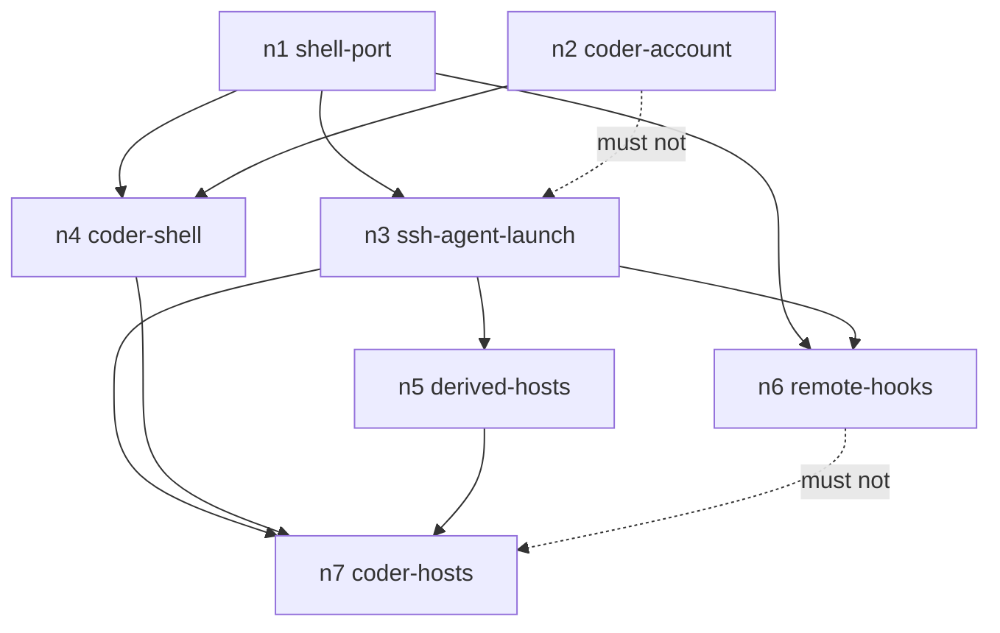
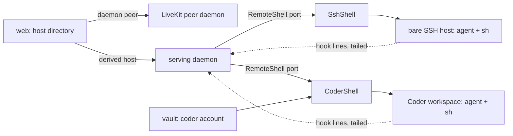

# Changeset: A remote agent's hooks reach the daemon with nothing installed

**Date**: 2026-11-15
**Status**: ✅ Complete
**Type**: Feature
**Complexity**: 4 — three crates (agent-backend, coding-agent-specs, agent-launch), a long-lived streamed reader with reconnect and ordering, an untrusted input stream
**Branch**: `feature/remote-shell/remote-hooks`, base `feature/remote-shell/derived-hosts` — `#remote-shell 6/7` — PR #920 (https://github.com/uppin/tddy-coder/pull/920)

## Initial Discovery

Full codebase exploration that grounded this plan: [initial-discovery.md](./2026-11-15-remote-shell-remote-hooks-initial-discovery.md).

State A below is distilled from that file. Do not duplicate grep traces or file dumps here.

## Prerequisites

No code issue in a touched package carries `Claimed by:` from another stack.

### ⚠ DURING — A claude-cli agent tab reports its activity as the session's — [`2026-10-24-claude-agent-tab-shares-session-hooks.md`](../todo/2026-10-24-claude-agent-tab-shares-session-hooks.md)

The same exposure exists on a target: the hooks file is in the worktree, so a second Claude Code started there by hand would append to the same log with the same token. This node does not make it worse than the local case and does not fix it.

### ⚠ DURING — `slots::render` complexity — [`packages/tddy-coding-agent-specs/docs/code-issues/complexity-slots-mod-render.md`](../../../packages/tddy-coding-agent-specs/docs/code-issues/complexity-slots-mod-render.md)

The carrier is a field of the params `render` already passes through. No branch is added to `render`.

## Affected Packages

- **tddy-agent-backend**: new `src/remote_hook_command.rs`: `HookCarrier`, `remote_hook_command`; `claude_hooks.rs`, `cursor_hooks.rs`, `muse_hooks.rs` build their command through the carrier and skip awaiting hooks for a remote one
- **tddy-coding-agent-specs**: `slots/hooks.rs`, `slots/cursor.rs`: the Muse and Cursor adapters accept a remote carrier in place of a daemon socket
- **tddy-agent-launch**: new `src/remote_hook_follower.rs`: `RemoteHookFollower`, `HookLine`; the remote launch starts it and the exit path stops it

## Related Feature Documentation

- [PRD-2026-11-15-remote-shell-remote-hooks.md](../../ft/daemon/1-WIP/PRD-2026-11-15-remote-shell-remote-hooks.md)
- [Agent session status](../../ft/daemon/agent-session-status.md)
- [Claude CLI session](../../ft/daemon/claude-cli-session.md)
- [Cursor CLI session](../../ft/daemon/cursor-cli-session.md)
- [Muse CLI session](../../ft/daemon/muse-cli-session.md)

## Summary

When a session's agent runs on a target, its lifecycle hooks still reach the daemon, with no tddy software on the target. Each hook is a plain shell command that appends one line to a file in the session's worktree; the daemon follows that file through the remote shell. It works for every agent whose spec supports hooks.

## Background

See the PRD.

## Responsibility

This PR owns:

- `tddy_agent_backend::remote_hook_command`: `enum HookCarrier<'a> { Tools { … today's fields … }, RemoteLog { log_path: &'a str } }` on `HookCommandParams`; `fn remote_hook_command(event, hook_token, log_path) -> String`; `REMOTE_HOOK_LOG = ".tddy/hooks.log"`.
- The rule that awaiting hooks are omitted under `HookCarrier::RemoteLog`.
- `tddy_agent_launch::remote_hook_follower`: `RemoteHookFollower::start(shell, log_path, hook_token, sink)`, `HookLine::parse`, resume from a byte offset, `stop`.
- Delivering a parsed line to the existing session-hook handling.
- Creating, git-excluding and removing the log on the target.

## Boundaries

This PR does not:

- answer a hook. Nothing travels from the daemon to the agent through this path;
- change the hook events an adapter installs or how a local hook is delivered;
- add hooks support to an agent that has none;
- change the port, the launch command or the target model: those are `shell-port`'s and `ssh-agent-launch`'s;
- fix agent terminal tabs sharing a session's hooks.

## Dependencies

What each parent PR delivers that this PR consumes. These surfaces are **theirs to create**;
implementing one here collides with the PR that owns it.

| Parent node | What it delivers | How this PR consumes it | This PR does NOT |
|---|---|---|---|
| `#remote-shell 1/7` `feature/remote-shell/shell-port` | `RemoteShell::exec_streamed`, `exec`, `write_file` | the follower runs `tail -c +<offset> -f <log>` through `exec_streamed` and creates the log with `exec` | add a streaming primitive, or spawn `ssh` |
| `#remote-shell 3/7` `feature/remote-shell/ssh-agent-launch` | `launch_on_target`, the session's `Arc<dyn RemoteShell>`, slot files written on the target, the remote command that carries argument-delivered hooks, the exit path | the launch passes `HookCarrier::RemoteLog` when rendering hooks and starts the follower after the agent; the exit path stops it | change `remote_agent_command`, the refusals, or how the PTY is spawned |

## Successor PRs

- `#remote-shell 7/7` — `feature/remote-shell/coder-hosts` — coder workspaces as hosts that run sessions

## Draft PR contract

The first push after the plan (commit 2) publishes, as the start of this same PR:

- `remote_hook_command.rs` with `HookCarrier` and the signature; body `// TODO(remote-hooks): implement`. Existing callers pass `HookCarrier::Tools` and behave as before.
- `remote_hook_follower.rs` with every signature; bodies `// TODO(remote-hooks): implement`.
- The failing tests below.

This PR goes on to implement all of it. It does not merge in that state.

## Contract as published

Published in the contract commit.

- **`tddy_agent_backend::remote_hook_command`**: `REMOTE_HOOK_LOG = ".tddy/hooks.log"`, `remote_hook_command(event, hook_token, log_path) -> String`. Both re-exported, so reachable as `tddy_core::…`.
- **`HookCommandParams.remote_log: Option<&str>`**: `None` is today's `tddy-tools` command, `Some(log)` is the remote log carrier. The builders do not honour it yet.
- **`tddy_agent_launch::remote_hook_follower`** (`TODO(remote-hooks)` bodies): `HookLine { event, payload: serde_json::Value }`, `HookLine::parse(line, expected_token)`, `HookLineError::{Malformed, WrongToken, UnknownEvent, BrokenPayload}`, `trait HookSink { async fn deliver(&self, line) }`, `follow_command(log_path, offset)`, `create_remote_hook_log(shell, worktree)`, `remove_remote_hook_log(shell, worktree)`, `RemoteHookFollower::{start(shell, log_path, hook_token, sink), dropped_lines, stop}`.
- 13 other `HookCommandParams` literals gained `remote_log: None`. Mechanical.

Where the contract differs from the plan above:

- **The carrier is a field, not the `HookCarrier` enum.** The enum would move seven fields into a variant and rewrite all 14 literals and every read of them, including the split launch and the jail hooks. The cost of the field: a remote session's params carry tools and daemon fields nobody reads.
- **The planned one-liner is wrong and is replaced.** `{ printf …; cat | tr -d '\n'; printf '\n'; } >> L` writes three times, so two hooks firing together interleave; it fails `two_hooks_fired_together_each_leave_a_whole_line`. The command is:

  ```sh
  printf '%s\t%s\t%s\n' 'E' 'T' "$(cat | tr -d '\n')" >> 'L'
  ```

  One write, after the payload has been read. It passed all seven shell tests in a trial that was then reverted. It still uses only `sh`, `printf`, `cat` and `tr`.
- **`follow_command`, `create_remote_hook_log`, `remove_remote_hook_log` and `dropped_lines` are added** so the tail command, the log's lifecycle and "dropped and counted" are each pinned by a test.

Decisions for the implementation:

- **"No hook that waits" is per agent, not per event name.** Claude Code's `PermissionRequest` and its `PreToolUse` question matcher wait for an answer locally, so on a target they are not installed; the render test pins Claude to its six reporting events. Muse's hooks of the same names only report and never wait, so on a target Muse keeps all eight with the log command. Cursor installs none that wait.
- **Delivery target**: `ActivityServiceImpl::report_session_status_impl` and `report_agent_activity_impl` in `packages/tddy-session-activity/src/service/hook_reports.rs`. The payload-to-request mapping is `tddy_tools::session_hook::session_status_request`, which takes the CLI's clap struct and lives in a crate the launch cannot depend on. The implementation moves that mapping to where both `tddy-tools` and the daemon reach it (`tddy-session-activity` already is a dependency of `tddy-agent-launch`), with `tddy-tools` calling the moved function. No second copy.
- **Wiring**: the launch passes `remote_log` when rendering hooks on a target and starts the follower after the agent; the exit and delete paths stop it and remove the log. The end-to-end tests drive `follower.stop()` and `remove_remote_hook_log` directly, so the implementation adds a test that deleting a target session through the service removes the log.

Red state at the contract commit: `remote_hook_command` unit tests 0 passed / 7 failed (each runs the command under a real `/bin/sh`); `remote_hooks_render_acceptance` 2 / 4 (the two passing guard unchanged local behaviour); `remote_hook_follower` unit tests 1 / 10; `remote_hook_follower_acceptance` 0 / 5; `remote_hooks_acceptance` 0 / 2, both at this PR's own stubs. After this PR's stubs are filled, the end-to-end pair next reaches `shell-port`'s `SshShell` and `ssh-agent-launch`'s `launch_on_target`: it goes green only once both are. `./test -p tddy-agent-backend -p tddy-coding-agent-specs`: 480 passed, 11 failed, the 11 being new. Clippy and fmt clean on the four touched packages. `the_command_names_no_tddy_binary` was verified on macOS only.

## Green wave

**Wave:** 3 of 4
**Greenable independently:** after `ssh-agent-launch` is green: the end-to-end test starts a real target session whose stub agent fires hooks
**Concurrent with:** `feature/remote-shell/derived-hosts`
**Blocks:** none

Real dependency edges, as opposed to the branch line:

    n1 → n3, n4, n6      n2 → n4      n3 → n5, n6, n7      n4 → n7      n5 → n7



Final design, all seven merged:



## Scope

- [x] **Command**: the carrier, the one-liner, awaiting hooks omitted, all three adapters
- [x] **Follower**: streamed read, parse, token check, delivery
- [x] **Robustness**: resume from offset, bad lines, cleanup on stop and delete
- [x] **Docs**: agent-session-status, the three CLI session docs, `packages/tddy-agent-backend/docs/`
- [x] **Wiring**: launch renders `remote_log`, creates the log and follows it; the follower delivers through the daemon's activity handling (mapping in `tddy-session-activity::hook_request`); exit, stop and delete stop it and remove the log

## Technical Changes

### State A (Current)

- `HookCommandParams { tddy_tools_path, daemon_url, session_id, os_user, hook_token, daemon_socket, answer_wait_secs }` (`tddy-agent-backend/src/claude_hooks.rs`).
- `hook_entry_for_event` formats `'<tools>' session-hook --session … --daemon … [--daemon-socket …] --os-user … --hook-token … --event …`. A hook command is a shell string run by `sh -c`, with the event payload on stdin.
- `build_claude_hooks_settings`, `build_cursor_hooks_settings` and `build_muse_hooks_config_value` take the same params. Claude installs eight events, Cursor five, Muse eight.
- Awaiting hooks (PermissionRequest, the PreToolUse matcher for the question tool) carry a timeout of `answer_wait_secs` plus a margin.
- `HooksAdapter` (`tddy-coding-agent-specs/src/slots/hooks.rs`): `ClaudeSettingsLocal` and `CursorHooksJson` deliver a file; `MuseConfigArg` delivers argv. Muse and Cursor refuse params without a daemon socket (`SlotError::NoDaemonSocket`).
- `tddy-tools session-hook` (`tddy-tools/src/session_hook.rs`) reads the payload from stdin and reports it to the daemon, which updates session activity.
- Six specs declare `hooks: { adapter: unsupported }`.

### State B (Target)

```sh
# the hook command on a target, for event E, token T, log L
printf '%s\t%s\t%s\n' 'E' 'T' "$(cat | tr -d '\n')" >> 'L'
```

- One line per hook: event, token, the payload with newlines removed (a JSON payload stays valid without them). The line is written by one `printf` after the payload has been read, so two hooks firing together each leave a whole line; the follower still drops a line it cannot parse.
- The follower: `tail -c +<offset+1> -f '<log>'` through `exec_streamed`; it counts bytes, splits on newlines, checks the token, parses the payload, delivers. On a stream end it reconnects with back-off and the offset it had reached.
- Delivery calls the same function the `session-hook` RPC handler calls, with the session's id and OS user.
- Under `RemoteLog` the builders skip awaiting entries; Muse and Cursor's socket requirement is satisfied by the carrier.

### Delta (What's Changing)

See *Affected Packages* and *Responsibility*.

## Implementation Milestones

- [x] `remote_hook_command` and its quoting
- [x] Each adapter renders it; awaiting hooks omitted
- [x] `HookLine::parse` and the token check
- [x] Follower delivers in order
- [x] Resume from offset with no loss or duplicate
- [x] Cleanup; `./test -p` per touched package

## Testing Plan

### Testing Strategy

- **Unit**: the command string, run through a real `sh` with a payload on stdin, and `HookLine::parse` over good and hostile lines.
- **Render acceptance** per adapter in `tddy-coding-agent-specs`.
- **Follower acceptance** against `InMemoryShell` scripted to end and resume the stream.
- **End to end** in `tddy-agent-launch`: a target session (stand-in `ssh`) whose stub agent runs the installed hook command; the session's activity changes.

No test uses LiveKit or a network service. Run `./test -p <package>` for each touched package; the whole-workspace result comes from CI.

### Coverage Requirements

Every acceptance criterion of the PRD has at least one named test below; each refusal and each distinct failure outcome has its own.

## Acceptance Tests

### tddy-agent-backend — `packages/tddy-agent-backend/src/remote_hook_command.rs` (unit)
- `the_command_appends_one_line_with_the_event_the_token_and_the_payload`
- `a_payload_with_newlines_and_quotes_arrives_as_one_parseable_line`
- `the_command_names_no_tddy_binary`
- `two_hooks_fired_together_each_leave_a_whole_line`

### tddy-coding-agent-specs — `packages/tddy-coding-agent-specs/tests/remote_hooks_render_acceptance.rs`
- `claude_code_on_a_target_gets_the_log_command_for_every_reporting_event`
- `cursor_on_a_target_gets_the_log_command_without_a_daemon_socket`
- `muse_on_a_target_gets_the_log_command_on_its_command_line`
- `no_hook_that_waits_for_an_answer_is_installed_on_a_target`
- `a_local_session_still_gets_the_tools_command`

### tddy-agent-launch — `packages/tddy-agent-launch/tests/remote_hook_follower_acceptance.rs`
- `each_logged_hook_is_delivered_once_in_order`
- `a_line_with_the_wrong_token_is_dropped`
- `an_unknown_event_or_a_broken_payload_is_dropped_and_the_next_line_still_arrives`
- `a_stream_that_ends_resumes_from_the_byte_it_reached`
- `stopping_the_follower_ends_its_remote_command`

### tddy-agent-launch — `packages/tddy-agent-launch/tests/remote_hooks_acceptance.rs`
- `a_hook_fired_by_an_agent_on_a_target_updates_the_sessions_activity`
- `deleting_the_session_removes_the_hook_log_on_the_target`

## Technical Debt & Production Readiness

(Populated during development.)

## Decisions & Trade-offs

- **The carrier belongs to the command, not the adapter.** One change covers three agents and any added later, which is the user's requirement of 2026-11-15.
- **A file and a follower, not a reverse-forwarded socket.** Writing to a socket from bare `sh` is not portable; appending to a file is.
- **Notify-only.** The user's choice. The cost is stated in the PRD: prompts move to the terminal on these sessions.
- **A token per line.** The log is writable by anything running as that user on the target; the token is what the local path already uses to tell a session's hooks from noise. It authenticates nothing stronger than that, and the payload is treated as untrusted input.
- **`tr -d '\n'` rather than encoding.** It keeps the command to tools every POSIX system has. A payload that is not JSON would lose its newlines; every adapter's payload is JSON.

## Planned by decision beyond the original plan

Three things this PR carries beyond the plan above, all taken by decision during the stack's
implementation and recorded here so the wrap describes them, not discovers them:

- **Production wiring of the hook log** (commit `69bdf7bbf` before the rebase): the launch creates
  the log on the target, renders `remote_log` for a target session, starts
  `RemoteHookFollower` with `ActivityHookSink`, and the exit, stop and delete paths stop it and
  remove the log (`RemoteHookFollowers` in `tddy-agent-launch`, `ActivityHookDelivery` in
  `tddy-session-lifecycle`). The payload-to-request mapping moved to
  `tddy-session-activity::hook_request`, shared with `tddy-tools session-hook`; no second copy.
- **A pid-based startup window in `remote_agent_launch.rs`** (code first shipped by PR #917,
  fixed here, commit `4c4fe4596` before the rebase): the startup window runs from the agent's
  recorded pid (`.tddy/agent.pid`, written by the remote command immediately before it `exec`s
  the agent), not from the PTY spawn. An agent that never records a pid within
  `max(10 × startup_window, 5 s)` is refused as `AgentNeverStarted`; liveness during the window
  is judged by the pid on the target beside the terminal's end.
- **A fixture warm-up (`TDDY_FIXTURE_WARMUP`) in test files owned by lower PRs**
  (commit `94c79ccef` before the rebase): a freshly written script's first exec takes ~2.4 s on
  macOS (measured, against ~20 ms afterwards), so each `write_executable` in the timed suites
  runs its script once, guarded, before any launch is timed. Test code only: the guard exits
  before the script body, records no call and writes no pid file, and no production path reads
  the variable. The shared stub writers in `agent_registry_support` / `harness_clis_support`
  (`packages/tddy-session-lifecycle/tests/`) are **not** warmed: no test of this PR times an
  executable they write (this PR's lifecycle suite uses only `builtin_yaml_as` from
  `agent_registry_support` and times its own warmed stub), so that is recorded as a backlog
  entry at the wrap (see Validation Results), not fixed here.

## Restructuring

File-length gate (`/pr-wrap` step 3.5, whole PR range, production lines to the first
`#[cfg(test)]`):

| File | Before → after | Disposition |
|---|---:|---|
| `packages/tddy-agent-launch/src/remote_agent_launch.rs` | 451 → 546 | 🔴 This PR pushed it past 500 — **not split**: successor PR #921 (`feature/remote-shell/coder-hosts`) also modifies this file, so the split is deferred to a follow-up branch after the `#remote-shell` stack lands (stack-branch rule). Recorded in `packages/tddy-agent-launch/docs/code-issues/oversized-file-remote-agent-launch.md` |
| `packages/tddy-session-lifecycle/src/connection_service/svc_activity_ports.rs` | 513 → 546 | 🔴 Already over, grew here — **not split**: successor PR #921 also modifies this file. Same deferral. Recorded in `packages/tddy-session-lifecycle/docs/code-issues/oversized-file-svc-activity-ports.md` |
| `packages/tddy-session-lifecycle/src/connection_service/svc_host_builders.rs` | 531 → 533 | 🔴 Already over, grew by 2 — **not split**: successor PR #921 also modifies this file. Same deferral. Re-measured in the existing `packages/tddy-session-lifecycle/docs/code-issues/oversized-file-svc-host-builders.md` |

One mechanical extract in this PR's own new file (not a file split, so not a
`/code-restructuring` plan): `RemoteHookFollower::start` (52 lines) now spawns
`follow_log`, which reads one stream via `read_stream` / `deliver_whole_lines`; no function in
the new follower is over 40 lines afterwards. Verified by the follower acceptance and unit
tests, green before and after.

## Refactoring Needed

### From /validate-changes
- None against the plan. The three oversized files above are stack-shared with PR #921 and are
  recorded, not split (see Restructuring).

### From /validate-tests
- None. The new suites use Given/When/Then, descriptive names and exact assertions; no
  `#[ignore]`, no focused tests, no always-passing tests were found.

### From /validate-prod-ready
- None. No mock or test-only code in production paths, no added `TODO`/`FIXME`, no added
  stdout/stderr in TUI paths (the `println!`/`eprintln!` in `tddy-tools/src/session_hook.rs`
  are pre-existing CLI output, untouched by this PR), no fallback added.

### From /analyze-clean-code
- `RemoteHookFollower::start` at 52 lines (needs attention, 41–60) — extracted, see
  Restructuring. The remaining over-60 functions in touched files are pre-existing and
  unchanged in substance: `launch_on_target` and `DaemonSessionHost::new` (both already
  recorded in their packages' code-issues), and `session_status_request` (70 lines), which is
  the mapping moved verbatim from `tddy-tools` into `tddy-session-activity::hook_request`.

## Validation Results

### /validate-changes
- 2026-11-16 (after the single-mode `/pr-stack-rebase` onto `a76247e46`): stack gate ✅ —
  `origin/feature/remote-shell/derived-hosts..HEAD` is this PR's six commits only. Boundary ✅:
  every Scope item implemented except Docs (wrapped at `/pr-wrap`); `## Responsibility`
  delivered, no stub bodies remain; nothing from `## Dependencies` implemented here; no
  dependent behaviour (PR #921's Coder hosts are not touched); diff contains only this PR's
  files; no parent-owned file deleted. The three planned-by-decision additions above are
  recorded, with the warm-up checked to have no production effect.
- Build/test (scoped, `CARGO_INCREMENTAL=0`): `tddy-agent-backend`, `tddy-coding-agent-specs`,
  `tddy-session-activity`, `tddy-agent-launch`, `tddy-tools`, `tddy-remote-shell` and
  `tddy-session-split` green; `tddy-session-lifecycle`'s own suites for this PR green
  (`remote_hooks_session_acceptance` 1/1, `remote_target_session_acceptance` 2/2,
  `derived_host_start_acceptance` 9/9). The one failure in the package run is
  `claude_cli_from_spec_acceptance::an_unsandboxed_claude_cli_start_runs_the_spec_binary_with_the_argv_its_template_renders`
  — the pre-existing macOS `/tmp` vs `/private/tmp` canonicalisation assertion, in a file this
  PR does not touch; PR #919's wrap records the same failure on the parent branch.
- Shared stub writers: no test of this PR times an executable written by
  `agent_registry_support` / `harness_clis_support`, so they are not warmed here; a
  `docs/dev/todo/` entry with the measured ~2.4 s cause is written at the wrap.

### /validate-tests
- 2026-11-16: tests analyzed — the four new suites plus the unit tests in
  `remote_hook_command.rs` / `remote_hook_follower.rs`. No anti-patterns found; the 30 s
  `OBSERVE` bounds are documented safety nets, not timing predictions.

### /validate-prod-ready
- 2026-11-16: files checked — all production files in the diff. Blockers 0, warnings 0.

### /analyze-clean-code
- 2026-11-16: file length — three files at or over 500, all stack-shared with PR #921 (see
  Restructuring). Function length — one needs-attention in new code, extracted; the rest
  pre-existing. No magic values, duplication or naming findings in the new code (the follower's
  local `shell_quote` mirrors the one in `remote_hook_command.rs`'s crate because the two live
  in different crates).

## TODO

- [x] Record initial discovery (`2026-11-15-remote-shell-remote-hooks-initial-discovery.md`)
- [x] Cross-check `packages/*/docs/code-issues/` and `docs/dev/todo/` for items this change touches (Step 2b)
- [x] Create/update PRD documentation
- [x] Create changeset (this document)
- [x] Create failing acceptance tests
- [x] Run acceptance tests (verify they fail)
- [x] USER REVIEW — acceptance tests (approved in advance on 2026-11-15: "proceed with your recommended option"; the titles are listed in the PR body)
- [x] TDD Red — write failing unit/integration tests
- [x] TDD Green — implement with quality code
- [x] Update documentation with progress
- [x] Repeat Red→Green→Update cycle until feature complete
- [x] Run the touched packages' tests (`./test -p {package}` per package) — verify 100% pass
- [x] Validate changes (/validate-changes)
- [x] Refactor issues from change validation
- [x] USER REVIEW — development complete
- [x] Validate tests (/validate-tests)
- [x] Refactor test issues
- [x] Validate production readiness (/validate-prod-ready)
- [x] Refactor production readiness issues
- [x] Analyze code quality (/analyze-clean-code)
- [x] Refactor code quality issues
- [x] Final validation (/validate-changes)
- [x] Linting and formatting (`cargo clippy -p {package} -- -D warnings`, `cargo fmt`)
- [x] USER REVIEW — scope developed, every gap approved: ready to wrap
