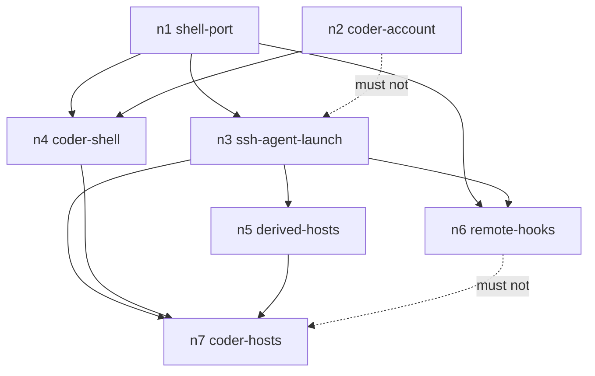
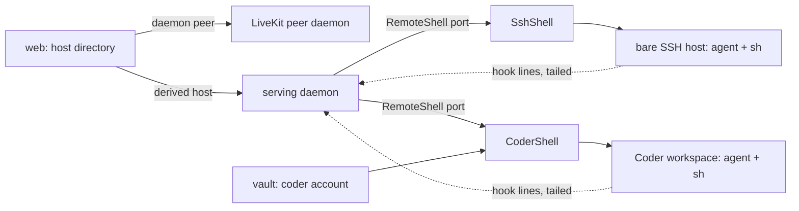

# Changeset: One remote-shell port, SSH as its first transport

**Date**: 2026-11-15
**Status**: 🚧 In Progress
**Type**: Refactor + Feature
**Complexity**: 4 — a new crate consumed by four others (tool-engine, git, agent-launch, worktree-service), a spawned-process I/O seam, streamed exec with deadlines (ordering)
**Branch**: `feature/remote-shell/shell-port`, base `master` — `#remote-shell 1/7` — PR #915 (https://github.com/uppin/tddy-coder/pull/915)

## Initial Discovery

Full codebase exploration that grounded this plan: [initial-discovery.md](./2026-11-15-remote-shell-shell-port-initial-discovery.md).

State A below is distilled from that file. Do not duplicate grep traces or file dumps here.

## Prerequisites

No code issue in a touched package carries `Claimed by:` from another stack.

### ⚠ DURING — `remote_git_service.rs` is over the file budget — [`packages/tddy-worktree-service/docs/code-issues/oversized-file-remote-git-service.md`](../../../packages/tddy-worktree-service/docs/code-issues/oversized-file-remote-git-service.md)

This node deletes `ssh_batch_mode_argv` and the remote spawn branch from that file, so it shrinks. It is not split here; record the new measurement at wrap.

### ⚠ DURING — Daemon git-over-SSH beyond the clone cannot ask for a passphrase — [`2026-10-17-daemon-git-over-ssh-beyond-the-clone-cannot-ask-for-a-passphrase.md`](../todo/2026-10-17-daemon-git-over-ssh-beyond-the-clone-cannot-ask-for-a-passphrase.md)

Recorded, not fixed here. `SshShell` keeps `BatchMode=yes`. The port is the one place an askpass environment would later be added, which makes that entry cheaper; this node must not add a prompt.

### ℹ CONSIDERED — `tddy-git` has no `docs/code-issues/` directory

It has not been analysed. The change there removes code; run `/analyze-code-issues` on it at wrap.

## Affected Packages

- **tddy-remote-shell**: **new crate**: `RemoteShell`, `ExecRequest`, `ExecOutput`, `StreamedExec`, `InteractiveCommand`, `RemoteShellError`, `SshShell`, `InMemoryShell` (feature `test-support`), `contract` suite
- **tddy-tool-engine**: `shell.rs`: the `RemoteShell` struct wraps an `Arc<dyn tddy_remote_shell::RemoteShell>`; `session_shell` builds an `SshShell`
- **tddy-git**: `ssh_exec.rs` loses `ssh_batch_command` / `run_ssh_batch`; `ssh_worktree.rs` `setup_worktree_for_session_over_ssh` takes `&dyn RemoteShell`. This package has no `docs/code-issues/` directory: it has not been analysed
- **tddy-agent-launch**: `slot_file_over_ssh.rs` and `cli_session_pointer.rs`: `PointerHost::Ssh` holds the shell; `run_over_ssh` and `ssh_options` are deleted
- **tddy-worktree-service**: `remote_git_service.rs`: `PackExecution::Remote` streams through `exec_streamed`; `ssh_batch_mode_argv` is deleted
- **tddy-core**: the `ssh_exec` re-exports follow `tddy-git`

## Related Feature Documentation

- [PRD-2026-11-15-remote-shell-shell-port.md](../../ft/daemon/1-WIP/PRD-2026-11-15-remote-shell-shell-port.md)
- [Remote managed worktree](../../ft/daemon/remote-managed-worktree.md)
- [Remote git repo](../../ft/daemon/remote-git-repo.md)

## Summary

Every place the daemon runs something on a machine it does not serve goes through one port, `RemoteShell`, in a new crate `tddy-remote-shell`. OpenSSH is its first transport. The four existing SSH spawn sites move onto it and share one set of connection options and one typed error.

## Background

See the PRD.

## Responsibility

This PR owns:

- The crate `tddy-remote-shell` and everything it exports.
- The trait `RemoteShell { fn address(&self) -> ShellAddress; async fn exec(&self, ExecRequest) -> Result<ExecOutput, RemoteShellError>; async fn exec_streamed(&self, command: &str) -> Result<StreamedExec, RemoteShellError>; fn interactive(&self, command: &str) -> InteractiveCommand; }` and the provided `read_file` / `write_file`.
- `ShellAddress` (a transport tag plus a display name, for errors and logs), `RemoteShellError::{Unreachable, TimedOut, Exited, Spawn}`.
- `SshShell::new(alias)` / `SshShell::through(ssh_binary, alias)` and its single `ssh_options()`.
- `InMemoryShell` and `contract::assert_behaves_like_a_remote_shell` behind `test-support`.
- Moving the four call sites onto the port.

## Boundaries

This PR does not:

- start an agent on a remote. `interactive` is implemented and contract-tested here; its first production caller is `feature/remote-shell/ssh-agent-launch`;
- add a Coder transport (`feature/remote-shell/coder-shell`);
- change `default_remote_repo_root`'s hard-coded `/home/dev/<name>`;
- split `remote_git_service.rs`, `runtime.rs` or any other over-budget file it touches;
- add an askpass path for SSH beyond the clone.

## Dependencies

None. This PR is based on `master` and consumes nothing from another PR of this stack.

## Successor PRs

- `#remote-shell 2/7` — `feature/remote-shell/coder-account` — connect a Coder deployment as an account
- `#remote-shell 3/7` — `feature/remote-shell/ssh-agent-launch` — a session whose agent runs on an SSH host
- `#remote-shell 4/7` — `feature/remote-shell/coder-shell` — coder workspaces as a remote-shell transport
- `#remote-shell 5/7` — `feature/remote-shell/derived-hosts` — sSH hosts as hosts derived from a daemon
- `#remote-shell 6/7` — `feature/remote-shell/remote-hooks` — a remote agent's hooks reach the daemon with nothing installed
- `#remote-shell 7/7` — `feature/remote-shell/coder-hosts` — coder workspaces as hosts that run sessions

## Draft PR contract

The first push after the plan (commit 2) publishes, as the start of this same PR:

- The crate with every exported type and signature; bodies `// TODO(shell-port): implement`.
- `InMemoryShell` fully working. It is a test double, and dependents' tests need it from this commit.
- The call sites are **not** moved in this commit; the first implementation push moves them.
- The failing tests below.

This PR goes on to implement all of it. It does not merge in that state.

## Contract as published

Published in the contract commit. Signatures are in `packages/tddy-remote-shell/src/`.

- **Port**: `RemoteShell { address, exec, exec_streamed, interactive, read_file, write_file }`, `ShellAddress { transport: String, name }`, `ExecRequest` (`new`, `with_stdin`, `within`; `DEFAULT_EXEC_DEADLINE` 60 s), `ExecOutput` (`succeeded`, `exited`, `success_or_exited`), `InteractiveCommand`, `FileMode::{TargetDefault, OwnerOnly}`, `RemoteShellError::{Unreachable, TimedOut, Exited, Spawn}`.
- **`StreamedExec { stdin: ShellStdin, stdout: ShellOutput, stderr: ShellOutput, exit: StreamedExit }`** holds boxed `AsyncWrite` / `AsyncRead` and an exit future, not `tokio::process` child handles. A transport that is not a local child, and the in-memory shell, could not produce those. `GitChildRelay` stores a `ChildStdin` and a pid today, so its remote path changes shape in the implementation.
- **`ShellAddress.transport` is a string** so a later transport adds its tag without editing this type.
- **`SshShell`**: `new`, `through`, `ssh_options`, `TRANSPORT = "ssh"`. Bodies are `TODO(shell-port)`.
- **`InMemoryShell`** (feature `test-support`) is fully working: `answers`, `answers_when`, `hangs_on`, `is_unreachable`, `has_file`, `streams` → `ScriptedStream`; `calls`, `commands_run`, `file`, `file_mode`. An unscripted command exits 127.
- **`contract::assert_behaves_like_a_remote_shell(shell, scratch_dir)`** and `an_in_memory_shell_for_the_contract()`.
- **Call-site seams** (`TODO(shell-port)` bodies; the call sites are not moved yet): `tddy_tool_engine::shell::RemoteShell::over(port, remote_root)`; `tddy_agent_launch::slot_files_over_shell::{write_slot_files_through, place_session_pointer_through}`; `GitChildRelay::spawn_remote_pack_verb(shell, argv, remote_repo_path)`.

What the tests found that the plan did not:

- **A fifth SSH site**: `tddy-agent-launch/src/svc_signal_delete_session.rs:211` (pointer removal on delete). It is in scope and the ratchet flags it. Six lines are flagged in all, because `cli_session_pointer.rs` and `slot_file_over_ssh.rs` are separate hits.
- **Two exemptions in the ratchet**, each listed with its reason in `NOT_A_REMOTE_COMMAND`: `clone_planner.rs:27` runs `ssh -V`, a local version probe; `tddy-vm/src/qemu.rs` reaches a QEMU guest with its own key and port. Neither runs a command on a session's target. The acceptance criterion reads accordingly: no other crate spawns `ssh` to run a command on a target.
- **The session pointer is placed in two steps** through the port (one `exec` for the git exclude, then `write_file` owner-only) where it is one SSH command today. One extra round trip per placement.
- **`tddy-git`'s worktree setup is synchronous** and the port is async. The implementation makes it async or bridges it; no test pins which.

Red state at the contract commit: `tddy-remote-shell` lib 18 passed / 3 failed, `ssh_shell_acceptance` 0 / 8, `shell_contract` 1 / 2 (the in-memory shell passes the contract), `one_ssh_spawn_site` 1 / 1; `tddy-tool-engine` `remote_shell_exec_acceptance` 5 existing passed / 2 new failed; `tddy-agent-launch` `slot_files_over_shell_acceptance` 0 / 1; `tddy-worktree-service` `remote_pack_over_shell_acceptance` 0 / 1. Every failure is this PR's own missing implementation. Clippy and fmt are clean on the four packages.

## Green wave

**Wave:** 1 of 4
**Greenable independently:** yes — every test drives this node's own port, through a stand-in `ssh` executable or the in-memory shell
**Concurrent with:** `feature/remote-shell/coder-account`
**Blocks:** `ssh-agent-launch`, `coder-shell`, `remote-hooks` (each runs commands through this port's behaviour)

Real dependency edges, as opposed to the branch line:

    n1 → n3, n4, n6      n2 → n4      n3 → n5, n6, n7      n4 → n7      n5 → n7



Final design, all seven merged:



## Scope

- [ ] **Port**: `RemoteShell`, typed errors, `SshShell`, `InMemoryShell`, contract suite
- [ ] **Call sites**: tool-engine, git worktree setup, agent-launch slot files and pointer, worktree-service packs
- [ ] **Ratchet**: no `ssh` spawn outside the crate
- [ ] **Docs**: `packages/tddy-remote-shell/docs/`, remote-managed-worktree, remote-git-repo

## Technical Changes

### State A (Current)

- `tddy_tool_engine::Shell { kind, root, read_to_string, write_string, run }` with `LocalShell` and `RemoteShell { host_alias, remote_root }`. `RemoteShell::ssh_run` calls `tokio::task::spawn_blocking(run_ssh_batch)`. Dispatch switches on `ShellKind`. Only `local_exec_tools.rs:166` (`route_tool`) uses it.
- `tddy_git::ssh_exec`: `ssh_batch_command(alias, cmd)` builds `ssh -o BatchMode=yes -- <alias> <cmd>` with stdin null; `run_ssh_batch` blocks on `.output()`. `ssh_worktree::setup_worktree_for_session_over_ssh(alias, git_url, session_id)` runs one `set -e` script. Both are re-exported through `tddy_core`.
- `tddy_agent_launch::slot_file_over_ssh`: `run_over_ssh(ssh, alias, path, remote, stdin, deadline)` with `ssh_options()` (`BatchMode`, `ConnectTimeout=15`, `ServerAliveInterval=5`, `ServerAliveCountMax=3`) and `SLOT_FILE_OVER_SSH_DEADLINE = 60s`. `cli_session_pointer::PointerHost::{Local, Ssh { ssh, alias }}`.
- `tddy_worktree_service::remote_git_service`: `PackExecution::{Local, Remote { ssh_config_host, remote_repo_path }}`, `ssh_batch_mode_argv`, `GitChildRelay::spawn_pack_verb` spawning the argv with piped stdio.

### State B (Target)

```rust
// packages/tddy-remote-shell/src/lib.rs
#[async_trait]
pub trait RemoteShell: Send + Sync {
    fn address(&self) -> ShellAddress;
    async fn exec(&self, request: ExecRequest) -> Result<ExecOutput, RemoteShellError>;
    async fn exec_streamed(&self, command: &str) -> Result<StreamedExec, RemoteShellError>;
    fn interactive(&self, command: &str) -> InteractiveCommand;
    async fn read_file(&self, path: &str) -> Result<Vec<u8>, RemoteShellError> { /* cat */ }
    async fn write_file(&self, path: &str, bytes: &[u8], mode: FileMode) -> Result<(), RemoteShellError> { /* umask + cat > */ }
}
pub struct ExecRequest { pub command: String, pub stdin: Option<Vec<u8>>, pub deadline: Duration }
pub struct ExecOutput { pub status: i32, pub stdout: Vec<u8>, pub stderr: Vec<u8> }
pub struct StreamedExec { pub stdin: ChildStdin, pub stdout: ChildStdout, pub stderr: ChildStderr, /* wait() */ }
pub struct InteractiveCommand { pub argv: Vec<OsString>, pub env: Vec<(OsString, OsString)> }
pub enum RemoteShellError { Unreachable { address, detail }, TimedOut { address, after }, Exited { status, stderr }, Spawn(String) }
```

- `SshShell` treats OpenSSH's exit 255 as `Unreachable`. `interactive` is `ssh -tt <options> -- <alias> <command>`.
- The four call sites hold an `Arc<dyn RemoteShell>` (or borrow one) where they held an alias. `exec` returns a non-zero exit as `Ok(ExecOutput)` when the caller asks for the status, and callers that need success use `ExecOutput::success_or_exited()`.

### Delta (What's Changing)

See *Affected Packages* and *Responsibility*.

## Implementation Milestones

- [ ] Port, errors, `SshShell` against a stand-in `ssh` executable, `InMemoryShell`, contract suite green on both
- [ ] tool-engine on the port
- [ ] git worktree setup on the port
- [ ] agent-launch slot files and pointer on the port
- [ ] worktree-service packs on `exec_streamed`
- [ ] Ratchet test green; `./test -p` per touched package

## Testing Plan

### Testing Strategy

- **Contract suite** in `tddy-remote-shell`: one function asserting the port's behaviour, run against `InMemoryShell` and against `SshShell` driving a stand-in `ssh` executable (a shell script on a temp path that runs the command locally, the pattern `PointerHost::through` already uses). No real SSH server, no network.
- **Integration per moved call site**: each crate keeps its existing SSH tests and gains one acceptance test that the call reaches the port.
- **Ratchet**: a text scan, like `livekit_is_a_satellite.rs`.

No test uses LiveKit or a network service. Run `./test -p <package>` for each touched package; the whole-workspace result comes from CI.

### Coverage Requirements

Every acceptance criterion of the PRD has at least one named test below; each refusal and each distinct failure outcome has its own.

## Acceptance Tests

### tddy-remote-shell — `packages/tddy-remote-shell/tests/ssh_shell_acceptance.rs`
- `a_command_runs_on_the_target_and_returns_its_output_and_status`
- `stdin_reaches_the_remote_command`
- `a_command_that_outlives_its_deadline_is_stopped_and_reported_as_timed_out`
- `an_unreachable_target_is_reported_as_unreachable_not_as_a_failed_command`
- `a_streamed_command_relays_both_directions_until_it_exits`
- `the_interactive_command_asks_ssh_for_a_terminal_on_the_alias`
- `every_ssh_call_carries_the_same_connection_options`

### tddy-remote-shell — `packages/tddy-remote-shell/tests/shell_contract.rs`
- `the_in_memory_shell_behaves_like_a_remote_shell`
- `the_ssh_shell_behaves_like_a_remote_shell`
- `a_written_file_reads_back_byte_for_byte_with_its_mode`

### tddy-remote-shell — `packages/tddy-remote-shell/tests/one_ssh_spawn_site.rs`
- `no_other_crate_spawns_ssh`

### tddy-tool-engine — `packages/tddy-tool-engine/tests/remote_shell_exec_acceptance.rs`
- `a_shell_tool_on_an_ssh_checkout_runs_through_the_remote_shell_port`
- `an_unreachable_checkout_fails_the_tool_with_the_ports_reason`

### tddy-agent-launch — `packages/tddy-agent-launch/tests/slot_files_over_shell_acceptance.rs`
- `slot_files_and_the_session_pointer_are_written_through_the_remote_shell`

### tddy-worktree-service — `packages/tddy-worktree-service/tests/remote_pack_over_shell_acceptance.rs`
- `a_remote_pack_verb_streams_through_the_remote_shell`

## Technical Debt & Production Readiness

(Populated during development.)

## Decisions & Trade-offs

- **A new crate, not an extension of `tddy_tool_engine::Shell`.** That trait is the exec catalog's view (contained paths, a root). The port is the transport underneath it, and `tddy-git`, `tddy-agent-launch` and `tddy-worktree-service` must not depend on the tool engine.
- **`interactive` returns an argv for a local PTY, not a PTY of its own.** Every terminal consumer is typed on `portable_pty::MasterPty`. Running the transport's client inside a local PTY keeps all of them unchanged and makes the serving daemon the mediator.
- **The port owns `interactive` although its first production caller is a later node.** Otherwise a later node would have to add a method to a trait this node owns. It is implemented and contract-tested here.
- **If this node proves too large in pass 2**, the capability split is one-shot exec first, streamed exec for git packs second. The user chose to keep it as one node on 2026-11-15.

## Refactoring Needed

### From /validate-changes
### From /validate-tests
### From /validate-prod-ready
### From /analyze-clean-code

## Validation Results

### /validate-changes
### /validate-tests
### /validate-prod-ready
### /analyze-clean-code

## TODO

- [x] Record initial discovery (`2026-11-15-remote-shell-shell-port-initial-discovery.md`)
- [x] Cross-check `packages/*/docs/code-issues/` and `docs/dev/todo/` for items this change touches (Step 2b)
- [x] Create/update PRD documentation
- [x] Create changeset (this document)
- [x] Create failing acceptance tests
- [x] Run acceptance tests (verify they fail)
- [x] USER REVIEW — acceptance tests (approved in advance on 2026-11-15: "proceed with your recommended option"; the titles are listed in the PR body)
- [x] TDD Red — write failing unit/integration tests
- [ ] TDD Green — implement with quality code
- [ ] Update documentation with progress
- [ ] Repeat Red→Green→Update cycle until feature complete
- [ ] Run the touched packages' tests (`./test -p {package}` per package) — verify 100% pass
- [ ] Validate changes (/validate-changes)
- [ ] Refactor issues from change validation
- [ ] USER REVIEW — development complete
- [ ] Validate tests (/validate-tests)
- [ ] Refactor test issues
- [ ] Validate production readiness (/validate-prod-ready)
- [ ] Refactor production readiness issues
- [ ] Analyze code quality (/analyze-clean-code)
- [ ] Refactor code quality issues
- [ ] Final validation (/validate-changes)
- [ ] Linting and formatting (`cargo clippy -p {package} -- -D warnings`, `cargo fmt`)
- [ ] USER REVIEW — scope developed, every gap approved: ready to wrap
