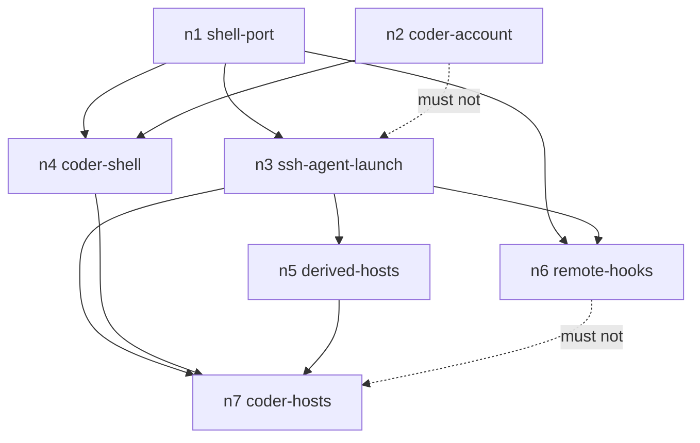
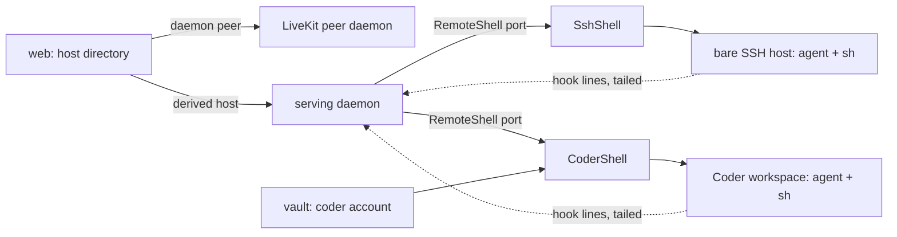

# Changeset: A session whose agent runs on an SSH host

**Date**: 2026-11-15
**Status**: 🚧 In Progress
**Type**: Feature
**Complexity**: 5 — a proto contract change, three crates (service, agent-launch, session-lifecycle), a spawned remote process with exit and ownership ordering, session metadata gaining a field
**Branch**: `feature/remote-shell/ssh-agent-launch`, base `feature/remote-shell/coder-account` — `#remote-shell 3/7` — PR #917 (https://github.com/uppin/tddy-coder/pull/917)

## Initial Discovery

Full codebase exploration that grounded this plan: [initial-discovery.md](./2026-11-15-remote-shell-ssh-agent-launch-initial-discovery.md).

State A below is distilled from that file. Do not duplicate grep traces or file dumps here.

## Prerequisites

No code issue in a touched package carries `Claimed by:` from another stack.

### ✅ RESOLVED HERE — An ssh session's pointer is owned by the daemon — [`2026-11-07-ssh-agent-launch-remote-pointer-owner.md`](../todo/2026-11-07-ssh-agent-launch-remote-pointer-owner.md)

This node is the ssh agent launch that entry waits for. The launch command writes `$$` to `.tddy/agent.pid` before `exec`, the launch calls `record_remote_owner` once the agent has started, and both `allow(dead_code)` are removed. Covered by `the_pointer_on_the_target_names_the_remote_agent_as_its_owner`.

### ⚠ DURING — `start_cli_harness_session` and `start_session_core` complexity — [`complexity-opencode-cli-spawn-start-cli-harness-session.md`](../../../packages/tddy-agent-launch/docs/code-issues/complexity-opencode-cli-spawn-start-cli-harness-session.md), [`complexity-svc-start-session-core-start-session-core.md`](../../../packages/tddy-agent-launch/docs/code-issues/complexity-svc-start-session-core-start-session-core.md)

The remote branch lives in the new `remote_agent_launch.rs` and is reached by one call from `harness_launch.rs`. It must not add branches to either recorded function beyond that call and the refusal. Record the new measurements at wrap.

### ⚠ DURING — `spawn_tool_on` complexity — [`complexity-pty-spawn-spawn-tool-on.md`](../../../packages/tddy-cli-sessions/docs/code-issues/complexity-pty-spawn-spawn-tool-on.md)

`spawn_rendered_main` is called as it is, with a different argv and cwd. `tddy-cli-sessions` is not edited.

## Affected Packages

- **tddy-service**: `proto/session.proto`: `SessionTarget { oneof kind { SshTarget ssh = 1; } }`, `StartSessionRequest.target`, `SessionEntry.target`
- **tddy-changeset**: `session_metadata.rs`: `target`; `reads_host_paths` is false for a target session
- **tddy-agent-launch**: new `remote_agent_launch.rs`: `RemoteLaunch`, `remote_agent_command`, `shell_for_target`; `harness_launch.rs` gains the remote branch; `cli_session_pointer.rs`: `record_remote_owner` gets its caller and loses `allow(dead_code)`
- **tddy-session-lifecycle**: start validation and refusals; stop, delete and resume for a target session
- **tddy-client-web**: regenerated `session_pb`

## Related Feature Documentation

- [PRD-2026-11-15-remote-shell-ssh-agent-launch.md](../../ft/daemon/1-WIP/PRD-2026-11-15-remote-shell-ssh-agent-launch.md)
- [Claude CLI session](../../ft/daemon/claude-cli-session.md)
- [Terminal sessions](../../ft/daemon/terminal-sessions.md)
- [Remote managed worktree](../../ft/daemon/remote-managed-worktree.md)

## Summary

A session can name a **target**: a machine the daemon reaches through a remote shell, with no tddy software on it. The daemon creates the worktree there, starts the coding agent there in an interactive shell, and serves its terminal as it serves a local one. SSH hosts are the first kind of target.

## Background

See the PRD.

## Responsibility

This PR owns:

- The proto messages `SessionTarget` and `SshTarget`, and the two fields that carry them.
- `SessionMetadata.target` and its `.session.yaml` form.
- `tddy_agent_launch::remote_agent_launch`: `shell_for_target(&SessionTarget) -> Result<Arc<dyn RemoteShell>, TargetError>`; `remote_agent_command(worktree, argv, env) -> String` (`cd`, write `$$` to `.tddy/agent.pid`, `exec env -i … <argv>`); `launch_on_target(...)`.
- The refusals of a target with managed codebase, sandbox, split or project-home main.
- Calling `record_remote_owner` and removing the two `allow(dead_code)`.
- Stop, exit, delete and resume of a target session.

## Boundaries

This PR does not:

- change what `ssh_config_host` does, or remove it;
- deliver hooks from the remote agent (`feature/remote-shell/remote-hooks`). Until that PR, a target session reports no agent activity;
- add a Coder case to `SessionTarget` or resolve one (`feature/remote-shell/coder-hosts`);
- show targets in the web (`feature/remote-shell/derived-hosts`);
- run `tddy-tools` or an MCP server on the target;
- install or verify the agent CLI on the target beyond reporting that it failed to start;
- change the port: `RemoteShell` is `shell-port`'s.

## Dependencies

What each parent PR delivers that this PR consumes. These surfaces are **theirs to create**;
implementing one here collides with the PR that owns it.

| Parent node | What it delivers | How this PR consumes it | This PR does NOT |
|---|---|---|---|
| `#remote-shell 1/7` `feature/remote-shell/shell-port` | `tddy_remote_shell::{RemoteShell, SshShell, InteractiveCommand, RemoteShellError}`; worktree setup, slot files and the pointer already running through the port | `shell_for_target` builds an `SshShell`; the launch spawns `shell.interactive(cmd)` in a local PTY and calls `exec` for the pid file | add a method to the trait, build an `ssh` argv, or change the connection options |

## Successor PRs

- `#remote-shell 4/7` — `feature/remote-shell/coder-shell` — coder workspaces as a remote-shell transport
- `#remote-shell 5/7` — `feature/remote-shell/derived-hosts` — sSH hosts as hosts derived from a daemon
- `#remote-shell 6/7` — `feature/remote-shell/remote-hooks` — a remote agent's hooks reach the daemon with nothing installed
- `#remote-shell 7/7` — `feature/remote-shell/coder-hosts` — coder workspaces as hosts that run sessions

## Draft PR contract

The first push after the plan (commit 2) publishes, as the start of this same PR:

- The proto messages and fields, with the TypeScript regenerated.
- `SessionMetadata.target`.
- `remote_agent_launch.rs` with every signature; bodies `// TODO(ssh-agent-launch): implement`.
- The failing tests below.

This PR goes on to implement all of it. It does not merge in that state.

## Contract as published

Published in the contract commit.

- **Proto**: `SshTarget { config_host = 1 }`, `SessionTarget { oneof kind { SshTarget ssh = 1; } }`, `SessionEntry.target = 40`, `StartSessionRequest.target = 50`. `session_pb.ts` regenerated in both gen directories. `unbundle_service_split` lists methods only; it still passes (28).
- **`tddy_changeset::SessionTarget`** (re-exported as `tddy_core::SessionTarget`): `enum SessionTarget { Ssh { config_host } }`, internally tagged, so `.session.yaml` reads `target: { kind: ssh, config_host: buildbox }`. `SessionMetadata.target: Option<SessionTarget>`; absent reads `None` and is not written. `reads_host_paths` is false for a target session. This half is real code and its five tests pass.
- **`tddy_agent_launch::remote_agent_launch`** (`TODO(ssh-agent-launch)` bodies): `TargetError::{NoSshHost, Unsupported}`; `shell_for_target(&SessionTarget)`; `remote_agent_command(worktree, argv, env)`; `RemoteLaunch { shell, worktree, session_dir, pointer, startup_window }`; `RemoteLaunched { handle, owner }`; `RemoteLaunchError::{Plan, Shell, Spawn, ExitedDuringStartup { status, last_output }}`; `launch_on_target(agent, params, slots, remote, session, on_exit)`, shaped like `spec_launch::launch_host_pty`.
- 58 exhaustive `SessionMetadata` literals in 47 files gained `target: None`. Mechanical.

Where the contract differs from the plan above:

- **Two `SessionTarget` types**: the proto one on the wire, a serde one in `tddy-changeset` for metadata and `shell_for_target`, because `tddy-changeset` cannot depend on `tddy-service`. The conversion is implementation.
- **`launch_on_target` takes the pointer, not the crate-private `PointerHost`**. The owner lookup therefore runs through the port, or `record_remote_owner` is adapted to it; it calls `run_over_ssh` directly today.
- **Refusals are pinned** as `InvalidArgument` with the message prefix `target cannot be combined with <field>`, the style `start_request_checks.rs` already uses.
- **The project-home-main refusal has no test here.** The harness has no session tokens for that start. It belongs in `project_home_start_spec::refuse_a_placement_off_the_home_worktree`, which already lists `ssh_config_host`; the implementation adds the target there with a unit test.

Decisions for the implementation that the tests surfaced:

- **Nothing the agent is told to read may be a local path.** A spec's argv can name a file in the local session directory (`--append-system-prompt-file`). Every such file is written on the target, and the argument names the target's copy. The tests cannot catch a miss, because their target is this machine.
- **The remote agent keeps `PATH` and `HOME` from the target's login shell and nothing else from it.** The command is `env -i PATH="$PATH" HOME="$HOME" K='V' …`. The daemon's own `PATH` and `HOME` must not be sent.
- **An unreachable target** may surface as the shell's `Unreachable` or as an early exit with status 255; the test pins only that the SSH complaint is in the error.

Red state at the contract commit: `remote_agent_launch_acceptance` 0 passed / 6 failed, all at `launch_on_target`; `remote_target_session_acceptance` 0 / 9, all because the start ignores `target` (the harness starts a local session, which shows the harness itself works); `remote_agent_launch` unit tests 1 / 8. After this PR's stubs are filled, the two acceptance suites next reach `shell-port`'s `SshShell` stubs: they go green only once that PR is. Clippy and fmt are clean on the touched packages. Only the new test binaries, `./test -p tddy-changeset` and `unbundle_service_split` were run locally.

## Green wave

**Wave:** 2 of 4
**Greenable independently:** after `shell-port` is green. Every launch test runs commands through the real `SshShell` behind a stand-in `ssh`, so it exercises that node's behaviour
**Concurrent with:** `feature/remote-shell/coder-shell`
**Blocks:** `derived-hosts`, `remote-hooks`, `coder-hosts` (each starts or observes a session on a target)

Real dependency edges, as opposed to the branch line:

    n1 → n3, n4, n6      n2 → n4      n3 → n5, n6, n7      n4 → n7      n5 → n7



Final design, all seven merged:



## Scope

- [ ] **Target model**: proto, metadata, validation, refusals
- [ ] **Launch**: remote command, local PTY around the port's interactive command, startup watch, pointer owner
- [ ] **Lifecycle**: stop, exit status, delete cleanup, resume
- [ ] **Docs**: claude-cli-session, terminal-sessions, remote-managed-worktree, `packages/tddy-agent-launch/docs/`

## Technical Changes

### State A (Current)

- `StartSessionRequest.ssh_config_host = 38` implies managed-codebase semantics: native agent file tools stay off and the exec catalog runs through `RemoteShell`. `SessionEntry.ssh_config_host = 33`.
- `start_cli_harness_session` (`opencode_cli_spawn.rs`) provisions the worktree (`provision_cli_worktree(... ssh_alias)`, a path on the target), writes slot files on the target (`write_slot_files_on_target`), places the pointer (`PointerHost::of(remote_host)`), then `launch(...)`.
- `harness_launch.rs` `launch` has two branches, tmux and `launch_host_pty`. Both run the agent locally with `cwd = worktree_path`. `spec_launch.rs` `spawn_host_pty` calls `CliSessionManager::spawn_rendered_main(session_id, session_type, worktree, model, argv, env, os_user, on_exit)`.
- `record_remote_owner` and `REMOTE_AGENT_PID_FILE = ".tddy/agent.pid"` are implemented, unit-tested and `#[allow(dead_code)]`.
- `PtySpawnSpec { argv, worktree_path, env, env_base }`; `PtyEnvBase::Cleared` for agents. ssh does not forward an environment.
- The startup-window watch that fails a start on an early exit exists for split agents (`ensure_split_agent_started`).

### State B (Target)

```proto
message SshTarget { string config_host = 1; }               // an explicit alias from ~/.ssh/config
message SessionTarget { oneof kind { SshTarget ssh = 1; } }
// StartSessionRequest.target, SessionEntry.target
```

- The local PTY's argv is `shell.interactive(remote_agent_command(...))`; its cwd is the local session directory; its environment is the daemon's SSH environment (`SSH_AUTH_SOCK`), not the agent's.
- The remote command: `cd '<worktree>' && mkdir -p .tddy && printf %s "$$" > .tddy/agent.pid && exec env -i K='V' … '<agent>' <args>`. The agent's environment travels inside the command because ssh forwards none.
- After the startup window, `record_remote_owner` reads and removes the pid file and rewrites the pointer.
- Stop closes the PTY; the transport's client exits and the remote shell hangs the agent up. The exit hook reports the client's exit status, which is the agent's.
- `target` and `ssh_config_host` are mutually exclusive on a start.

### Delta (What's Changing)

See *Affected Packages* and *Responsibility*.

## Implementation Milestones

- [ ] Proto and metadata round-trip a target
- [ ] Refusals
- [ ] Remote command composition, unit-tested for quoting
- [ ] Launch through the port with the startup watch
- [ ] Pointer owner recorded
- [ ] Stop, exit, delete, resume
- [ ] `./test -p` per touched package

## Testing Plan

### Testing Strategy

- **Launch acceptance** in `tddy-agent-launch`: the real launch path with an `SshShell` behind a stand-in `ssh` executable that runs the remote command on this machine in a temp directory standing for the target. The agent is a stub script. This proves the command, the PTY, the pid file and the exit status end to end with no SSH server.
- **Lifecycle acceptance** in `tddy-session-lifecycle`: the real `DaemonSessionHost` over in-memory RPC, same stand-in.
- **Unit**: `remote_agent_command` quoting.

No test uses LiveKit or a network service. Run `./test -p <package>` for each touched package; the whole-workspace result comes from CI.

### Coverage Requirements

Every acceptance criterion of the PRD has at least one named test below; each refusal and each distinct failure outcome has its own.

## Acceptance Tests

### tddy-agent-launch — `packages/tddy-agent-launch/tests/remote_agent_launch_acceptance.rs`
- `the_agent_runs_on_the_target_in_the_sessions_worktree`
- `the_agents_output_reaches_the_session_terminal`
- `the_agent_sees_only_its_specs_environment`
- `the_pointer_on_the_target_names_the_remote_agent_as_its_owner`
- `an_agent_that_exits_in_the_startup_window_fails_the_start_with_its_last_output`
- `an_unreachable_target_fails_the_start_and_leaves_no_session`

### tddy-session-lifecycle — `packages/tddy-session-lifecycle/tests/remote_target_session_acceptance.rs`
- `a_started_target_session_records_its_target`
- `stopping_the_session_ends_the_remote_agent`
- `the_remote_agents_exit_status_ends_the_terminal`
- `a_resume_starts_the_agent_on_the_target_again`
- `a_target_with_managed_codebase_is_refused`
- `a_target_with_a_sandbox_is_refused`
- `a_target_with_a_split_placement_is_refused`
- `a_target_and_an_ssh_config_host_together_are_refused`
- `deleting_a_target_session_removes_its_worktree_and_pointer_on_the_target`

### tddy-agent-launch — `packages/tddy-agent-launch/src/remote_agent_launch.rs` (unit)
- `the_remote_command_quotes_a_worktree_path_with_a_space`
- `an_environment_value_with_a_quote_survives_the_remote_shell`
- `the_pid_file_is_written_before_the_agent_replaces_the_shell`

## Technical Debt & Production Readiness

(Populated during development.)

## Decisions & Trade-offs

- **A new `target` field, not a new meaning for `ssh_config_host`.** That field promises managed-codebase semantics with the agent local, and sessions rely on it. The user chose the agent on the remote for the new path on 2026-11-15; whether the old mode is later retired is a separate decision.
- **Native tools on the target.** With nothing installed there, the agent's own tools are the only ones available.
- **The environment travels in the command.** ssh forwards none, and `env -i` keeps the cleared-environment rule the local launch has.
- **Complexity 5.** If pass 2 shows the lifecycle half (stop, delete, resume) is as large as the launch, the capability split is start-and-stop first, resume second.

## Refactoring Needed

### From /validate-changes
### From /validate-tests
### From /validate-prod-ready
### From /analyze-clean-code

## Validation Results

### /validate-changes
### /validate-tests
### /validate-prod-ready
### /analyze-clean-code

## TODO

- [x] Record initial discovery (`2026-11-15-remote-shell-ssh-agent-launch-initial-discovery.md`)
- [x] Cross-check `packages/*/docs/code-issues/` and `docs/dev/todo/` for items this change touches (Step 2b)
- [x] Create/update PRD documentation
- [x] Create changeset (this document)
- [x] Create failing acceptance tests
- [x] Run acceptance tests (verify they fail)
- [x] USER REVIEW — acceptance tests (approved in advance on 2026-11-15: "proceed with your recommended option"; the titles are listed in the PR body)
- [x] TDD Red — write failing unit/integration tests
- [ ] TDD Green — implement with quality code
- [ ] Update documentation with progress
- [ ] Repeat Red→Green→Update cycle until feature complete
- [ ] Run the touched packages' tests (`./test -p {package}` per package) — verify 100% pass
- [ ] Validate changes (/validate-changes)
- [ ] Refactor issues from change validation
- [ ] USER REVIEW — development complete
- [ ] Validate tests (/validate-tests)
- [ ] Refactor test issues
- [ ] Validate production readiness (/validate-prod-ready)
- [ ] Refactor production readiness issues
- [ ] Analyze code quality (/analyze-clean-code)
- [ ] Refactor code quality issues
- [ ] Final validation (/validate-changes)
- [ ] Linting and formatting (`cargo clippy -p {package} -- -D warnings`, `cargo fmt`)
- [ ] USER REVIEW — scope developed, every gap approved: ready to wrap
