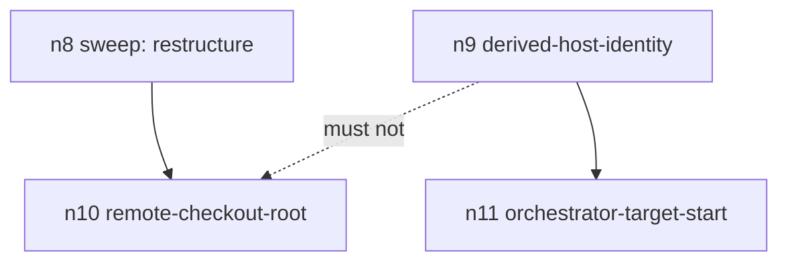
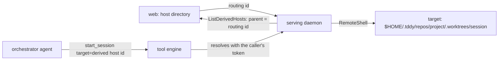

# Changeset: Derived hosts are offered under the daemon the web addresses

**Date**: 2026-11-16
**Status**: 🚧 In Progress
**Type**: Bug Fix
**Complexity**: 3 — one proto field, one id change in the daemon, a per-parent rewrite of one web source plus a refresh port, across six packages; every behaviour is drivable with in-memory connections
**Branch**: `feature/remote-shell/derived-host-identity`, base `feature/remote-shell/sweep` — `#remote-shell 9/11`

## Initial Discovery

Full codebase exploration that grounded this plan: [initial-discovery.md](./2026-11-16-remote-shell-derived-host-identity-initial-discovery.md).

State A below is distilled from that file. Do not duplicate grep traces or file dumps here.

## Prerequisites

Backlog entries checked (`docs/dev/todo/`, `packages/*/docs/code-issues/`):

- [`2026-11-16-coder-hosts-never-run-against-a-real-deployment.md`](../todo/2026-11-16-coder-hosts-never-run-against-a-real-deployment.md) — **during**: this node is the first consequence of that run. Kept open; `#remote-shell 11/11` decides whether it closes.
- [`2026-11-16-orchestrator-start-tool-cannot-start-on-a-target.md`](../todo/2026-11-16-orchestrator-start-tool-cannot-start-on-a-target.md) — **unrelated here**, claimed by `#remote-shell 11/11`.
- `packages/tddy-session-create-web/docs/code-issues/oversized-file-use-create-session-pane-state.md` — the sweep (`#remote-shell 8/11`) splits it; this node adds no line to that file (the failure renders in `CreateSessionHostField`).
- `packages/tddy-host-service/docs/code-issues/oversized-file-svc-host-builders.md`, `complexity-svc-host-builders-new.md` — the sweep's; untouched here.

## Affected Packages

- **tddy-service**: `KnownHostEntry.routing_instance_id = 9`
- **tddy-host-service**: parent id = routing id; `ListKnownHosts` fills the routing id of online rows
- **tddy-client-web**: per-parent derived listing, `DerivedHostsRefresh` port
- **tddy-web**: `DerivedHostDirectorySources` keeps per-parent answers; refresh and connect re-ask
- **tddy-session-create-web**: a parent's failure beside the Host field
- **tddy-hosts-web**: rows ask through the routing id
- **tddy-workspace-web**: Accounts connect and vault unlock call the refresh
- **tddy-rust-typescript-tests**: regenerated `host_pb.ts`

## Related Feature Documentation

- [PRD-2026-11-16-remote-shell-derived-host-identity.md](../../ft/web/1-WIP/PRD-2026-11-16-remote-shell-derived-host-identity.md)
- [Hosts screen](../../ft/web/hosts-screen.md)
- [Create-session package](../../ft/web/create-session-package.md)

## Summary

A derived host names its parent by the id the web addresses that daemon with — the routing id, which differs from the durable one when the daemon appends its startup timestamp — and the New-session form lists each daemon's derived hosts on its own: one daemon that never answers withholds nothing, an earlier answer is kept until a newer one arrives, a parent is asked again when it connects, when an account is connected and when the vault opens, and a parent's failure is shown beside the Host field. The Hosts screen asks an online row's daemon through the routing id it carries.

## Background

See the PRD.

## Responsibility

This PR owns:

- which id a derived host names as its parent, and which id an online known host says it answers on
- how the web's host directory asks daemons for their derived hosts: per parent, bounded, kept, refreshed, failures recorded
- the refresh port and its two callers
- the failure beside the Host field; the Hosts screen rows' addressing

## Boundaries

This PR does not:

- change how the daemon lists or judges derived hosts (`#remote-shell 5/11`, `7/11`);
- change what the form submits for a derived host;
- offer derived hosts to the orchestrator's start tool (`#remote-shell 11/11`);
- touch `tddy-agent-launch` or any file the sweep (`#remote-shell 8/11`) moves.

## Dependencies

None from this stack's behaviour. `feature/remote-shell/sweep` (`#remote-shell 8/11`) is beneath this branch in the line only because a registered stack is linear; this PR consumes nothing it delivers and must not edit a file the sweep moves.

## Successor PRs

- `#remote-shell 10/11` — `feature/remote-shell/remote-checkout-root` — a target session's checkout lives under the target user's home and is cut like a local one
- `#remote-shell 11/11` — `feature/remote-shell/orchestrator-target-start` — an orchestrator starts a session on a derived host

## Draft PR contract

The first push after the plan (commit 2) publishes, as the start of this same PR:

- `host.proto`: `KnownHostEntry.routing_instance_id = 9`, regenerated Rust and TypeScript
- `tddy-host-service/tests/derived_hosts_identity_acceptance.rs`: `a_derived_hosts_parent_is_the_id_its_daemon_answers_on`, `an_online_known_host_carries_the_routing_id_it_answers_on`, `an_offline_known_host_carries_no_routing_id`
- `tddy-client-web/src/hostDirectory/derivedSource.ts`: `askParentForDerivedHosts(parent, sessionToken, deadlineMs)`, `mergeParentAnswer(previous, answer)`, `DERIVED_LISTING_DEADLINE_MS`; `ports/derivedHostsRefresh.tsx`: `DerivedHostsRefreshProvider`, `useRefreshDerivedHosts()` (a no-op when no provider is mounted)
- `derivedSource.test.ts`: the five listing tests named below, failing
- `CreateSessionDerivedHostAcceptance.cy.tsx`: `a_parents_listing_failure_is_shown_beside_the_host_field`; `DerivedHostsAcceptance.cy.tsx`: `an_online_rows_derived_hosts_are_asked_through_its_routing_id`; `HostsScreenToolingAcceptance.cy.tsx`: `an_online_rows_tooling_is_asked_through_its_routing_id`; `AccountsScreen` and `CredentialVaultPrompt` refresh specs

This PR goes on to implement all of it. It does not merge in that state.

## Contract as published

The contract commit (commit 2) publishes exactly this; `/green` implements against it.

**Surface**

- `host.proto`: `KnownHostEntry.routing_instance_id = 9` — the id an online host answers RPCs on, empty offline. Rust and TypeScript regenerated.
- `tddy-host-service::multi_host::EligibleDaemonSource::routing_instance_id_of(&self, durable_host_id) -> Option<DaemonInstanceId>` — default pairs `live_known_hosts()` with `list_eligible_daemons()` by position; `ListKnownHosts` fills the field from it for online rows and from `local_instance_id_for_config` for this daemon.
- `tddy-client-web/src/hostDirectory/derivedSource.ts`: `DERIVED_LISTING_DEADLINE_MS = 20_000`, `ParentDerivedHosts { parentHostId, hosts, failure }`, `askParentForDerivedHosts(parent, sessionToken, deadlineMs?)` (never rejects), `mergeParentAnswer(previous, answer)`, `parentsToAsk(parents, asked, refreshed)`. The three functions throw "not implemented" until green; `listDerivedHosts` stays until the app's source moves off it, then goes.
- `tddy-client-web/src/ports/derivedHostsRefresh.tsx`: `DerivedHostsRefreshProvider({ refresh })`, `useRefreshDerivedHosts()` (no-op without a provider), `useDerivedHostListingFailures()` over the directory's derived source. Exported from the package index.
- Test ids: `create-session-derived-hosts-failure-<safe parent id>` on the New-session form.

**Red tests at the contract commit**

- `tddy-host-service/tests/derived_hosts_identity_acceptance.rs` — 3 tests: the parent id and the online row's routing id fail; the offline row's empty id passes already (the field is unfilled) and stays as the guard that green fills it for online rows only. The room is a stand-in `EligibleDaemonSource` whose `live_known_hosts` strips the stamp, as the LiveKit source does; the departed peer is pre-recorded in a `FileHostRegistry`, as the discovery tick records it.
- `tddy-client-web/src/hostDirectory/derivedSource.test.ts` — 5 tests under "derived hosts, one parent at a time".
- `tddy-hosts-web/cypress/component/DerivedHostsAcceptance.cy.tsx` — `asks an online row's derived hosts through its routing id`; `HostsScreenToolingMountAcceptance.cy.tsx` — `asks an online row's tooling through its routing id`.
- `tddy-session-create-web/cypress/component/CreateSessionDerivedHostAcceptance.cy.tsx` — `shows a parent's listing failure beside the Host field and still offers the daemon`.
- `tddy-workspace-web/cypress/component/ConnectCoderAccountAcceptance.cy.tsx` — the refresh is called once after an accepted connect, not after a refused one.

**Differences from the plan**

- The vault prompt's refresh (`unlocking_the_vault_refreshes_the_derived_hosts`) has no red test here: `CredentialVaultPrompt` is driven by `useAuth().unlockVault`, and no spec mounts it yet. It is written at green with an auth-port double, as the first step of that milestone, before the call is wired.
- The Hosts screen tests mount the screen with the directory listing the daemon by its routing id (the only id a connection exists under); the `tddy-web` wiring that keys the screen's `useHostClient` on `routing_instance_id || instance_id` is green's.
- The "a parent that becomes connected is asked" and "a refresh asks every connected parent again" behaviours are pinned on the pure `parentsToAsk` rather than on the React effect; the effect in `tddy-web` is a thin loop over it.

**Complexity re-scored:** 3 → 3. Six packages, but every piece is small and in-memory; nothing in the contract contradicted the plan.

## Green wave

**Wave:** 1 of 2
**Greenable independently:** yes — the daemon tests set `daemon_instance_id_append_startup_timestamp` in a config, the web tests use scripted connections; no LiveKit
**Concurrent with:** nothing in this stack: `n10` waits on the sweep, `n11` waits on this node
**Blocks:** `orchestrator-target-start` (resolves a derived host to the daemon the web addresses)

Real dependency edges, as opposed to the branch line:

    n8 (sweep) → n10      n9 → n11

Final design, all three merged:

## Scope

- [ ] `KnownHostEntry.routing_instance_id`, filled for online rows
- [ ] `ListDerivedHosts` parent = routing id
- [ ] per-parent derived listing in `tddy-client-web`, with deadline, kept answers, failures
- [ ] `DerivedHostsRefresh` port; Accounts connect and vault unlock call it; a parent that becomes connected is asked
- [ ] the failure beside the Host field
- [ ] Hosts screen rows ask through the routing id
- [ ] feature docs: hosts-screen.md, create-session-package.md

## Technical Changes

### State A (Current)

- `derived_hosts.rs:47` stamps the durable id; `listings.rs:115` answers `GetHostTooling` with the routing id; `KnownHostEntry` has no routing id.
- `derivedSource.ts` `listDerivedHosts(parents, token)` asks every connected parent with `Promise.all`; `derivedSource.tsx` keeps one `DerivedHostDirectorySource` and discards a superseded run; its effect depends on the parent ids, the connector and the token only.
- `DerivedHostRows.tsx` and `useHostTooling.ts` call `useHostClient(HostService, row.instanceId)` with the durable id.
- `CreateSessionHostField.tsx` renders the group and nothing about a failure.

### State B (Target)

- `KnownHostEntry.routing_instance_id` names what an online daemon answers on; `ListDerivedHosts` names the parent by it.
- The web asks each parent on its own (`askParentForDerivedHosts`), bounded by `DERIVED_LISTING_DEADLINE_MS`, merges per parent (`mergeParentAnswer`), re-asks a parent on connect and on `refreshDerivedHosts()`.
- The Host field shows `Could not list the hosts <parent> reaches: <reason>` beside itself.
- Hosts screen rows ask through `routing_instance_id || instance_id`.

### Delta (What's Changing)

See *Affected Packages* and *Responsibility*.

## Implementation Milestones

- [ ] proto field and daemon ids, green on the identity acceptance
- [ ] per-parent listing and refresh port, green on the client-web tests
- [ ] form failure, Hosts screen addressing, the two refresh callers, green on the Cypress specs
- [ ] feature docs updated

## Testing Plan

### Testing Strategy

Rust acceptance tests build a `HostServiceImpl` from a config with the timestamp flag on and a stub tooling probe; web unit tests drive `askParentForDerivedHosts`/`mergeParentAnswer` with scripted clients (one that never resolves, one that rejects, one slow); Cypress component specs mount the form and the Hosts screen over the existing in-memory host backends with a routing id that differs from the durable one.

No test uses LiveKit or a network service. Run `./test -p <package>` for each touched package; the whole-workspace result comes from CI.

### Coverage Requirements

Every acceptance criterion of the PRD has at least one named test below; each refusal and each distinct failure outcome has its own.

## Acceptance Tests

### tddy-host-service — `tests/derived_hosts_identity_acceptance.rs`
- `a_derived_hosts_parent_is_the_id_its_daemon_answers_on`
- `an_online_known_host_carries_the_routing_id_it_answers_on`
- `an_offline_known_host_carries_no_routing_id`

### tddy-client-web — `src/hostDirectory/derivedSource.test.ts`
- `a_parent_that_never_answers_withholds_only_its_own_hosts`
- `a_parents_earlier_answer_is_kept_until_a_newer_one_arrives`
- `a_call_past_its_deadline_is_that_parents_failure`
- `a_parent_that_becomes_connected_is_asked`
- `a_refresh_asks_every_connected_parent_again`

### tddy-session-create-web — `cypress/component/CreateSessionDerivedHostAcceptance.cy.tsx`
- `a_parents_listing_failure_is_shown_beside_the_host_field`

### tddy-hosts-web — `cypress/component/DerivedHostsAcceptance.cy.tsx`, `HostsScreenToolingAcceptance.cy.tsx`
- `an_online_rows_derived_hosts_are_asked_through_its_routing_id`
- `an_online_rows_tooling_is_asked_through_its_routing_id`

### tddy-workspace-web — `cypress/component/AccountsScreenCoderRefreshAcceptance.cy.tsx`, `CredentialVaultPromptRefreshAcceptance.cy.tsx`
- `connecting_a_coder_account_refreshes_the_derived_hosts`
- `unlocking_the_vault_refreshes_the_derived_hosts`

## Technical Debt & Production Readiness

(Populated during development.)

## Decisions & Trade-offs

- **The routing id is the parent.** It is what the web addresses a daemon with everywhere (connections, the directory, `daemon_instance_id` on a start); the durable id belongs to the registry. `GetHostTooling` already answers with the routing id, so this makes the two host RPCs agree.
- **The registry gains no second id.** `routing_instance_id` is filled at answer time from the eligible roster and this daemon's own id; nothing is persisted, so a restart cannot leave a stale one behind.
- **Per parent, not all-or-nothing.** One daemon's silence is one daemon's failure; the Hosts screen already behaves this way per row, and the form now matches it.
- **A refresh port rather than polling.** The two moments a listing goes stale are known (an account connected, the vault opened); each caller says so once.
- **Deadline over LiveKit.** A unary call to a listed peer may never answer; `DERIVED_LISTING_DEADLINE_MS` (20 s) turns that into a failure the form can show.

## Refactoring Needed

### From /validate-changes
### From /validate-tests
### From /validate-prod-ready
### From /analyze-clean-code

## Validation Results

### /validate-changes
### /validate-tests
### /validate-prod-ready
### /analyze-clean-code

## TODO

- [x] Record initial discovery (`2026-11-16-remote-shell-derived-host-identity-initial-discovery.md`)
- [x] Cross-check `packages/*/docs/code-issues/` and `docs/dev/todo/` for items this change touches (Step 2b)
- [x] Create/update PRD documentation
- [x] Create changeset (this document)
- [x] Create failing acceptance tests
- [x] Run acceptance tests (verify they fail)
- [x] USER REVIEW — acceptance tests (approved in advance by the developer's standing instruction for this stack's review gates)
- [ ] TDD Red — write failing unit/integration tests
- [ ] TDD Green — implement with quality code
- [ ] Update documentation with progress
- [ ] Repeat Red→Green→Update cycle until feature complete
- [ ] Run the touched packages' tests (`./test -p {package}` per package) — verify 100% pass
- [ ] Validate changes (/validate-changes)
- [ ] Refactor issues from change validation
- [ ] USER REVIEW — development complete
- [ ] Validate tests (/validate-tests)
- [ ] Refactor test issues
- [ ] Validate production readiness (/validate-prod-ready)
- [ ] Refactor production readiness issues
- [ ] Analyze code quality (/analyze-clean-code)
- [ ] Refactor code quality issues
- [ ] Final validation (/validate-changes)
- [ ] Linting and formatting (`cargo clippy -p {package} -- -D warnings`, `cargo fmt`)
- [ ] USER REVIEW — scope developed, every gap approved: ready to wrap
