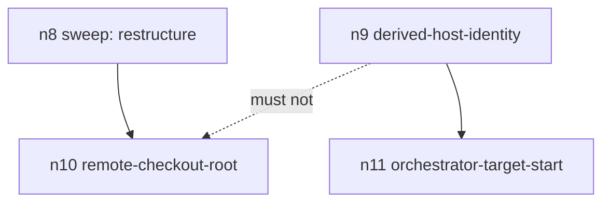
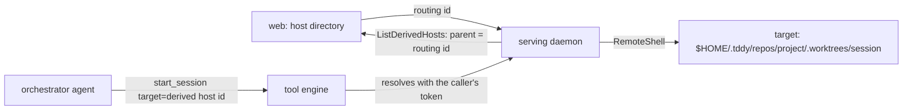

# Changeset: An orchestrator starts a session on a derived host

**Date**: 2026-11-16
**Status**: 🚧 In Progress
**Type**: Feature
**Complexity**: 4 — a new argument on the start tool with daemon-side resolution of a derived-host id for the caller, a new start-options list, the parity test's withheld→offered move, across three crates
**Branch**: `feature/remote-shell/orchestrator-target-start`, base `feature/remote-shell/remote-checkout-root` — `#remote-shell 11/11`

## Initial Discovery

Full codebase exploration that grounded this plan: [initial-discovery.md](./2026-11-16-remote-shell-orchestrator-target-start-initial-discovery.md).

State A below is distilled from that file. Do not duplicate grep traces or file dumps here.

## Prerequisites

Backlog entries checked:

- [`2026-11-16-orchestrator-start-tool-cannot-start-on-a-target.md`](../todo/2026-11-16-orchestrator-start-tool-cannot-start-on-a-target.md) — ✅ RESOLVED HERE. This node's `/wrap-context-docs` deletes the file.
- [`2026-11-16-coder-hosts-never-run-against-a-real-deployment.md`](../todo/2026-11-16-coder-hosts-never-run-against-a-real-deployment.md) — **answered**: nodes 9–11 are what the run found; the entry is narrowed at wrap to what still has no real-deployment evidence (the hook follower on a Coder workspace), not deleted.
- `packages/tddy-tool-engine/docs/code-issues/complexity-start-session-args-schema-schema-offering.md` — **during**: this node adds one field to that schema; the function must not grow beyond its recorded size (the new text is a constant, not a branch).

## Affected Packages

- **tddy-tool-engine**: `derived_hosts` in the options, `target` on the start, parity move, schema text
- **tddy-daemon-rpc**: lists derived hosts; resolves `target` for the caller before the request
- **tddy-host-service**: `resolve_derived_host(subject, parent, id)`

## Related Feature Documentation

- [PRD-2026-11-16-remote-shell-orchestrator-target-start.md](../../ft/daemon/1-WIP/PRD-2026-11-16-remote-shell-orchestrator-target-start.md)
- [Project concept — project-home tools](../../ft/daemon/project-concept.md)

## Summary

An orchestrator agent can start a session on an SSH host or a Coder workspace: `DescribeSessionStartOptions` lists the derived hosts the daemon reaches (kind, parent, usable, reason), `start_session` takes `target` — a derived-host id — which the daemon resolves for the **caller** (the calling session's token names whose Coder account is read) into the parent daemon and the host's `SessionTarget`; an unknown id is refused naming the listed ones, an unusable host with its reason. The parity test moves `target` from withheld to offered, and the tool's text says a wildcard `Host` entry is not an alias.

## Background

See the PRD.

## Responsibility

This PR owns:

- how an orchestrator names a derived host and how the daemon resolves it for the caller
- the derived-host list in the start options
- the parity test's verdict on `target`

## Boundaries

This PR does not:

- change how derived hosts are listed or judged;
- change how the daemon starts on a target;
- touch the web.

## Dependencies

What each parent PR delivers that this PR consumes. These surfaces are **theirs to create**;
implementing one here collides with the PR that owns it.

| Parent node | What it delivers | How this PR consumes it | This PR does NOT |
|---|---|---|---|
| `#remote-shell 9/11` — `feature/remote-shell/derived-host-identity` | `DerivedHost.parent_instance_id` is the routing id | sets `daemon_instance_id` on the request from the resolved host's parent, which then routes | stamp or alter the parent id |

## Successor PRs

None. This is the top of the stack.

## Draft PR contract

The first push after the plan (commit 2) publishes, as the start of this same PR:

- `tddy-tool-engine/src/start_options.rs`: `DerivedHostChoice { id, label, kind, parent_daemon_instance_id, usable, unusable_reason }`, `StartOptions.derived_hosts`, `StartOptions.derived_hosts_unavailable`; `start_session_args.rs`: `StartSessionArgs.target`, `target` moved from `INTERNAL_START_FIELDS` to `offered_start_fields`, the schema text
- `tddy-host-service/src/derived_host_resolution.rs`: `resolve_derived_host(sources, subject, id) -> Result<ResolvedDerivedHost { parent_instance_id, target }, DerivedHostResolutionError::{Unknown { listed }, Unusable { reason }, Listing(String)}>`
- `tddy-tool-engine/tests/start_options.rs`: `start_options_list_the_derived_hosts_the_host_reaches`, `an_unanswerable_derived_host_list_says_why`; `tests/start_session_schema.rs`: `the_start_tool_offers_target_as_a_derived_host_id`; `tests/start_session_args_parity.rs` updated — failing
- `tddy-daemon-rpc/tests/project_home_start_target_acceptance.rs`: the four tests named below, failing

This PR goes on to implement all of it. It does not merge in that state.

## Contract as published

The contract commit (commit 2) publishes exactly this; `/green` implements against it.

**Surface**

- `tddy-tool-engine`: `start_options::DerivedHostChoice { id, label, kind, parent_daemon_instance_id, usable, unusable_reason }`, `StartOptions.derived_hosts`, `StartOptions.derived_hosts_unavailable`; `StartSessionArgs.target: String`; `target` moved out of `INTERNAL_START_FIELDS` and offered by the schema with its description; `ssh_config_host`'s description says a wildcard `Host` is not an alias and points at `target`. `into_request` does not yet carry `target` — the daemon resolves the id before the request is built, so the field never reaches the request as a string.
- `tddy-host-service`: `HostServiceImpl::resolve_derived_host(&self, session_token, id) -> Result<ResolvedDerivedHost, DerivedHostResolutionError>` (`service/derived_host_resolution.rs`, re-exported at the crate root), `ResolvedDerivedHost { parent_instance_id, target }`, `DerivedHostResolutionError::{Unauthenticated, Listing, Unknown { id, listed }, Unusable { id, reason }}` with `Display`. The body is `todo!()` until green.
- `tddy-daemon-rpc`: `describe_start_options` fills the two new fields with an empty list and a placeholder reason (`FIXME`); the start handler does not read `target` yet.
- `tddy-session-create-web/cypress/support/fixtures/start-session-tool-fields.json`: `target` added to `offered` (34 fields), as the parity test requires; the web's `createSessionRequestParity.cy.ts` runs over it at green.

**Red tests at the contract commit**

- `tddy-host-service/tests/derived_host_resolution_acceptance.rs` — 3 tests (a listed SSH alias and a running Coder workspace resolve; an unknown id is refused naming the listed ids; a stopped workspace is refused with its reason); all panic on `todo!()`.
- `tddy-daemon-rpc/tests/start_options_acceptance.rs` — `the_derived_hosts_are_offered_and_the_list_is_answered` fails on the placeholder reason.
- `tddy-daemon-rpc/tests/project_home_start_target_acceptance.rs` — `a_start_naming_an_unknown_derived_host_is_refused_naming_the_listed_ones` fails: the handler starts a local session instead of refusing.
- Guards that already pass: `tddy-tool-engine/tests/start_session_schema.rs` `target_is_offered_as_a_derived_host_id`, `ssh_config_host_says_a_wildcard_is_not_an_alias`; `tests/start_options.rs` `a_derived_host_choice_carries_what_a_start_needs_and_what_an_agent_reads`; the four parity tests.

**Differences from the plan**

- The daemon-rpc acceptance proves the refusal, not a start that lands: the test hosts' operator has no SSH config and no Coder account, and the stub-target fixtures live in `tddy-session-lifecycle`. The landing test (`a_start_naming_a_derived_host_runs_on_its_parent_with_the_hosts_target`) and `a_coder_derived_host_is_resolved_with_the_callers_own_account` are written at green beside `derived_host_start_acceptance`, with a project-home session issuing the start.
- The options' parity with `ListDerivedHosts` over a host that does reach hosts is green's too: `TestDaemon` does not expose `HostService`.
- Resolution is a method on `HostServiceImpl` rather than a free function over sources: the sources (operator files, tooling cache, Coder ports) are the service's own.

**Complexity re-scored:** 4 → 4.

## Green wave

**Wave:** 2 of 2
**Greenable independently:** after `#remote-shell 9/11`: the derived host's parent is the id the daemon routes on, so a start addressed to it lands
**Concurrent with:** `remote-checkout-root`
**Blocks:** nothing — top of the stack

Real dependency edges, as opposed to the branch line:

    n8 (sweep) → n10      n9 → n11

Final design, all three merged:

## Scope

- [x] `DerivedHostChoice` list in the start options
- [x] `target` on `start_session`, resolved for the caller
- [x] unknown and unusable refusals
- [x] parity: `target` offered; schema text on wildcards
- [ ] docs: project-concept.md; TODO deleted at wrap

## Technical Changes

### State A (Current)

- `INTERNAL_START_FIELDS` withholds `target`; `StartSessionArgs` has no such field; `StartOptions` lists `ssh_config_hosts` only.
- `project_home_start_options.rs:105` asks `HostService::list_ssh_config_hosts`; nothing asks `list_derived_hosts`.
- The start handler builds `StartSessionRequest` from the args and never sets `target`.

### State B (Target)

- `StartOptions.derived_hosts` from `HostService::list_derived_hosts` on the described host; `StartSessionArgs.target`.
- The handler resolves `target` with `resolve_derived_host` over the parent's listing for the caller, sets `daemon_instance_id` and `target`, refuses unknown/unusable.
- Parity offers `target`; the schema says what a wildcard `Host` is.

### Delta (What's Changing)

See *Affected Packages* and *Responsibility*.

## Implementation Milestones

- [x] tool-engine fields, schema and parity green
- [x] host-service resolution green
- [x] daemon-rpc options and start acceptance green
- [ ] docs; TODO deleted (wrap)

## Testing Plan

### Testing Strategy

Tool-engine tests run the options and the schema over fixtures; host-service tests resolve ids against in-memory sources (SSH config files, a Coder account source double); daemon-rpc acceptance drives `ExecuteTool` on a project-home session with a stub host service that lists one SSH alias and one stopped Coder workspace and asserts the `StartSession` the handler forwards. No LiveKit.

No test uses LiveKit or a network service. Run `./test -p <package>` for each touched package; the whole-workspace result comes from CI.

### Coverage Requirements

Every acceptance criterion of the PRD has at least one named test below; each refusal and each distinct failure outcome has its own.

## Acceptance Tests

### tddy-tool-engine — `tests/start_options.rs`, `tests/start_session_schema.rs`, `tests/start_session_args_parity.rs`
- `start_options_list_the_derived_hosts_the_host_reaches`
- `an_unanswerable_derived_host_list_says_why`
- `the_start_tool_offers_target_as_a_derived_host_id`
- `target_is_offered_not_withheld`

### tddy-host-service — `tests/derived_host_resolution_acceptance.rs`
- `a_listed_derived_host_resolves_to_its_parent_and_target`
- `an_unknown_derived_host_is_refused_naming_the_listed_ones`
- `an_unusable_derived_host_is_refused_with_its_reason`

### tddy-daemon-rpc — `tests/project_home_start_target_acceptance.rs`
- `a_start_naming_a_derived_host_runs_on_its_parent_with_the_hosts_target`
- `a_start_naming_an_unknown_derived_host_is_refused_naming_the_listed_ones`
- `a_start_naming_an_unusable_derived_host_is_refused_with_its_reason`
- `a_coder_derived_host_is_resolved_with_the_callers_own_account`

## Technical Debt & Production Readiness

(Populated during development.)

## Decisions & Trade-offs

- **By id, resolved on the daemon.** The agent names what the options listed; the daemon turns the id back into the parent and the `SessionTarget` it listed, so the tool never carries a `SessionTarget` an agent could compose.
- **The caller's account.** The tool call is made with the calling session's token, which resolves to the person the session belongs to; their vault is the one the daemon reads, exactly as the web's start does. No shared or daemon-wide Coder account.
- **Wildcards stay unlisted.** `Host coder.*` matches names, it is not a host; the Coder workspaces it would reach are listed under `derived_hosts` with their state.

## Refactoring Needed

### From /validate-changes
### From /validate-tests
### From /validate-prod-ready
### From /analyze-clean-code

## Validation Results

### /validate-changes
### /validate-tests
### /validate-prod-ready
### /analyze-clean-code

## TODO

- [x] Record initial discovery (`2026-11-16-remote-shell-orchestrator-target-start-initial-discovery.md`)
- [x] Cross-check `packages/*/docs/code-issues/` and `docs/dev/todo/` for items this change touches (Step 2b)
- [x] Create/update PRD documentation
- [x] Create changeset (this document)
- [x] Create failing acceptance tests
- [x] Run acceptance tests (verify they fail)
- [x] USER REVIEW — acceptance tests (approved in advance by the developer's standing instruction for this stack's review gates)
- [ ] TDD Red — write failing unit/integration tests
- [x] TDD Green — implement with quality code
- [ ] Update documentation with progress
- [ ] Repeat Red→Green→Update cycle until feature complete
- [ ] Run the touched packages' tests (`./test -p {package}` per package) — verify 100% pass
- [ ] Validate changes (/validate-changes)
- [ ] Refactor issues from change validation
- [ ] USER REVIEW — development complete
- [ ] Validate tests (/validate-tests)
- [ ] Refactor test issues
- [ ] Validate production readiness (/validate-prod-ready)
- [ ] Refactor production readiness issues
- [ ] Analyze code quality (/analyze-clean-code)
- [ ] Refactor code quality issues
- [ ] Final validation (/validate-changes)
- [ ] Linting and formatting (`cargo clippy -p {package} -- -D warnings`, `cargo fmt`)
- [ ] USER REVIEW — scope developed, every gap approved: ready to wrap
