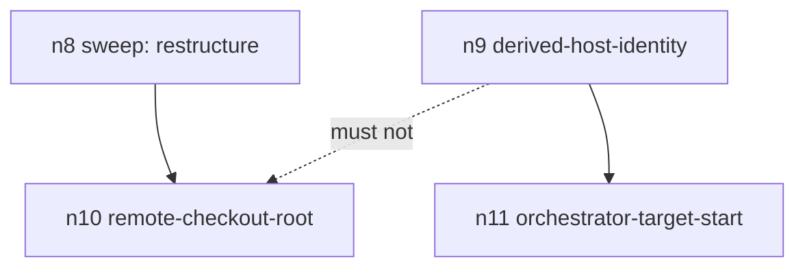
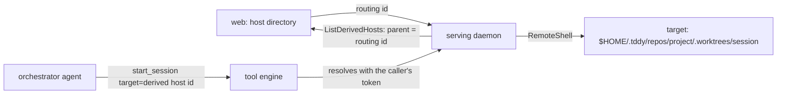

# Changeset: A target session's checkout lives under the target user's home and is cut like a local one

**Date**: 2026-11-16
**Status**: 🚧 In Progress
**Type**: Bug Fix
**Complexity**: 4 — a new remote checkout plan in `tddy-git` consumed by the start, the delete and the pack path, driven through the remote-shell port on files the sweep is moving
**Branch**: `feature/remote-shell/remote-checkout-root`, base `feature/remote-shell/derived-host-identity` — `#remote-shell 10/11`

## Initial Discovery

Full codebase exploration that grounded this plan: [initial-discovery.md](./2026-11-16-remote-shell-remote-checkout-root-initial-discovery.md).

State A below is distilled from that file. Do not duplicate grep traces or file dumps here.

## Prerequisites

Backlog entries checked:

- [`2026-11-16-coder-hosts-never-run-against-a-real-deployment.md`](../todo/2026-11-16-coder-hosts-never-run-against-a-real-deployment.md) — **during**: the second consequence of that run. Kept open.
- `packages/tddy-agent-launch/docs/code-issues/complexity-opencode-cli-spawn-start-cli-harness-session.md` (368 lines) — **sequencing**: claimed by the sweep (`#remote-shell 8/11`) as not restorable; this node must not grow `start_cli_harness_session`: the intent is passed through `CliWorktreeStart`, which the function already fills.
- `packages/tddy-agent-launch/docs/code-issues/oversized-file-remote-agent-launch.md` — the sweep splits it; this node does not edit `remote_agent_launch`.
- `packages/tddy-worktree-service/docs/code-issues/oversized-file-remote-git-service.md` — the sweep's; this node edits `tddy-session-activity`, not that file.

## Affected Packages

- **tddy-git**: `remote_checkout.rs`: root resolution, plan, typed errors; `ssh_worktree.rs` calls it; `default_remote_repo_root` gone
- **tddy-agent-launch**: the remote cut honours the intent; delete removes and prunes on every target kind
- **tddy-session-activity**: `remote_repo_path_for_session` has no fallback root

## Related Feature Documentation

- [PRD-2026-11-16-remote-shell-remote-checkout-root.md](../../ft/daemon/1-WIP/PRD-2026-11-16-remote-shell-remote-checkout-root.md)
- [Remote managed worktree](../../ft/daemon/remote-managed-worktree.md)
- [Claude CLI session](../../ft/daemon/claude-cli-session.md)

## Summary

A session whose agent runs on a target — an SSH host or a Coder workspace — gets its checkout under the target user's own home, `$HOME/.tddy/repos/<project>`, resolved on the target through the remote shell; the worktree `.worktrees/<session>` is cut with the same branch intent, base ref and new-branch name a local start honours; a clone, fetch or cut that fails refuses the start with the target's own words; deleting the session removes the worktree on the target, for a Coder target too, and unregisters it from the clone. The fixture default `/home/dev/<repo>` leaves production.

## Background

See the PRD.

## Responsibility

This PR owns:

- where a target session's checkout lives and how it is cut, fetched and removed on the target
- the words a failed remote cut reports
- the remote pack path's refusal of a record without a path

## Boundaries

This PR does not:

- change the launch on the target (`remote_agent_launch`, hooks, pointer);
- change where a **local** session's worktree lives;
- offer a per-project remote root to operators (recorded as a follow-up if asked);
- touch `start_cli_harness_session`'s body beyond the fields `CliWorktreeStart` already receives.

## Dependencies

What each parent PR delivers that this PR consumes. These surfaces are **theirs to create**;
implementing one here collides with the PR that owns it.

| Parent node | What it delivers | How this PR consumes it | This PR does NOT |
|---|---|---|---|
| `#remote-shell 8/11` — `feature/remote-shell/sweep` | the restructured `tddy-agent-launch` (plan A and B: `remote_agent_launch/{startup,target}.rs`, `svc_start_session_core/started_session_name.rs`) | edits `cli_session_worktree.rs` and `svc_signal_delete_session.rs` in their post-sweep place | move or split any file |

## Successor PRs

- `#remote-shell 11/11` — `feature/remote-shell/orchestrator-target-start` — an orchestrator starts a session on a derived host

## Draft PR contract

The first push after the plan (commit 2) publishes, as the start of this same PR:

- `tddy-git/src/remote_checkout.rs`: `RemoteBranch::{NewFrom { name, base_ref }, Existing { name }}`, `RemoteWorktreeRequest { git_url, project_name, session_id, branch }`, `RemoteCheckout { root, worktree, branch }`, `RemoteCheckoutError::{HomeUnresolved(String), Clone { url, stderr }, Fetch(String), Worktree(String), Shell(RemoteShellError)}` with `Display`, `remote_checkout_root(shell, project_name)`, `setup_worktree_for_session_over_ssh(shell, &RemoteWorktreeRequest) -> Result<RemoteCheckout, RemoteCheckoutError>` (the old signature is removed; its two callers compile against the new one with the intent they already hold)
- `tddy-git/tests/remote_checkout_acceptance.rs`: the six tests named below, failing against `InMemoryShell`
- `tddy-agent-launch/tests/target_checkout_acceptance.rs`: `a_coder_target_start_cuts_its_checkout_under_the_workspace_users_home`, `deleting_a_coder_target_session_removes_its_worktree_on_the_workspace`, `deleting_a_target_session_unregisters_the_worktree_from_the_targets_clone`
- `tddy-session-activity`: `a_remote_pack_for_a_session_without_a_recorded_path_is_refused`
- `tddy-git/tests/no_fixture_root_in_production.rs`: `no_production_source_names_home_dev`

This PR goes on to implement all of it. It does not merge in that state.

## Contract as published

The contract commit (commit 2) publishes exactly this; `/code-restructuring` is not involved — `/green` implements against it.

**Surface**

- `tddy-git/src/remote_checkout.rs` (re-exported at the crate root and through `tddy_core`): `REMOTE_REPOS_DIR = ".tddy/repos"`, `RemoteBranch::{NewFrom { name, base_ref }, Existing { name }}`, `RemoteWorktreeRequest { git_url, session_id, branch }`, `RemoteCheckout { root, worktree, branch }`, `RemoteCheckoutError::{HomeUnresolved, Clone { url, stderr }, Fetch, Worktree, Shell}` (+ `Display`, `From<RemoteShellError>`), `repository_name_of(git_url)`, `remote_checkout_root(shell, git_url)`, `setup_remote_worktree(shell, &request)`. The bodies are `todo!()` until green. **The root is named by the repository the git URL names**, not by the project's registry name: the cut has the URL and not the project record, and the two differ only when an operator renamed a project.
- `setup_worktree_for_session_over_ssh` and `default_remote_repo_root` stay through the contract commit and go at green, when `cli_session_worktree::remote_worktree_through`, `remote_git_pack_execution` and the four `tddy-session-lifecycle` acceptance suites that read `default_remote_repo_root("")` as the stub target's checkout (`remote_target_session_acceptance`, `coder_target_session_acceptance`, `derived_host_start_acceptance`, `remote_hooks_session_acceptance`) move to the resolved root.
- `tddy-agent-launch`: `remove_target_worktree(shell: &dyn RemoteShell, worktree)` takes the shell; `target_checkout_root_of(worktree)` names the clone. The delete still resolves the shell with `shell_for_target` (a `FIXME` marks it): resolving a Coder target's shell with the caller's account is green's, and its test is in `tddy-session-lifecycle` beside `coder_target_session_acceptance`.

**Red tests at the contract commit**

- `tddy-git/tests/remote_checkout_acceptance.rs` — 7 tests over `InMemoryShell` (the six planned plus `the_repository_name_is_the_urls_last_segment_without_git`); all panic on `todo!()`.
- `tddy-git/tests/no_fixture_root_in_production.rs` — `no_production_source_names_home_dev` fails on `ssh_exec.rs`.
- `tddy-agent-launch` (in-crate): `cli_session_worktree::remote_cut_tests::a_target_checkout_is_cut_under_the_targets_home_from_the_requested_branch_and_base`, `svc_signal_delete_session::target_worktree_removal_tests::removing_a_target_worktree_unregisters_it_from_the_clone` fail; `a_worktrees_clone_is_two_directories_up` passes (the helper is implemented).
- `tddy-session-activity`: `a_remote_pack_for_a_session_without_a_recorded_path_packs_locally_rather_than_guessing` fails. The existing `resolver_picks_an_ssh_backed_session_for_the_project` asserts the guessed `/home/dev/repo/.worktrees/sess-b`; green rewrites it to a recorded path.

**Differences from the plan**

- The agent-launch tests are in-crate unit tests over `remote_worktree_through` and `remove_target_worktree`, not a new `tests/target_checkout_acceptance.rs`: both seams take the shell, so the in-memory shell drives them without a daemon. The two Coder-target end-to-end tests (`a_coder_target_start_cuts_its_checkout_under_the_workspace_users_home`, `deleting_a_coder_target_session_removes_its_worktree_on_the_workspace`) are written at green in `tddy-session-lifecycle`, where the stub-target fixtures are.
- `a_remote_pack_for_a_session_without_a_recorded_path` packs **locally** rather than refusing: the resolver's existing answer for "no SSH session" is a local pack, and a record without a path is treated as not SSH-backed. Refusing would need a new `PackExecution` variant for one corrupt-record case.

**Complexity re-scored:** 4 → 4.

## Green wave

**Wave:** 2 of 2
**Greenable independently:** after `#remote-shell 8/11` (the sweep) is green: it moves `cli_session_worktree.rs`'s neighbours and `svc_signal_delete_session.rs`
**Concurrent with:** `orchestrator-target-start`
**Blocks:** nothing

Real dependency edges, as opposed to the branch line:

    n8 (sweep) → n10      n9 → n11

Final design, all three merged:

## Scope

- [ ] `remote_checkout_root` through the shell; `$HOME/.tddy/repos/<project>`
- [ ] `RemoteWorktreeRequest` with the branch intent; `RemoteCheckout`; typed errors with the target's words
- [ ] `default_remote_repo_root` removed from production
- [ ] the remote cut in `cli_session_worktree.rs` passes the intent
- [ ] delete: shell resolved for every target kind, `worktree remove` + `prune`
- [ ] `remote_repo_path_for_session` without a fallback
- [ ] feature docs updated

## Technical Changes

### State A (Current)

- `ssh_exec.rs:40` `default_remote_repo_root` → `/home/dev/<repo>`; `ssh_worktree.rs` clones there and cuts `-b tddy-<session> HEAD`; result is a `String` path, errors are `String`.
- `cli_session_worktree.rs:cut_worktree` computes `worktree_base_ref` and then calls `remote_worktree_through(start, git_url, shell)` without it.
- `svc_signal_delete_session.rs:remove_target_worktree` uses `shell_for_target` (SSH only) and `rm -rf`.
- `remote_git_pack_execution.rs:75` falls back to `default_remote_repo_root(git_url)/.worktrees/<session>`.

### State B (Target)

- `remote_checkout.rs` resolves the root on the target, plans the cut from the request's branch, runs clone/fetch/add through the shell, returns `RemoteCheckout`, fails with `RemoteCheckoutError` carrying stderr.
- `cut_worktree` passes `RemoteBranch` derived from `start.intent`, `start.new_branch_name`, `start.selected_integration_base_ref`, `start.selected_branch_to_work_on`.
- Delete resolves the shell with `shell_for_session_target` and runs `git -C <root> worktree remove --force <wt>; git -C <root> worktree prune`.
- The pack path refuses a record without `repo_path`.

### Delta (What's Changing)

See *Affected Packages* and *Responsibility*.

## Implementation Milestones

- [ ] `tddy-git` plan, root and errors green over `InMemoryShell`
- [ ] the start passes the intent; the delete handles every target kind; green on `tddy-agent-launch`
- [ ] the pack path without a fallback; docs; `/home/dev` gone

## Testing Plan

### Testing Strategy

`InMemoryShell` scripts `printf '%s' "$HOME"` and the git commands and records every command run; tests assert the exact remote command lines (root, branch, base), the error words on a scripted failure, and the delete's commands. The agent-launch acceptance drives a Coder target through a credential-source double and the same in-memory shell, as `#remote-shell 7/11`'s tests do. No `ssh`, no network.

No test uses LiveKit or a network service. Run `./test -p <package>` for each touched package; the whole-workspace result comes from CI.

### Coverage Requirements

Every acceptance criterion of the PRD has at least one named test below; each refusal and each distinct failure outcome has its own.

## Acceptance Tests

### tddy-git — `tests/remote_checkout_acceptance.rs`
- `the_checkout_root_is_under_the_target_users_home`
- `a_target_whose_home_cannot_be_read_is_refused_with_its_words`
- `a_new_branch_is_cut_from_its_base_ref_on_the_target`
- `an_existing_branch_is_checked_out_on_the_target`
- `a_clone_that_fails_reports_the_targets_words`
- `a_cut_names_no_tddy_session_branch`

### tddy-git — `tests/no_fixture_root_in_production.rs`
- `no_production_source_names_home_dev`

### tddy-agent-launch — `tests/target_checkout_acceptance.rs`
- `a_coder_target_start_cuts_its_checkout_under_the_workspace_users_home`
- `deleting_a_coder_target_session_removes_its_worktree_on_the_workspace`
- `deleting_a_target_session_unregisters_the_worktree_from_the_targets_clone`

### tddy-session-activity — `src/remote_git_pack_execution.rs` tests
- `a_remote_pack_for_a_session_without_a_recorded_path_is_refused`

## Technical Debt & Production Readiness

(Populated during development.)

## Decisions & Trade-offs

- **`$HOME/.tddy/repos/<project>`, resolved on the target.** The target user's home is the one directory a bare SSH host or a Coder workspace is sure to let its user write; `.tddy/` is already the name tddy uses for its own state on a host. A per-project override is a follow-up, not this fix.
- **The target's words, verbatim.** A clone fails for reasons only the target knows (no credentials there, a private repository, no network); the operator reads them as git wrote them.
- **The legacy exec-host mode moves too.** It shares the cut, and `/home/dev` was never right for it either.
- **No fallback path on the pack route.** A record without a path is a record this daemon did not write; guessing a path would pack a stranger's checkout.

## Refactoring Needed

### From /validate-changes
### From /validate-tests
### From /validate-prod-ready
### From /analyze-clean-code

## Validation Results

### /validate-changes
### /validate-tests
### /validate-prod-ready
### /analyze-clean-code

## TODO

- [x] Record initial discovery (`2026-11-16-remote-shell-remote-checkout-root-initial-discovery.md`)
- [x] Cross-check `packages/*/docs/code-issues/` and `docs/dev/todo/` for items this change touches (Step 2b)
- [x] Create/update PRD documentation
- [x] Create changeset (this document)
- [x] Create failing acceptance tests
- [x] Run acceptance tests (verify they fail)
- [x] USER REVIEW — acceptance tests (approved in advance by the developer's standing instruction for this stack's review gates)
- [ ] TDD Red — write failing unit/integration tests
- [ ] TDD Green — implement with quality code
- [ ] Update documentation with progress
- [ ] Repeat Red→Green→Update cycle until feature complete
- [ ] Run the touched packages' tests (`./test -p {package}` per package) — verify 100% pass
- [ ] Validate changes (/validate-changes)
- [ ] Refactor issues from change validation
- [ ] USER REVIEW — development complete
- [ ] Validate tests (/validate-tests)
- [ ] Refactor test issues
- [ ] Validate production readiness (/validate-prod-ready)
- [ ] Refactor production readiness issues
- [ ] Analyze code quality (/analyze-clean-code)
- [ ] Refactor code quality issues
- [ ] Final validation (/validate-changes)
- [ ] Linting and formatting (`cargo clippy -p {package} -- -D warnings`, `cargo fmt`)
- [ ] USER REVIEW — scope developed, every gap approved: ready to wrap
