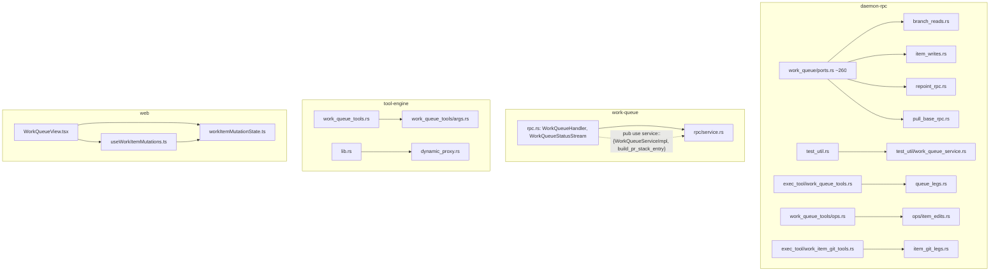

# Changeset: `#workqueue` sweep — split the files the stack left over 500 lines, close its code issues and closable TODOs

**Date**: 2026-11-23
**Status**: 🚧 In Progress — `[G]` and validate done 2026-11-23; wrap next
**Type**: Refactor
**Stack**: `#workqueue` 15/15 (gh stack #1016), on `feature/workqueue/land-propagate` (#1015, `f53459523`)
**Branch**: `feature/workqueue/sweep`

## Initial Discovery

Full exploration that grounded this plan:
[2026-11-23-workqueue-sweep-initial-discovery.md](./2026-11-23-workqueue-sweep-initial-discovery.md).
State A below is distilled from it.

## Responsibility

The stack's post-pipeline sweep, in one PR:

1. **Split** every source the stack created or grew past 500 lines (initial discovery § 1) — whole-item
   moves into child modules, and inline test modules into their own files.
2. **Close** every code-issue record the stack added, and narrow the one it regressed
   (`oversized-file-service.md`).
3. **Delete** the two backlog entries whose remedy needs no decision:
   `docs/dev/todo/2026-11-23-count-only-shape-tests.md` and
   `docs/dev/todo/2026-11-22-stack-helpers-with-no-production-caller.md` (by deleting the dead writer and
   validator it names).
4. **Record** every other stack backlog entry as needing the operator (§ Decisions), changing none.

## Boundaries

- **No behaviour change.** No RPC, tool, refusal message, wire shape or UI changes; every moved body is
  moved, not rewritten. The one deletion (`docs.rs` writer/validator) removes code with no production caller.
- Does not fix the restructure engine (`#[path]` walk, guarded-range extract): those are their own backlog
  entries. A seam the engine refuses is either moved by hand **with the operator's consent** (§ Decisions D1)
  or left open with the refusal recorded on its record.
- Does not touch files over budget that the stack did not grow (initial discovery § 1, first paragraph).
- Does not close the `complexity-*` records moved into `tddy-work-queue` by #1004 — pre-existing, not added.
- Does not run `/analyze-code-issues` coverage (§ Decisions D3).

## Dependencies

- **#1015 (`#workqueue` 14/14)** — the tip every file is measured against; its `land.rs`,
  `work_queue_tools.rs` schedule leg and `WorkQueueView.tsx` land state are among what moves.
- Nothing is taken from any other stack. No code-issue record touched here is claimed by another PR.

## Draft PR contract

A Refactor sweep publishes no new surface: every public path a consumer names today
(`tddy_work_queue::rpc::{WorkQueueHandler, WorkQueueServiceImpl, build_pr_stack_entry, WorkQueueStatusStream}`,
`tddy_work_queue::docs::{node_doc_paths, NodeDocPaths, NODE_*, PR_STACK_PLAN_MD_BASENAME}`,
`tddy_daemon_rpc::test_util::*`, the tool-engine's `work_queue_tools::*`) still resolves after it. The removed
public items are `tddy_work_queue::docs::{StackDocsOutput, NodeDocs, validate_stack_docs, write_stack_docs}`.
The contract is the **Baseline** below: same failing set by name, before and after.

## Affected Packages

- **tddy-daemon-rpc** — `work_queue/ports.rs`, `test_util.rs`, `exec_tool/work_queue_tools.rs`,
  `exec_tool/work_queue_tools/ops.rs`, `exec_tool/work_item_git_tools.rs`, `work_queue/land.rs`
  - `docs/architecture.md` § module table, `work_queue` row — lists `ports.rs (WorkQueueHandler)` and its siblings
- **tddy-work-queue** — `rpc.rs`, `git_ops.rs`, `item_ops/nodes.rs`, `assess.rs`, `docs.rs`
  - `README.md` module table (`rpc.rs` row); `docs/architecture.md` § `rpc.rs` and the `docs` paragraph (lines 70–72)
- **tddy-tool-engine** — `work_queue_tools.rs`, `work_item_git_tools.rs`, `lib.rs`
- **tddy-changeset** — `changeset/work_queue.rs`
- **tddy-workqueue-web** — `WorkQueueView.tsx`
- **tddy-worktree-service** — `service.rs` (seam W, attempt)
- **tddy-core**, **tddy-daemon-rpc** tests — the empty size-budget banners

## Related Feature Documentation

None — behaviour-preserving restructure. No PRD.

## Summary

Fifteen files shrink. Nine Rust files lose an impl block, a function group or an inline module to a child
module: eight by the engine, and `ports.rs` by hand only if the operator consents (seven method bodies move to
inherent methods in sibling modules, because the engine cannot cut a trait impl). `WorkQueueView.tsx` loses
its helpers and per-item mutation state to two TypeScript modules. Five more files lose only their inline
test module. Everything reachable today stays reachable at the same path: the moves go into
**children** of the file they leave, so private helpers stay visible, and `rpc.rs` keeps a `named` facade.
The dead per-PR document writer and validator are deleted; the readers stay.

## Background

Every `#workqueue` node edited these files, so the stack-branch rule deferred each split to this sweep. Each
record says so (`Not split: the file is stack-shared … deferred to the post-stack sweep`). `ports.rs` was
already accepted as standing debt on 2026-11-14 because the engine refused it; the stack has since grown it
by 102 lines, all thin delegations. The trait-impl shape is the problem: 23 of its 30 methods are already
one-line delegations, so the 759 lines left in the other seven are the whole debt.

## Scope

- [ ] **Baseline**: `./test -p` per touched crate on the base, failing set recorded by name (§ Baseline)
- [ ] **Plan**: one plan per crate, anchors from `restructure anchors`, `check --deep` clean per plan
- [ ] **Apply**: dry run, apply, `restructure verify --against <pre-plan ref>`, one commit per plan
- [ ] **Hand seams**: V (TypeScript); P only under consent D1
- [ ] **Deletions**: `docs.rs` writer/validator + its tests; two empty test banners; two TODO files
- [ ] **Gate**: `cargo fmt --check`, `./dev cargo clippy -p <each> --all-targets -- -D warnings`, scoped tests = baseline
- [ ] **Records**: each closed record gets its final measurement in the change-history entry, then is deleted at wrap
- [ ] **Documentation**: Final Checklist executed

## Technical Changes

### State A

See initial discovery § 1 for every file's item outline. The over-budget production counts are
`ports.rs` 970, `test_util.rs` 706, `exec_tool/work_queue_tools.rs` 647, `tddy-tool-engine/work_queue_tools.rs` 531,
`work_item_git_tools.rs` 529, `rpc.rs` 514, `ops.rs` 510, `WorkQueueView.tsx` 504 and `worktree-service/service.rs` 897.
Six more files are over 500 only because of an inline test module: `land.rs`, `git_ops.rs`, `nodes.rs`, `assess.rs`,
`changeset/work_queue.rs` and the tool-engine's `work_item_git_tools.rs` / `lib.rs`.

### State B — layout

| Seam | File (after) | Moves out to | Op | Projected prod lines (file / new) |
|---|---|---|---|---|
| **P** | `tddy-daemon-rpc/src/work_queue/ports.rs` | `work_queue/branch_reads.rs` (`query_branch`, `get_pr_status`, `resolve_work_item_base` bodies), `work_queue/item_writes.rs` (`add_work_item`, `link_work_item`), `work_queue/repoint_rpc.rs` (`repoint_work_item`), `work_queue/pull_base_rpc.rs` (`pull_base_into_branch`) as `impl WorkQueueRpcHandler { pub(super) async fn …_rpc }` | **hand, under D1** (engine has no route — discovery § 2) | ~260 / ~300, ~195, ~165, ~190 |
| **T** | `tddy-daemon-rpc/src/test_util.rs` | `test_util/work_queue_service.rs` — the whole `impl WorkQueueService for TestDaemon` | `extract_module` + `to_file` | ~400 / ~310 |
| **Q** | `tddy-daemon-rpc/src/exec_tool/work_queue_tools.rs` | `work_queue_tools/queue_legs.rs` — the whole inherent `impl DaemonStackTools` | `extract_module` + `to_file` | ~310 / ~345 |
| **O** | `tddy-daemon-rpc/src/exec_tool/work_queue_tools/ops.rs` | `ops/item_edits.rs` — `annotation_refusal_message`, `edit_annotations`, `edit_links`, `update_planned`, `set_status` | `extract_module` + `to_file` | ~345 / ~170 |
| **G** | `tddy-daemon-rpc/src/exec_tool/work_item_git_tools.rs` | `work_item_git_tools/item_git_legs.rs` — the whole inherent `impl DaemonStackGitTools` | `extract_module` + `to_file` | ~295 / ~245 |
| **R** | `tddy-work-queue/src/rpc.rs` | `rpc/service.rs` — `WorkQueueServiceImpl`, its inherent impl, `impl WorkQueueService for WorkQueueServiceImpl`, `build_pr_stack_entry`; `reexport: "named"` | `extract_module` + `to_file` | ~275 / ~245 |
| **E** | `tddy-tool-engine/src/work_queue_tools.rs` | `work_queue_tools/args.rs` — `StackToolArgs`, `DEFAULT_SEARCH_STATE`, `required`, `pr_address_of`, `work_queue_op_of` | `extract_module` + `to_file` | ~380 / ~155 |
| **L** | `tddy-tool-engine/src/lib.rs` | `dynamic_proxy.rs` (the inline `pub mod dynamic_proxy`) | `extract_module_to_file` | ~370 / ~60 |
| **X1–X9** | `land.rs`, `git_ops.rs`, `item_ops/nodes.rs`, `assess.rs`, `changeset/work_queue.rs` (`mod stack_tests`), tool-engine `work_queue_tools.rs`, `work_item_git_tools.rs`, `lib.rs` (both test modules), daemon-rpc `exec_tool/work_queue_tools.rs` | `<file>/tests.rs` (`stack_tests.rs` for the changeset) | `extract_module_to_file` on the `mod` keyword | file = its production count; a test file still over 500 (`git_ops` 518, `nodes` 507, `changeset` 544) is split again by topic with `extract_module` inside it |
| **V** | `tddy-workqueue-web/src/WorkQueueView.tsx` | `workItemMutationState.ts` (`withoutNode`, `withoutNodeInFlight`, `failureReason`, `unpushedPullReason`) and `useWorkItemMutations.ts` (the repoint / reorder / sync error and in-flight state and their handlers) | hand (TypeScript; engine v1 is Rust-only) | ≤ ~400 |
| **W** | `tddy-worktree-service/src/service.rs` | `service/host.rs` — the inherent `impl WorktreeServiceImpl` | `extract_module` + `to_file` — **attempt**; on refusal, record it and stop | ~676 / ~225 (narrows, does not close) |

**Must-not edges** (the review checklist):
- [ ] no new module imports its parent's *parent* by a `crate::` path it did not need before (moves are to children)
- [ ] `rpc/service.rs` does not become the home of `WorkQueueHandler` — the trait stays in `rpc.rs`
- [ ] `useWorkItemMutations.ts` does not import `WorkQueueView.tsx`
- [ ] no `pub` widening beyond `pub(super)` / `pub(crate)` for anything a parent still calls
- [ ] `tddy-session-files` still compiles against `tddy_work_queue::docs` unchanged

### Delta — seams in dependency order

1. **X1–X9** (test modules to files) — first, so each later `extract_module` anchors on a production-only file.
2. **R** (`tddy-work-queue`, no `#[path]`) — the type `T` forwards to is unchanged, so order with T does not matter.
3. **E**, **L** (`tddy-tool-engine`, no `#[path]`).
4. **T**, **Q**, **O**, **G** (`tddy-daemon-rpc`) — `extract_module` only; one plan per file, each `check --deep`ed.
5. **W** (`tddy-worktree-service`) — attempt.
6. **P** — only under D1, by hand, after 4 so the crate's engine plans are committed first.
7. **V** (web, hand).
8. **Deletions** — `docs.rs`: `StackDocsOutput`, `NodeDocs`, `validate_stack_docs`, `write_stack_docs`,
   `carries_heading`, `REQUIRED_CHANGESET_HEADINGS` and the unit tests only they use (the tests of
   `node_doc_paths` stay); the empty `// AC11, AC12 — the size budget` banner at the end of
   `tddy-daemon-rpc/tests/rpc_handlers_shape.rs` and `// AC2 — the size budget` in
   `tddy-core/tests/core_facade_shape.rs`; the two TODO files.

## Callers

| | |
|---|---|
| External importers | `tddy-session-lifecycle/src/work_queue_rpc.rs:7` (`tddy_work_queue::rpc::{build_pr_stack_entry, WorkQueueHandler, WorkQueueServiceImpl}`), `tddy-agent-launch/src/launch_ports.rs:42`, `tddy-daemon-rpc/src/work_queue/status_stream.rs:14` — all still resolve |
| Facade | `reexport: "named"` on seam R only; every other seam moves an impl block or private items into a child, which nothing outside names |
| Consequence | no caller file outside the moved-from files appears in the diff, except `docs.rs`'s deletion (no caller) |

## Visibility

Filled by `[G]`: widenings to `pub(crate)` reported by the applies (tool-engine `StackToolArgs`, `work_queue_op_of`; daemon-rpc moved legs; worktree-service host helpers); `queue_legs` `*_through_inbox` are `pub(super)`. Hand fixes after the daemon-rpc compile gate: restored trait/constant imports the engine's import pass missed (match-arm constants in tool-engine `args.rs`; `WorkQueueHome`, `ProjectHomePort`, `ProjectHomeTurnPort`, `WorkQueueToolPort`, `ScheduleCtx`) and `merge_holdups` to `pub(crate)`. Deviations: seam O split into two modules (`item_edits`, `annotation_edits`, the items are not adjacent); seam E uses `reexport: named` (tests name `work_queue_op_of`); seam V moved only the four pure helpers (504 → 489), not the mutation hook. Original text: Expected: private methods of `DaemonStackTools` /
`DaemonStackGitTools` called from the parent's port impl widen to `pub(super)`; private items moved into
`ops/item_edits.rs` called by `ops::run` widen to `pub(super)`. Zero widenings expected for T, R, L, X*.
Seam P's new inherent methods are `pub(super)` by construction. Then the moved-line diff (normalise
`pub(crate)`/`pub(super)` and whitespace, set-compare against the pre-plan ref): expected zero differing
lines except the `use` blocks and, for P, the seven delegating method bodies.

## Baseline

Recorded by `[G]` on `f53459523` **before the first plan**, `CARGO_INCREMENTAL=0 CARGO_PROFILE_DEV_DEBUG=0`,
one package at a time, `df` ≥ 15 GiB before each:

| Gate | Before | After |
|---|---|---|
| `./test -p tddy-daemon-rpc` | 150 passed, 0 failed before the run died (disk); not completed | **not run** (disk < 8 GiB) — CI |
| `./test -p tddy-work-queue` (with session-files: 307/0) | pass | with session-files 294/0 (−13 = deleted `docs.rs` writer/validator tests) |
| `./test -p tddy-tool-engine` | 323/0 | 323/0 |
| `./test -p tddy-changeset` | 268/0 | 268/0 |
| `./test -p tddy-worktree-service` (if W lands) | not run (disk) | 197 passed, 12 failed — all in `remote_git_livekit_acceptance` (`tddy-remote-git-repo` binary not built in this worktree; environment) |
| `./test -p tddy-session-files` (compiles against `docs`) | pass | pass (in the 294/0 above) |
| `tddy-workqueue-web` — the `WorkQueueView*` component specs | — | **not run**: the worktree has no `tddy-workspace-web` link (needs `./dev bun run local-registry-install`); `bun build --no-bundle` parses both files |
| `./dev cargo clippy -p <each> --all-targets -- -D warnings` | — | clean: tool-engine, work-queue, session-files, changeset, worktree-service, daemon-rpc |

Name every pre-existing failure here (the macOS sandbox/seatbelt set in `tddy-daemon-rpc` is the known one),
so none reads as a regression. CI is the authority for the whole workspace.

## Plan

One JSONL plan per crate under `tmp/restructure/workqueue-sweep/` (not committed), generated from
`tddy-tools restructure anchors`, never hand-numbered; a warm index via `./run-index-daemon` (never piped).

## Decisions & Trade-offs

- **D1 — `ports.rs` needs a hand move, or stays as debt (operator).** It is one `#[async_trait]` trait impl,
  and the engine has no operation that moves a trait method's body: *extract into function* is not offered for
  ranges after the `forward_if_addressed … return Ok(..)` guard (2026-11-14 entries), and a trait impl cannot be
  split across files. The proposal is a **verbatim** cut of each of the seven bodies into a `pub(super) async fn
  <name>_rpc(&self, request)` on `impl WorkQueueRpcHandler` in the sibling modules of State B. Each trait method
  becomes `self.<name>_rpc(request).await`. This is the pattern #1007 already used for `ReorderWorkItem`. Proof:
  `restructure verify --against <pre-P ref> --rebind …` plus the moved-line diff. **Recommended: consent**,
  because otherwise the record stays open until the engine gains the capability. Without consent the record
  stays open and gets a re-measurement row. `[G]` tries `check --deep` on the post-guard ranges first, and a
  surprise acceptance there needs no hand move.
- **D2 — any other seam `check --deep` refuses** (most likely in `tddy-daemon-rpc` / `tddy-changeset`, whose
  `#[path]` modules break the move walk): no hand move without consent. The refusal goes on the seam's record
  verbatim, and the record stays open. `extract_module` is chosen everywhere to keep off that walk.
- **D3 — `/analyze-code-issues` coverage not run (operator).** The `#orchestra` sweep skipped it at the
  operator's choice for cost. Function-length debt the stack added inside files under budget is therefore
  unmeasured. One example is `ops::run` at ~186 lines, which seam O does not cut.
- **The test files X1–X9 count.** Moving an inline `mod tests` into `tests.rs` takes it out of the production
  count but leaves a file of its own. Files still over 500 are split by topic in the same plan, so no new
  oversized file appears.
- **Seam W only narrows.** `service.rs` was already over budget and engine-deferred on 2026-11-21. Moving the
  inherent impl takes back more than #1005's +66, but the record stays open, carrying its earlier seam C
  refusal.

### Stack TODOs that stay open — need the operator

| Entry | The decision |
|---|---|
| `2026-11-22-github-inbox-reads-a-repository-with-one-projects-credential.md` | the access rule: inbox rows keyed by credential, or a per-caller access check |
| `2026-11-22-target-session-inspector-has-no-sync-state-or-pr.md` | whether sync and push run on a target with that machine's credentials |
| `2026-11-22-work-item-git-tools-reach-only-the-queue-owners-host.md` | build cross-host per-item git steps now, or wait (the entry recommends waiting) |
| `2026-11-22-work-queue-status-stream-is-local-only.md` | a peer-forwarded stream in `PeerRouting`, or the browser dials the holding daemon |
| `2026-11-23-work-queue-graph-is-not-live.md` | line edges on `WorkQueueStatusView` (proto), or a graph re-read per status snapshot |
| `2026-07-26-pr-stack-status-polling-and-stack-hygiene.md` (narrowed by #1015) | route the web's `RepointWorkItem` RPC through `tddy_work_queue::engine` (its refusals change) |
| `2026-11-14-node-session-not-listed-…`, `2026-11-21-trunk-watch-reads-github-com-only.md`, `2026-08-30-…querybranch…`, `2026-10-25-new-session-form-…`, `2026-07-30-…full-control-follow-ups.md` | narrowed by the stack; each remainder is a feature |

## Validation Results

`/validate-changes` 2026-11-23, base `origin/master` (`0b5f4a3b1`, the merged #1015 — already the branch's base, leak check clean: only this PR's 17 commits).

- **Critical: 0 open.** One found and fixed: four Cypress failure screenshots had been swept into two commits by `git add -A packages`; removed in `chore(workqueue): remove Cypress failure screenshots…`.
- **Boundary:** no behaviour change; every moved body verified by `restructure verify` (nothing lost). No parent-owned symbol implemented; the `docs.rs` deletion is the only removal and had no caller.
- **Build:** `cargo check`/`clippy --all-targets -D warnings` clean for tool-engine, work-queue, session-files, changeset, worktree-service, daemon-rpc. daemon-rpc scoped tests not run locally (disk) — CI.
- **Info:** seam V moved only the four pure helpers (489 lines, under budget); the planned `useWorkItemMutations.ts` hook was not written. W narrowed `service.rs` to 679, still over budget (trait impl; engine cannot cut it).

## Final Checklist

Tasks executed by `/wrap-context-docs` before this changeset is deleted.

- [ ] `packages/<each affected>/docs/changesets/2026-11-23-workqueue-sweep.md` — release-note file with before/after line counts and the baseline numbers
- [ ] `docs/dev/changesets/2026-11-23-workqueue-sweep.md` — cross-package entry
- [ ] `packages/tddy-daemon-rpc/docs/architecture.md:219` (`work_queue` row) — add `branch_reads.rs`, `item_writes.rs`, `repoint_rpc.rs`, `pull_base_rpc.rs` (if P lands); `ports.rs` "only delegates"
- [ ] `docs/ft/coder/pr-stacking.md:539` — "`ports.rs` only delegates" — still true; no edit unless P changes the module list it names
- [ ] `packages/tddy-work-queue/README.md:30` (`rpc.rs` row) — `WorkQueueServiceImpl` / `build_pr_stack_entry` live in `rpc/service.rs`, re-exported from `rpc`
- [ ] `packages/tddy-work-queue/docs/architecture.md` § `rpc.rs` (line 161) — same; lines 70–72 — drop `StackDocsOutput`, `NodeDocs`, `validate_stack_docs`, `write_stack_docs`, `REQUIRED_CHANGESET_HEADINGS`; keep the path convention and basenames
- [ ] `packages/tddy-work-queue/docs/architecture.md:193` — test layout (`git_ops.rs`, `rpc.rs` test modules now in `…/tests.rs`)
- [ ] `docs/ft/web/session-drawer.md:1089` — `WorkQueueView` still names `WorkQueueView.tsx`; add the hook only if the section lists the component's files
- [ ] each closed code-issue record — final measurement into the release note, then delete the record
- [ ] `docs/dev/todo/2026-11-23-count-only-shape-tests.md`, `docs/dev/todo/2026-11-22-stack-helpers-with-no-production-caller.md` — ✅ RESOLVED HERE; delete
