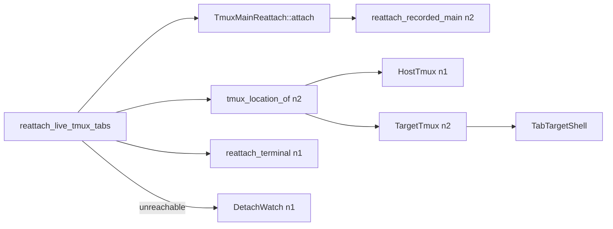

# Changeset: daemon start re-attaches tmux-run target mains and agent tabs (`#target-reconnect` 3/3)

**Created:** 2026-11-25
**Status:** Created
**Type:** Feature
**Stack:** `#target-reconnect` 3/3 — base `feature/target-reconnect/target-exit-lazy-reattach` (node 2, PR #1041)
**Design:** State A/B and decisions D1–D9 are in node 1's changeset (PR #1040).

## Affected Packages

- [ ] `tddy-session-lifecycle` — `svc_reattach_live_tmux_tabs.rs`: `Reattach::session` and
      `pre_roster_main` stop skipping target chains; unreachable / vault-locked / no-subject targets
      go to `ReattachReport.left` with the reason, and unreachable ones to a node-1 watcher in its
      unreachable state.
- [ ] docs: `docs/ft/daemon/terminal-sessions.md` (drop "the daemon-start re-attach leaves target
      tabs for Resume"), `docs/ft/daemon/session-liveness.md` § A daemon restart,
      `packages/tddy-session-lifecycle/docs/`.

## Prerequisites

| Record | Class | Note |
|---|---|---|
| `packages/tddy-session-lifecycle/docs/code-issues/oversized-file-connection-service.md` | — | no edit to `connection_service.rs` |

## Responsibility

- Daemon start re-attaches a **`[target, tmux]` main** (known from `.session.yaml` `target` +
  `tmux_session`, since a target main records no roster entry) and every **`[target, tmux, agent]`
  tab**, through node 2's `tmux_location_of`, as the session's recorded `owner_subject`.
- A target that cannot be reached, or whose owner's vault is locked: reported `left` with the reason
  and handed to a detach watcher (D5); startup never blocks on a target beyond one exec deadline.
- A session without `owner_subject`: `left`, "records no owner subject", left for Resume.
- `[target, tmux-attach]` tabs (a person's tmux) are never re-attached.

## Boundaries

- No change to the port, adapters, resolver, probe, `owner_subject` writing or lazy path (nodes 1–2).
- No eager re-dial loop of its own: the retry is node 1's watcher.
- No change to host-chain startup behaviour.

## Dependencies

These surfaces are **their nodes' to create**; implementing one here collides with its owner.

| Parent node | What it delivers | How this PR consumes it | This PR does NOT |
|---|---|---|---|
| `n1` tmux-location-port (#1040) | `TmuxLocation`, `DetachWatch::start(session_id, session, location)` with unreachable backoff/grace | hands an unreachable target to a watcher | change watcher policy or the trait |
| `n2` target-exit-lazy-reattach (#1041, `feature/target-reconnect/target-exit-lazy-reattach`) | `tmux_location_of`, `TargetTmux`, `ReattachSkip::{NoOwnerSubject, TargetUnreachable}`, `SessionMetadata.owner_subject`, `reattach_recorded_main` over the resolver | resolves each target chain's location; re-attaches the main via `TmuxMainReattach::attach` and tabs via `reattach_terminal` | add a second resolver, probe, or subject lookup |

## Draft PR contract

First push: the failing startup tests below against node 2's published resolver; no new public
surface is introduced by this node.

## Green wave

**Wave:** 3 of 3
**Greenable independently:** no — `daemon_start_reattaches_a_live_target_main` needs node 2's
`TargetTmux` actually attaching to the stand-in target.
**Concurrent with:** none
**Blocks:** none

Real dependency edges: `n1 → n2 → n3`.

### Acceptance dependency graph (after this node — the final design)

Must-not edges (checklist):
- [ ] startup → `crate::tmux::*` for a chain starting with `target`
- [ ] startup → `tmux_attach` (person's tmux) re-attach
- [ ] startup blocks on a retry loop

## Milestones

### M3 (this node) — Startup re-attach of target chains
- [ ] `reattach_live_tmux_tabs` / `pre_roster_main` handle `[target, tmux]` and `[target, tmux, agent]`
- [ ] unreachable/vault-locked → `left` + unreachable-state watcher
- [ ] hook-log follower restarted on every target re-attach (verify; add if missing)
- [ ] docs: terminal-sessions.md target bullets, session-liveness.md, claude-cli-session.md

## Testing Strategy

Stand-in target as in node 2; a fresh `DaemonSessionHost` over a pre-populated sessions directory
stands for the restart. No real Coder/ssh.

### Acceptance tests (this node)

`tddy-session-lifecycle` (acceptance, `tests/remote_target_tmux_reconnect/`)
- [ ] `daemon_start_reattaches_a_live_target_main` — `ReattachReport.reattached` contains `(id, main, tddy-<id>)`; pane pid unchanged
- [ ] `daemon_start_reattaches_a_live_target_agent_tab` — `[target, tmux, agent]` tab re-attached to `tddy-<id>-<terminal>`
- [ ] `daemon_start_leaves_an_unreachable_target_and_watches_it` — `left` reason names unreachability; making the stand-in reachable + a stream re-attaches
- [ ] `daemon_start_leaves_a_pre_subject_target_session_for_resume` — `left` "records no owner subject"
- [ ] `daemon_start_never_attaches_a_persons_tmux_on_the_target` — `[target, tmux-attach]` not in `reattached`
- [ ] `daemon_start_leaves_a_target_whose_owner_vault_is_locked` — reason names the locked vault
- [ ] existing `claude_cli_tmux_reattach_acceptance.rs`, `session_liveness_acceptance.rs` stay green

## Refactoring Needed
### From /red (TDD red phase)
### From /validate-changes

## Validation Results
| Validation | Last Run | Status |
|------------|----------|--------|
| /validate-changes | Not yet run | Pending |
| /validate-tests | Not yet run | Pending |
| /validate-prod-ready | Not yet run | Pending |
| /analyze-clean-code | Not yet run | Pending |
