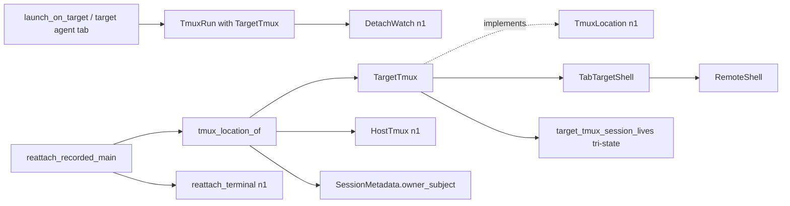

# Changeset: a target tmux session stays live when its transport drops and re-attaches on view (`#target-reconnect` 2/3)

**Created:** 2026-11-25
**Status:** Created
**Type:** Feature
**Stack:** `#target-reconnect` 2/3 — base `plan/target-session-reconnect` (node 1, PR #1040)
**Design:** State A/B, the port and decisions D1–D9 are in node 1's changeset (PR #1040); this
document names the slice this node delivers.

## Affected Packages

- [ ] `tddy-agent-launch` — `TargetTmux` adapter (new `remote_agent_launch/target_tmux_location.rs`),
      `tmux_location_of` resolver, tri-state `target_tmux_session_lives`, target main and
      `[target, tmux, agent]` tab spawned with their `TmuxRun`, `reattach_recorded_main` resolving
      its location, `owner_subject` recorded at target start/resume.
- [ ] `tddy-changeset` — `SessionMetadata.owner_subject: Option<String>`.
- [ ] `tddy-cli-sessions` — `ClientMain` struct replacing `spawn_rendered_client_main`'s positional
      arguments and carrying the `TmuxRun`; `ClientTab` gains the `TmuxRun`;
      `ReattachSkip::{NoOwnerSubject, TargetUnreachable(String)}`.
- [ ] `tddy-session-lifecycle` — `TmuxMainReattach` hands the resolver its `TabTargetShell`.
- [ ] docs: `docs/ft/daemon/terminal-sessions.md` (target bullets: "Dropped connection" no longer
      "No automatic reconnect"), `claude-cli-session.md` § tmux mode.

## Prerequisites

| Record | Class | Note |
|---|---|---|
| [docs/dev/todo/2026-11-23-target-tmux-auto-reconnect.md](../todo/2026-11-23-target-tmux-auto-reconnect.md) | ✅ RESOLVED HERE | the drop no longer ends the session; delete at wrap |
| [docs/dev/todo/2026-11-22-coder-target-stop-reads-exit-code-1.md](../todo/2026-11-22-coder-target-stop-reads-exit-code-1.md) | ⚠ during | narrow to non-tmux target runs at wrap |
| `packages/tddy-agent-launch/docs/code-issues/oversized-file-remote-agent-launch.md` | ⚠ during | new code in a new module; `remote_agent_launch.rs` must not grow |
| `packages/tddy-cli-sessions/docs/code-issues/complexity-pty-spawn-spawn-tool-on.md` | ⚠ during | `ClientMain` reduces, never adds, parameters |

## Responsibility

- **`TargetTmux`** implementing node 1's `TmuxLocation`, resolving its shell per call through
  `TabTargetShell::target_of(session_dir, subject)`; attach is `tmux attach-session -t '=<name>'`
  through the target login shell, never `new-session -A` (D2); kill via
  `end_target_tmux_session_named`.
- **Tri-state target probe**: exit 0 alive; exit 1 with tmux's "can't find session" / "no server
  running" / "error connecting" gone; `exec` `Err`, 255, 127 or other stderr unreachable.
- **`tmux_location_of(session_dir, os_user, shells)`** — `HostTmux` or `TargetTmux` from the record;
  `ReattachSkip::NoOwnerSubject` for a target session without `owner_subject` (D3, no guessing).
- **`SessionMetadata.owner_subject`** written by target start, and by resume when absent.
- **Client exit**: target main and `[target, tmux, agent]` tabs spawn with a `TmuxRun` naming their
  `TargetTmux`, so node 1's watcher holds them (alive / unreachable) or ends them (gone).
- **Lazy re-attach**: `reattach_recorded_main` uses the resolver, so the first stream to `main` of a
  dropped target session attaches a new transport client.
- **Hook-log follower**: re-attach of a target main restarts it when it is not running (verify first
  whether the follower dies with the client; add only if it does).

## Boundaries

- Does not change the port, `HostTmux`, `DetachWatch`'s policy or constants (node 1).
- Does not touch `reattach_live_tmux_tabs` / `pre_roster_main` (node 3) — target chains are still
  left at daemon start after this node.
- Resume keeps `new-session -A`; no change to start/resume relaunch semantics beyond recording
  `owner_subject`.
- No eager re-dial (D7).

## Dependencies

What node 1 delivers that this PR consumes. These surfaces are **node 1's to create**.

| Parent node | What it delivers | How this PR consumes it | This PR does NOT |
|---|---|---|---|
| `n1` tmux-location-port (#1040, `plan/target-session-reconnect`) | `TmuxLocation`, `TmuxClient`, `TmuxUnreachable`, `HostTmux`, `FakeTmuxLocation` in `tddy-cli-sessions/src/tmux_location.rs` | implements `TmuxLocation` as `TargetTmux`; resolver returns `HostTmux` for host chains | change the trait, add methods, or re-implement host probing |
| `n1` | `TmuxRun { session, location }`, `DetachWatch` with backoff/grace, `reattach_terminal` over a location | passes a `TargetTmux` `TmuxRun` into client spawns; lazy path calls `reattach_terminal` | alter watcher policy, constants or D6 |

## Draft PR contract

First push: `SessionMetadata.owner_subject`, `TargetTmux` + `tmux_location_of` signatures compiling
against node 1's port, `ReattachSkip` variants, `ClientMain`; the failing tests below. Node 3
consumes `tmux_location_of` and `ReattachSkip::{NoOwnerSubject, TargetUnreachable}` exactly as
published.

## Green wave

**Wave:** 2 of 3
**Greenable independently:** no — `a_target_session_stays_live_when_its_transport_client_drops`
needs node 1's ported watcher actually holding a session through a `TmuxLocation`.
**Concurrent with:** none
**Blocks:** node 3 (its startup test re-attaches through `tmux_location_of` / `TargetTmux`).

Real dependency edges: `n1 → n2 → n3`.

### Acceptance dependency graph (after this node)

Must-not edges (checklist):
- [ ] `reattach_recorded_main` → `crate::tmux::tmux_session_alive` for a target session
- [ ] lazy re-attach → `new-session -A`
- [ ] resolver → `UserMapping` (subject never derived from OS user)
- [ ] `tddy-cli-sessions` → `tddy-remote-shell`

## Successor PRs

- node 3: branch `feature/target-reconnect/startup-reattach-target-chains`

## Milestones

### M2 (this node) — Target client exit and lazy re-attach
- [ ] `owner_subject` recorded by target start (and by resume when missing and a caller is present)
- [ ] tri-state `target_tmux_session_lives`
- [ ] `TargetTmux` adapter + `tmux_location_of` resolver
- [ ] target main and `[target, tmux, agent]` tab spawned with their `TmuxRun`
- [ ] `reattach_recorded_main` resolves the location; target attach uses `attach-session`

## Testing Strategy

Stand-in target (`tddy-session-lifecycle/tests/target_tab_support/fake_target_shells.rs`), real tmux
under a per-test `TMUX_TMPDIR`, in-memory `RemoteShell` for probe units. No real Coder/ssh.

### Acceptance tests (this node)

`tddy-agent-launch` (unit, `remote_agent_launch/target_tmux_location_tests.rs`, in-memory `RemoteShell`)
- [ ] `the_target_probe_reads_exit_255_as_unreachable_not_gone`
- [ ] `the_target_probe_reads_cant_find_session_as_gone`
- [ ] `the_target_probe_reads_a_missing_tmux_as_unreachable` (127)
- [ ] `the_target_attach_client_attaches_and_never_creates` — remote command contains `attach-session -t '=tddy-<id>'` and not `new-session`
- [ ] `a_session_without_an_owner_subject_resolves_no_target_location` → `ReattachSkip::NoOwnerSubject`
- [ ] `a_locked_vault_resolves_as_unreachable_naming_the_vault`
- [ ] `a_target_start_records_its_owner_subject` — `.session.yaml` `owner_subject == caller subject`

`tddy-session-lifecycle` (acceptance, new `tests/remote_target_tmux_reconnect/`, stand-in target)
- [ ] `a_target_session_stays_live_when_its_transport_client_drops` — kill the local client pid; `ListSessions` still active; tmux `tddy-<id>` on the stand-in untouched
- [ ] `the_first_stream_reattaches_a_dropped_target_main_without_relaunching` — `StreamSessionTerminalIo(main)` yields the pane's existing output marker; pane pid unchanged; exactly one new client
- [ ] `a_target_session_whose_tmux_ended_while_detached_ends` — kill `tddy-<id>` on the stand-in; within 2 intervals inactive, `AgentEnd` with no exit code
- [ ] `a_dropped_target_agent_tab_is_held_by_a_watcher` — `[target, tmux, agent]` tab client killed; tab's tmux alive; session still live
- [ ] `a_reattached_target_main_restarts_its_hook_log_follower` — a hook line appended on the stand-in after re-attach is read
- [ ] existing `remote_target_tmux_tabs/*`, `coder_target_session_acceptance.rs` stay green

## Refactoring Needed
### From /red (TDD red phase)
### From /validate-changes

## Validation Results
| Validation | Last Run | Status |
|------------|----------|--------|
| /validate-changes | Not yet run | Pending |
| /validate-tests | Not yet run | Pending |
| /validate-prod-ready | Not yet run | Pending |
| /analyze-clean-code | Not yet run | Pending |
