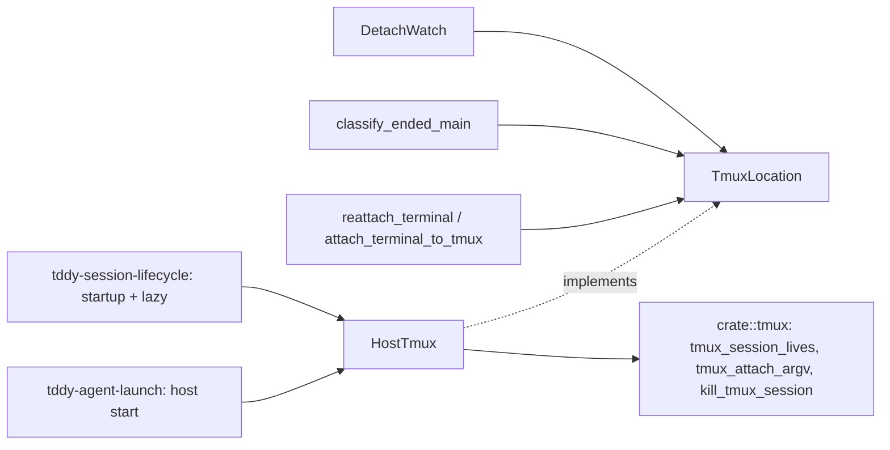
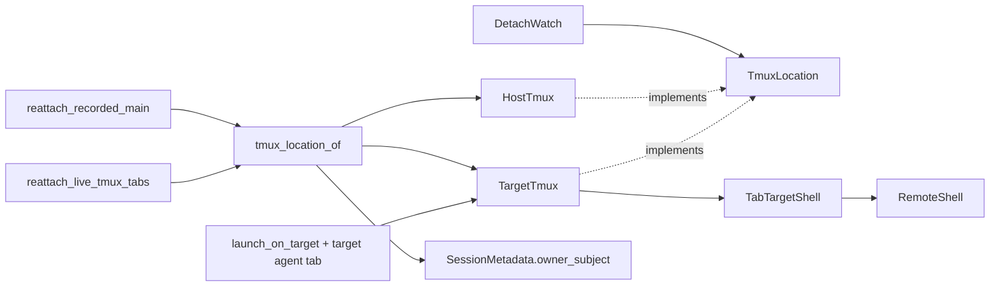

# Changeset: the `TmuxLocation` port — one detach/re-attach lifecycle for every tmux run (`#target-reconnect` 1/3)

**Created:** 2026-11-25
**Status:** Created
**Type:** Feature (with a behaviour-preserving port extraction as its first milestone)
**PRD:** none — the behaviour is specified by
[docs/ft/daemon/session-liveness.md](../../ft/daemon/session-liveness.md) (§ The rule, § A daemon
restart) and [docs/ft/daemon/terminal-sessions.md](../../ft/daemon/terminal-sessions.md) (lines
213–260, the target-tmux bullets). This changeset rewrites those bullets at wrap.
**Stack:** `#target-reconnect` 1/3. The TODO [docs/dev/todo/2026-11-23-target-tmux-auto-reconnect.md](../todo/2026-11-23-target-tmux-auto-reconnect.md) is claimed ✅ RESOLVED by node 2 (branch `feature/target-reconnect/target-exit-lazy-reattach`), not here.

## Problem

A Coder/ssh target session started with `run_in_tmux` keeps its agent alive in tmux on the target
(`tddy-<session>`), but once the local transport client (`coder ssh` / `ssh`) exits — a dropped
connection or a daemon restart — the session lists inactive and never comes back until an operator
resumes it. A host tmux-run session in the same situation stays live (detach watcher) and comes back
by itself (startup re-attach, lazy re-attach on first stream). The two lifecycles should be one.

## Affected Packages

- [ ] `tddy-cli-sessions` — new `TmuxLocation` port; `DetachWatch`, `TmuxRun`, `classify_ended_main`
      and `reattach_terminal` written against it; the host adapter (`HostTmux`) wraps today's
      `tmux_session_lives` / `tmux_attach_argv` / `kill_tmux_session`.
- [ ] `tddy-agent-launch` — the target adapter (`TargetTmux`) over the existing `TabTargetShell`
      port; the target main spawned **with** its tmux session recorded; `reattach_recorded_main`
      resolves its location from the record instead of probing the host's tmux; the target probe's
      tri-state fix; the owner subject recorded at start.
- [ ] `tddy-changeset` (`tddy_core::SessionMetadata`) — one new optional field, `owner_subject`.
- [ ] `tddy-session-lifecycle` — `reattach_live_tmux_tabs` stops skipping `[target, tmux]` mains and
      `[target, tmux, agent]` tabs; `TmuxMainReattach` passes the resolver.
- [ ] `tddy-terminal-rpc` — no signature change (`MainReattach::reattach_main(os_user, session_id)`
      stays; the subject comes from the record, see D3).
- [ ] docs: `docs/ft/daemon/terminal-sessions.md`, `docs/ft/daemon/session-liveness.md`,
      `docs/ft/daemon/claude-cli-session.md` § tmux mode, `packages/tddy-cli-sessions/docs/`.

## State A (verified against `017755f93`)

### Host tmux run (the reference lifecycle)

1. **Client exit.** `CliSessionManager::spawn_terminal_cleanup`
   (`tddy-cli-sessions/src/cli_session_manager/pty_spawn.rs:304`) holds the session `settling`,
   then `classify_ended_main(TmuxRun)` (`tmux_reattach.rs:296`) probes
   `crate::tmux::tmux_session_alive(os_user, name)` on the blocking pool. `ClientOnly` →
   `DetachWatch::hold_detached_agent` starts a watcher that polls every `DETACH_WATCH_INTERVAL`
   (10 s) until the tmux session is gone (then drops workflow/exposure/lease and announces an
   `AgentEnd` with `exit_code: None`) or the terminal is registered again. A probe `Err` (join
   failure) is logged and retried — never read as gone. `Watchers::watched_sessions` makes a watched
   session count as live.
2. **Startup.** `DaemonSessionHost::reattach_live_tmux_tabs`
   (`tddy-session-lifecycle/src/connection_service/svc_reattach_live_tmux_tabs.rs`) walks every
   roster: a tab whose chain holds a `tmux` node is re-attached (main via `TmuxMainReattach::attach`,
   other tabs via `CliSessionManager::reattach_terminal`), as the node's `os_user`. **A chain that
   starts with `target` is left** ("it runs in tmux on its target, which Resume re-attaches"), and
   `pre_roster_main` skips `metadata.target.is_some()`.
3. **Lazy.** The terminal service calls `MainReattach::reattach_main(os_user, session_id)`
   (`tddy-terminal-rpc/src/service/ports.rs:192`); the daemon's `TmuxMainReattach`
   (`svc_terminal_ports.rs:249`) runs single-flight `reattach_recorded_main`
   (`tddy-agent-launch/src/claude_cli_tmux.rs:58`): record → `main_ran_in_tmux` →
   `require_live_tmux_session` (host tmux) → `reattach_recorded_harness`.

### Target tmux run (what is broken)

| Path | What happens today | Why |
|---|---|---|
| Client exit | **`AgentEnded`**: workflow, exposure and lease dropped, an `AgentEnd` announced with the transport's exit code; no watcher | `launch_on_target` spawns the main through `spawn_rendered_client_main` (`launch.rs:82`), which passes `tmux_session: None` — so `TmuxRun::is_tmux_run()` is false |
| Lazy re-attach | `Skipped(gone)` | `main_ran_in_tmux` is true (`.session.yaml` `tmux_session`), then `require_live_tmux_session` probes **the daemon host's** tmux for `tddy-<id>` — never there |
| Startup | left, by design | target chains skipped; `pre_roster_main` skips targets |
| Target agent tab `[target, tmux, agent]` client exit | **`AgentEnded`** for the tab, no watcher | `spawn_rendered_client_tab` also records no `tmux_session` |
| Probe | `target_tmux_session_lives` (`remote_agent_launch/target_tmux_tab.rs:143`) answers `Ok(status == 0)` | an ssh exit **255** (transport failure after connect), or a login shell without tmux (127), reads as **gone** |
| Credentials | resolved only for a caller: `TabTargetShell::target_of(session_dir, subject)` | the session record names **no subject** — `SessionMetadata` has `target`, `tmux_session`, no owner; the roster's `tmux` node records only `os_user`; `UserMapping` is `{github_user, os_user}` and one `os_user` may map to several GitHub users |

A target **main** records no roster entry (`record_tmux_main` is called only on the host path,
`cli_harness_tmux.rs:159`); its tmux run is known from `.session.yaml` (`target` + `tmux_session`).

## Prerequisites (deferred-work cross-check)

| Record | Class | Note |
|---|---|---|
| `docs/dev/todo/2026-11-23-target-tmux-auto-reconnect.md` | ℹ answered | resolved by node 2, which deletes it at its wrap |
| `docs/dev/todo/2026-11-22-coder-target-stop-reads-exit-code-1.md` | ⚠ during | a target main's client exit stops being classified by its exit code at all for tmux runs (the probe decides), so this TODO narrows to non-tmux target runs; narrow it at wrap |
| `packages/tddy-agent-launch/docs/code-issues/oversized-file-remote-agent-launch.md` (623 lines, not claimed) | ⚠ during | the new adapter goes in a **new** module `remote_agent_launch/target_tmux_location.rs`; `remote_agent_launch.rs` must not grow |
| `docs/dev/todo/2026-11-23-split-remote-agent-launch-after-target-tmux.md` | — | not a blocker; same rule as above |
| `packages/tddy-cli-sessions/docs/code-issues/complexity-pty-spawn-spawn-tool-on.md` (13 params, not claimed) | ⚠ during | adding the location must not add a 14th parameter: it travels inside `TmuxRun`, which `spawn_cleanup_for` already builds |
| `packages/tddy-session-lifecycle/docs/code-issues/oversized-file-connection-service.md` | — | no edit to `connection_service.rs`; work is in `svc_reattach_live_tmux_tabs.rs` |
| `docs/dev/todo/2026-11-03-detached-tmux-agent-output-is-not-recorded.md`, `2026-10-24-reattach-does-not-replay-the-alternate-screen.md` | — | apply equally to target runs once unified; unchanged |

No record carries `**Claimed by:**`.

## State B (Target)

One lifecycle for every tmux-run terminal, wherever its tmux server lives:

1. **Client exit** of a target tmux main or `[target, tmux, agent]` tab is classified by probing
   `tddy-<…>` **on the target**. Alive → `ClientOnly` → a detach watcher holds the session live and
   polls the target. Gone → `AgentEnded`, as today. Could-not-tell (unreachable, vault locked,
   workspace stopped, exit 255) → `ClientOnly` with the watcher in its *unreachable* state (D4).
2. **Lazy re-attach**: the first stream addressing `main` of a target tmux session with no main
   registered re-attaches a transport client running `tmux attach-session -t '=tddy-<id>'` on the
   target — never `new-session -A`, so a re-attach never relaunches an agent (D2).
3. **Startup re-attach** treats `[target, tmux]` mains (from `.session.yaml`) and
   `[target, tmux, agent]` tabs like host ones, resolving the target with the session's recorded
   `owner_subject` (D3). A target it cannot reach is reported in `ReattachReport.left` with the
   reason and handed to a detach watcher in its unreachable state — so it is retried on the watcher's
   cadence, not dropped (D5).
4. **`[target, tmux-attach]` tabs** (a person's tmux session) stay as today: not a client of anything
   the session keeps, never watched, never re-attached.
5. **Resume** is unchanged (`new-session -A` with resume args), and still the path that *relaunches*.

### The port (`tddy-cli-sessions/src/tmux_location.rs`, new)

Defined in the consumer's crate, in its own types — `tddy-cli-sessions` does not depend on
`tddy-remote-shell` and must not start to.

```rust
/// Where a tmux session lives and how a terminal of this host reaches it.
#[async_trait::async_trait]
pub trait TmuxLocation: Send + Sync {
    /// For logs and `ReattachReport` reasons: "the tmux of dev", "tmux on buildbox".
    fn describe(&self) -> String;

    /// Whether `name` lives there. `Err` = could not tell (never read as gone).
    async fn session_lives(&self, name: &str) -> Result<bool, TmuxUnreachable>;

    /// The local process that is a client attached to exactly `name` (no create).
    /// `Err` when the location cannot even be resolved (vault locked, no target in the record).
    async fn attach_client(&self, name: &str) -> Result<TmuxClient, TmuxUnreachable>;

    /// Kill `name`; a session or server already gone is `Ok`.
    async fn kill(&self, name: &str) -> Result<(), TmuxUnreachable>;
}

pub struct TmuxClient {
    pub argv: Vec<String>,
    pub env: Vec<(String, String)>,
    /// The OS user the local client runs as: `Some(os_user)` on the host, `None` for a transport
    /// client (it runs as the daemon, carrying the daemon's ssh environment — as today).
    pub run_as: Option<String>,
    pub exit_code_in_output: Option<tddy_pty::ExitCodeInOutput>,
}

#[derive(Debug, Clone, PartialEq, Eq)]
pub struct TmuxUnreachable(pub String);
```

Every type it names exists today: `tddy_pty::ExitCodeInOutput` (`launch.rs:92`), `async_trait`
(already a `tddy-cli-sessions` dependency through `tddy-terminal-rpc`'s ports; add it to
`Cargo.toml` explicitly if not). Not in the port, deliberately: **pane pid** (only a *start* reads
it, and both starts already have it — `pane_pid` and `RemoteAgentPid::TmuxPane`), **list-sessions**
(the tab menu, a different consumer).

**Adapters**

| Adapter | Crate | Wraps (existing, verified) |
|---|---|---|
| `HostTmux { os_user }` | `tddy-cli-sessions` (`tmux_location.rs`) | `tmux_session_lives(os_user, name) -> Result<bool, TmuxError>` on `spawn_blocking`; `tmux_attach_argv(&tmux_binary(), name)`; `kill_tmux_session(os_user, name)` |
| `TargetTmux { session_dir, subject, shells: Arc<dyn TabTargetShell> }` | `tddy-agent-launch` (`remote_agent_launch/target_tmux_location.rs`, new) | `TabTargetShell::target_of(session_dir, subject) -> Result<TabTarget, Status>` resolved **per call** (a vault unlocked later is picked up); `RemoteShell::exec` / `interactive(command) -> InteractiveCommand`; `end_target_tmux_session_named`; the probe below |
| `FakeTmuxLocation` | `tddy-cli-sessions` behind `#[cfg(any(test, feature = "test-support"))]` | an in-memory `{alive: HashSet<String>, reachable: bool}` + a client argv of `/bin/sh -c 'sleep …'`; used by watcher/classifier unit tests |

**Probe semantics (target).** `target_tmux_session_lives` becomes tri-state: `exec` `Err` →
unreachable; status `0` → alive; status `1` **with** tmux's "can't find session" / "no server
running" / "error connecting" on stderr → gone (the same strings `end_target_tmux_session_named`
already matches); anything else (255, 127, 1 with other stderr) → unreachable. Today's
`status == 0` reading is a defect this changeset fixes and pins.

**Resolver.** A watcher, a startup pass and a lazy re-attach each need a location from a session
record, so `tddy-agent-launch` gains:

```rust
/// The tmux location of `session_dir`'s tmux node: `HostTmux` for a chain without `target`,
/// `TargetTmux` (as `.session.yaml`'s `owner_subject`) for one that starts with it.
pub fn tmux_location_of(
    session_dir: &Path,
    os_user: &str,
    shells: &Arc<dyn TabTargetShell>,
) -> Result<Arc<dyn TmuxLocation>, ReattachSkip>;
```

`ReattachSkip` (`cli_session_manager/reattach_outcome.rs`) gains `NoOwnerSubject` and
`TargetUnreachable(String)`.

### What moves / changes shape

- `TmuxRun { session: Option<String>, os_user: Option<String> }` →
  `TmuxRun { session: Option<String>, location: Option<Arc<dyn TmuxLocation>> }`.
  `TmuxRun::os_user()` stays (read by `ended_agent_announcement`) via `HostTmux` / the record.
- `DetachWatch::start(session_id, session, os_user)` → `start(session_id, session, location)`;
  `watch_until_gone` calls `location.session_lives`; `detached_agent_ended` announces
  `AgentEnd { os_user }` from the run, unchanged.
- `classify_ended_main` / `classify_main_exit`: the injected probe becomes
  `FnOnce(&str) -> Result<bool, TmuxUnreachable>`; `Err` → `ClientOnly` (today: a join error →
  `ClientOnly`; a refused probe → `false` → `AgentEnded` — a **host** behaviour change, see D6).
- `reattach_terminal` / `attach_terminal_to_tmux` take the location instead of `os_user` and build
  their argv from `attach_client`.
- `spawn_rendered_client_main` / `spawn_rendered_client_tab` gain no parameter: the target launch
  passes its `TmuxRun` through the existing `ClientTab` struct and a new `ClientMain` struct that
  replaces the main's positional arguments (fixes the argument count rather than adding a 10th).
- `crate::tmux::tmux_session_alive` (the bool that hides refusals) loses its last callers in this
  path; keep it only if other callers remain.

## Decisions & alternatives

**D1 — Port in `tddy-cli-sessions`, target adapter in `tddy-agent-launch`.** The detach watcher and
classifier live in `tddy-cli-sessions`, which already sits below `tddy-agent-launch` and has no
remote-shell dependency. *Alternative*: put both adapters in a new `tddy-tmux` crate — rejected: it
would need `tddy-remote-shell` + `TabTargetShell` (`tddy-agent-launch`) and create a cycle or a
third copy of target resolution. *Alternative*: make the watcher generic over `RemoteShell` —
rejected: the host path is not a remote shell, and a `LocalShell` adapter would change how the host
drops privilege (`run_output_as_user`), which a todo already tracks separately.

**D2 — Re-attach uses `attach-session`, never `new-session -A`.** Today's target start/resume run
`new-session -A`, which recreates a gone session. A watcher- or stream-triggered re-attach that
raced the agent's exit would silently relaunch an agent nobody asked for — a fallback by the repo's
definition. The lazy and startup paths therefore attach only; Resume keeps `new-session -A`.

**D3 — Record the owner subject at start (`SessionMetadata.owner_subject`).** Startup and the
watcher run with no caller, and `MainReattach::reattach_main` gives only an OS user. *Alternative
A*: derive the subject from `UserMapping` by OS user — rejected: not unique (several GitHub users
may share an OS user), and picking one is a silent fallback onto someone else's vault.
*Alternative B*: add `subject` to `MainReattach::reattach_main` — rejected as the only source: it
covers the lazy path but not startup or the watcher. A session started before this field exists
has `owner_subject: None` and is left for Resume with `ReattachSkip::NoOwnerSubject` — no guess.
The subject is a GitHub login, not a secret; it is what `stop_as` already carries per call.

**D4 — Liveness while unreachable: held live, bounded.** The rule is "the daemon holds a live agent
tab"; a watcher holding a session counts. When the target cannot be asked, the agent may well be
alive (a dropped Wi-Fi) or not (workspace stopped). The watcher keeps polling with
**exponential backoff 10 s → 5 min cap** while unreachable, and holds the session live for at most
**`DETACH_UNREACHABLE_GRACE` = 15 min** of consecutive unreachability; after that it releases the
hold **without announcing an agent end and without dropping state other than the hold** — the
session lists inactive with the last unreachability reason, and the watcher keeps probing at the
cap so a target that comes back re-attaches it (via the lazy path on the next view, or the next
startup). *Alternative*: hold live forever — rejected: a stopped Coder workspace would list as
running indefinitely. *Alternative*: release at once — rejected: a 30 s network blip would flap
every target session to inactive. **Open:** the two constants (D-open-1).

**D5 — Startup with an unreachable target: no blocking retry.** `reattach_live_tmux_tabs` probes
each target once (bounded by `RemoteShell`'s exec deadline), reports it `left`, and hands it to an
unreachable-state watcher (D4). Startup never waits on a target. A **vault-locked** subject is the
same path: reason "the Coder vault of <subject> is locked"; the watcher's per-call resolution picks
up an unlock.

**D6 — Host probe refusal stops reading as "gone".** Today `tmux_session_alive` turns a refused probe
(tmux missing, cannot become the user) into `false` → the session's agent state is dropped. With the
port it is `Err` → `ClientOnly` + watcher. This is a deliberate host behaviour change, required for
the two to be one lifecycle; pinned by a host test.

**D7 — No eager re-dial of the main client.** A host tmux session that lost its client is not
re-attached eagerly either: it is held live by the watcher and re-attached on view or at startup.
Target runs get exactly that. The agent's reports do **not** ride the main client (the hook-log
follower is its own `exec_streamed`, see `docs/dev/changesets/2026-11-22-coder-target-back-channel.md`),
so a missing client loses no reports — **provided the follower is restarted on re-attach**, which
green must verify (M3 task). *Alternative*: re-dial on drop with backoff (the TODO's sketch) —
rejected for parity; it can be added later as a watcher policy without changing the port.

**D8 — Coder workspace stopped.** Not special-cased: `coder ssh` to a stopped workspace fails
(unreachable) → D4. No auto-start of the workspace (that is a start-path decision, and costly).

**D9 — OS user of a target run.** The target login is the transport's (the ssh alias / Coder
account), not a host OS user. The local client runs as the daemon (as `launch_on_target` does
today); the roster/metadata `os_user` is still recorded and used for the agent-tool socket and the
`AgentEnd` announcement.

## Operator decisions (2026-11-25)

1. D4 constants accepted: backoff cap 5 min, hold grace 15 min.
2. Three-node stack: n1 port + host (this PR), n2 target exit + lazy re-attach, n3 startup re-attach.
3. D6 accepted.

## Responsibility

Node 1 of 3 (`#target-reconnect`). Owns the **`TmuxLocation` port**
(`tddy-cli-sessions/src/tmux_location.rs`: `TmuxLocation`, `TmuxClient`, `TmuxUnreachable`), its
**host adapter `HostTmux`**, the in-crate `FakeTmuxLocation`, and porting every **host** consumer
onto it: `TmuxRun` carries a location; `DetachWatch`, `classify_ended_main`, `reattach_terminal` and
`attach_terminal_to_tmux` probe and attach through it; host start / startup / lazy call sites pass
`HostTmux`. Also owns the watcher's **unreachable policy** (D4: backoff 10 s → 5 min cap, 15 min hold
grace, release without an agent end) and **D6** (a refused host probe keeps the session). This
document carries the whole-stack design (State A, State B, decisions) because the port is what every
node builds on.

## Boundaries

- No target code: no `TargetTmux`, no resolver, no `owner_subject`, no change to `launch_on_target`,
  `target_tmux_session_lives` or `spawn_rendered_client_*` (node 2).
- No change to `reattach_live_tmux_tabs`'s skipping of target chains (node 3).
- No new RPC, proto, or `MainReattach` signature change.

## Dependencies

None — the bottom node, based on `master`.

## Draft PR contract

First push after this plan: `tmux_location.rs` with the trait, `TmuxClient`, `TmuxUnreachable` and
`HostTmux` compiling; `TmuxRun { session, location }` and `DetachWatch::start(session_id, session,
location)` in their new signatures; the failing M1 tests below. Node 2 compiles its `TargetTmux`
against exactly these signatures.

## Green wave

**Wave:** 1 of 3
**Greenable independently:** yes — every test drives a `FakeTmuxLocation` or the host tmux; nothing
needs a target.
**Concurrent with:** none
**Blocks:** node 2 (its target client-exit acceptance test needs the ported watcher's behaviour);
node 3 transitively.

Real dependency edges: `n1 → n2 → n3`.

### Acceptance dependency graph (after this node)



Must-not edges (checklist):
- [x] `tddy-cli-sessions` → `tddy-remote-shell`
- [x] `DetachWatch` / `classify_ended_main` → `crate::tmux::*` directly (only through the port)
- [x] `spawn_tool_on` gains a 14th parameter — the location travels inside `TmuxRun`, which `spawn_tool_on` now takes instead of a session name

### Final design graph (after node 3)



## Successor PRs

- node 2: branch `feature/target-reconnect/target-exit-lazy-reattach`
- node 3: branch `feature/target-reconnect/startup-reattach-target-chains`


## Milestones

### M1 — `TmuxLocation` port, host adapter, host paths ported (behaviour-preserving but D6)
- [x] `tmux_location.rs`: trait, `TmuxClient`, `TmuxUnreachable`, `HostTmux`, `FakeTmuxLocation`
- [x] `TmuxRun` carries a location; `DetachWatch`, `classify_ended_main`, `reattach_terminal`,
      `attach_terminal_to_tmux` ported; host start/startup/lazy call sites pass `HostTmux`
- [x] watcher backoff + grace (D4) implemented in `DetachWatch`

## Testing Strategy

No real Coder or ssh: the target is the existing **stand-in** (`tddy-session-lifecycle/tests/
target_tab_support/fake_target_shells.rs` — `AStandInTarget`, `target_shells_reaching_a_machine`,
`target_shells_reaching_an_unreachable_machine`) whose "remote" tmux is a real tmux on the test host
under a per-test `TMUX_TMPDIR`, as `remote_target_tmux_tabs/` already does. Reachability is toggled
on the stand-in. Watcher timing is made deterministic with `with_detach_watch_interval` and a
`tokio::time::pause()`d clock for backoff/grace (the fake location never touches real time).

### Test level decisions

| Aspect | Level | Rationale |
|---|---|---|
| probe tri-state, classify, backoff/grace state machine | Unit (`tddy-cli-sessions`, `tddy-agent-launch`) | pure decisions over a fake location / injected exec output |
| target main exit → live → re-attach on stream | Integration/acceptance (`tddy-session-lifecycle`) | spans launch, PTY cleanup, watcher, terminal service port |
| startup re-attach of target chains | Integration/acceptance (`tddy-session-lifecycle`) | `DaemonSessionHost::reattach_live_tmux_tabs` over real session dirs |
| host regressions | existing `claude_cli_tmux_reattach_acceptance.rs`, `session_liveness_acceptance.rs` | must stay green unchanged except D6 |

### Acceptance tests (this node)

`tddy-cli-sessions` (unit, `cli_session_manager/tmux_reattach.rs` tests / `tmux_location_tests.rs`)
- [x] `a_client_exit_whose_location_cannot_be_asked_keeps_the_session` — `Err` → `ClientOnly`, watcher registered, no `AgentEnd` sent
- [x] `a_watcher_backs_off_while_its_location_is_unreachable` — paused clock: probe instants 10, 20, 40 … capped at 300 s
- [x] `an_unreachable_location_releases_the_hold_after_the_grace_without_ending_the_agent` — at 15 min `watched_sessions()` no longer lists it; managed workflow still registered; no `AgentEnd`
- [x] `a_location_that_comes_back_alive_resets_the_backoff` — next probe at 10 s
- [x] `a_location_reporting_gone_ends_the_detached_agent` — workflow/exposure/lease dropped, `AgentEnd{exit_code: None}`
- [x] `the_host_location_attaches_with_tmux_attach_session_exactly` — argv `[tmux, -T, clipboard, attach-session, -t, =name]`, `run_as = Some(user)`
- [x] `a_refused_host_probe_no_longer_drops_the_session` (D6)

## Technical Debt
- `tmux_session_alive` (bool, hides refusals) — remove once no caller is left.
- Real-Coder verification of reconnect remains an operator step (same as
  `2026-11-16-coder-hosts-never-run-against-a-real-deployment.md`).

## Refactoring Needed
### From /ft-dev (acceptance test creation)
### From /red (TDD red phase)
### From /validate-changes
### From /validate-tests
### From /validate-prod-ready
### From /analyze-clean-code

## Validation Results
| Validation | Last Run | Status |
|------------|----------|--------|
| Scoped tests | `./test -p tddy-cli-sessions`: 107 passed | Pass |
| Clippy | `cargo clippy -p tddy-cli-sessions --all-targets -- -D warnings` | Pass |
| /validate-tests | Not yet run | Pending |
| /validate-prod-ready | Not yet run | Pending |
| /analyze-clean-code | Not yet run | Pending |
